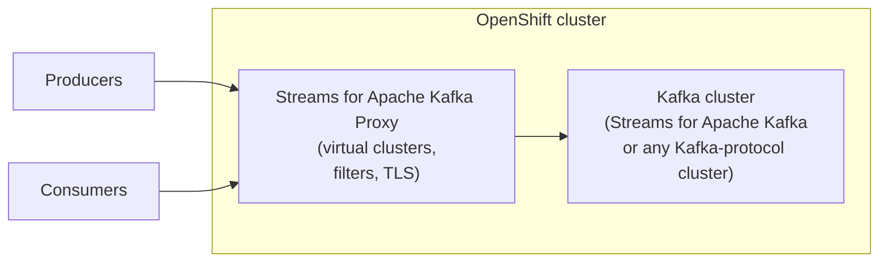
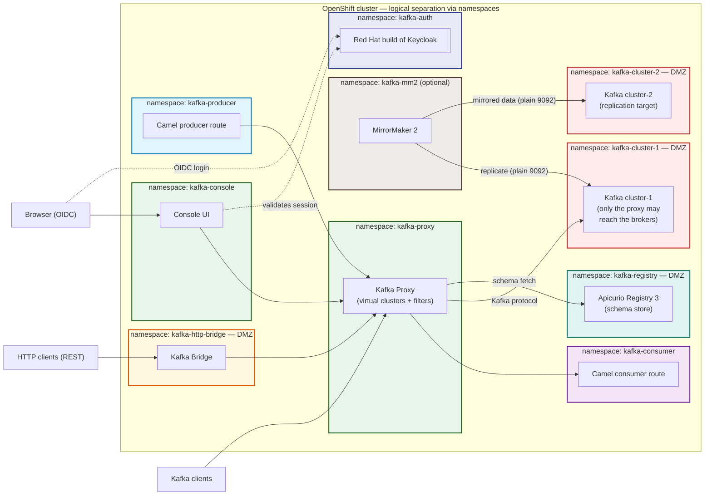
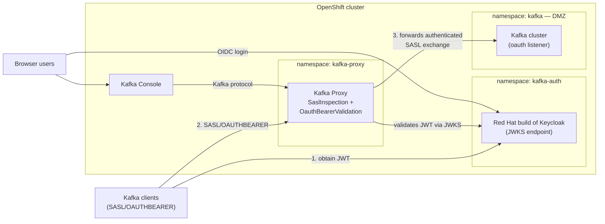

# Kafka Proxy Use Cases Guide — Streams for Apache Kafka Proxy

A practical guide to **Streams for Apache Kafka Proxy** (Red Hat's supported Kafka protocol-aware proxy, part of the [Streams for Apache Kafka](https://docs.redhat.com/en/documentation/red_hat_streams_for_apache_kafka/) portfolio): what it is, the problems it solves, and which use cases it supports today.

> Reflects the **Streams for Apache Kafka 3.2** release (Apache Kafka 4.2 / Strimzi 0.51.x, OpenShift 4.16–4.21 excluding 4.17 — verified in practice on OpenShift 4.22). Capabilities evolve between releases — check the [current docs](https://docs.redhat.com/en/documentation/red_hat_streams_for_apache_kafka/3.2/html/deploying_and_managing_streams_for_apache_kafka_proxy_on_openshift) and the [3.2 release notes](https://docs.redhat.com/en/documentation/red_hat_streams_for_apache_kafka/3.2/html/release_notes_for_streams_for_apache_kafka_3.2_on_openshift) for details.

---

## Table of Contents

- [What Is Streams for Apache Kafka Proxy?](#what-is-streams-for-apache-kafka-proxy)
- [Architecture at a Glance](#architecture-at-a-glance)
- [Use Case Catalog](#use-case-catalog)
  - [1. Encryption at Rest for Records (Record Encryption filter)](#1-encryption-at-rest-for-records-record-encryption-filter)
  - [2. Centralized Key Management & Rotation](#2-centralized-key-management--rotation)
  - [3. Data Quality: Blocking Poison Messages (Record Validation filter)](#3-data-quality-blocking-poison-messages-record-validation-filter)
  - [4. Multi-Tenancy on a Shared Cluster](#4-multi-tenancy-on-a-shared-cluster)
  - [5. OIDC / OAuth 2.0 Authentication with Red Hat build of Keycloak](#5-oidc--oauth-20-authentication-with-red-hat-build-of-keycloak)
  - [6. Stable Client Endpoints & TLS Termination](#6-stable-client-endpoints--tls-termination)
  - [7. Cluster Migration & Upstream Switching](#7-cluster-migration--upstream-switching)
  - [8. Observability & Metrics](#8-observability--metrics)
- [Capability Matrix](#capability-matrix)
- [When NOT to Use the Proxy](#when-not-to-use-the-proxy)
- [Getting Started on OpenShift](#getting-started-on-openshift)
- [Glossary](#glossary)
- [References](#references)

---

## What Is Streams for Apache Kafka Proxy?

**Streams for Apache Kafka Proxy** is an Apache Kafka **protocol-aware proxy** that mediates communication between a Kafka cluster and its clients. It understands the Kafka wire protocol, so unlike a plain TCP load balancer it can inspect, filter, and transform individual produce requests and fetch responses.

The proxy is built on the open-source [Kroxylicious](https://kroxylicious.io) project and is deployed and managed on **OpenShift / Kubernetes** as part of the Streams for Apache Kafka product.

Its core idea is the **filter mechanism**: additional behavior is injected into the data path **without changing your applications or the Kafka cluster itself**.

Because clients and brokers are both unaware of the proxy's transformations, adoption is incremental: you can start with one topic or one team and roll out from there.

## Architecture at a Glance

The full-stack deployment pattern (see the [complete diagram in openshift-setup.md](openshift-setup.md#the-architecture-youll-deploy)) — the whole stack runs on OpenShift, with each component in its own namespace for logical separation. The DMZ spans the `kafka-cluster-1` and `kafka-cluster-2` namespaces (brokers, ingress only from the proxy — plus the optional `kafka-mm2` replication plane on the plain listener), `kafka-http-bridge` (the exposed Kafka Bridge, locked down by its own NetworkPolicy), and `kafka-registry` (Apicurio Registry, reachable only by the proxy — see [Step 17](docs/09-apicurio-registry.md#step-17-deploy-apicurio-registry-and-validate-records-record-validation)):

- **Virtual clusters** — the proxy presents one or more virtual Kafka clusters; each looks like a real cluster to clients but forwards to a physical (upstream) cluster.
- **Filters** — behavior attached to a virtual cluster's data path (e.g., Record Encryption, Record Validation, Entity Isolation, Authorization). Custom filters can be developed against the Kroxylicious filter API (Java).
- **Ingress** — how clients reach each virtual cluster: Kubernetes load balancers or, as of 3.2, **OpenShift Routes** for off-cluster access.
- **TLS** — TLS can be terminated at the proxy (client → proxy) and re-established upstream (proxy → broker). `trustAnchorRef` accepts Kubernetes Secrets, and the operator can automatically trust the CA anchor generated by Strimzi.
- **Deployment on OpenShift** — managed by the **proxy Operator** using the proxy custom resources (`KafkaProxy`, `KafkaProxyIngress`, `VirtualKafkaCluster`, `KafkaService`, and related CRs). The operator handles deployment, scaling, and rolling updates.

## Use Case Catalog

### 1. Encryption at Rest for Records (Record Encryption filter)

**Status:** Generally available.

**Problem.** Compliance requires payload confidentiality at rest, but distributing encryption keys to every producer and consumer — across languages and teams — is operationally infeasible, and clients could leak key material.

**Proxy solution.** The **Record Encryption filter** applies industry-standard **envelope encryption** inside the proxy, transparently to clients and brokers:

1. The filter intercepts **produce requests** and encrypts record values with a Data Encryption Key (DEK).
2. Encrypted records (ciphertext + encrypted DEK + metadata) are forwarded to the broker — the broker never sees plaintext.
3. The filter intercepts **fetch responses**, decrypts them, and returns plaintext to consumers.

Key properties:

- **AES-256 (GCM)** symmetric encryption.
- **KEKs stay in the KMS**; only the proxy can generate/decrypt DEKs. Clients and brokers have no access to key material and no influence on ciphering.
- **Only record values are encrypted.** Record keys, headers, and timestamps are untouched, and **null values (tombstones) pass through unencrypted** — so **compacted topics work correctly**.
- **Per-topic encryption** — via a KEK selector template such as `KEK_${topicName}`; you choose which topics are encrypted and leave non-sensitive topics unencrypted.
- **DEK reuse with bounds** — the same DEK is reused per topic until a time/usage limit is hit (`encryptionDekRefreshAfterWriteSeconds`, `encryptionDekExpireAfterWriteSeconds`, `maxEncryptionsPerDek`), trading KMS API cost against blast radius.

**KMS integrations:** HashiCorp Vault (Transit Engine) and AWS KMS are supported out of the box; the KMS SPI allows additional implementations.

> ⚠️ **Operational notes**
> - The **KMS must be available at runtime** — if it's down, produce/consume through the filter eventually becomes impossible. Run the KMS in a highly available configuration.
> - Encrypting at the proxy costs CPU: expect a noticeable throughput reduction (benchmarks on upstream Kroxylicious show ~25% lower throughput per partition with AES-256-GCM enabled, with end-to-end latency largely preserved at sub-saturation rates). Size proxy replicas accordingly.
> - If the KMS has no key for a topic, the filter **passes records through unencrypted** rather than failing — monitor for misconfiguration.

### 2. Centralized Key Management & Rotation

**Status:** Generally available (part of Record Encryption).

**Problem.** Key rotation with client-side encryption means coordinating every producing application.

**Proxy solution.** Rotate **Key Encryption Keys (KEKs) in the KMS** (e.g., Vault key rotation, AWS KMS automatic rotation). New records are encrypted with the new key material; existing records remain decryptable as long as previous KEK versions remain available in the KMS.

- DEK caching means rotation propagates within a bounded window (default ~1 hour); a **rolling restart of proxy instances** forces immediate rotation.
- Never delete old KEK versions while records encrypted with them are still consumed — fetches fail and offsets would need advancing past the unreadable records.

**Good fit when:** security teams demand key rotation cadences without a client-release cycle.

### 3. Data Quality: Blocking Poison Messages (Record Validation filter)

**Status:** **Technology Preview** — not recommended for production yet.

**Problem.** A single malformed producer can publish *poison messages* that crash consumers downstream — and the damage is already done by the time you notice.

**Proxy solution.** The **Record Validation filter** validates records in produce requests and **rejects invalid ones before they reach the broker** (the producer receives an error). Three validation modes:

1. **Schema Validation** — record key/value must conform to a schema identified by its **`contentId`** in an **Apicurio Registry** (JSON schemas only; embedded schema IDs in record headers or payload bytes are checked). Requires the **Red Hat build of Apicurio Registry 3.x** — 3.2 removed 2.x support, and schema references moved from `globalId` to `contentId`. As of 3.2, TLS connections to Apicurio can be secured with a private/corporate CA via trust anchor configuration.
2. **JSON Syntax Validation** — record content must be syntactically valid JSON (with optional unique-object-keys enforcement).
3. **JWS Signature Validation** *(new in 3.2, Technology Preview)* — verifies **JSON Web Signatures** on records, so record **provenance** can be checked before records are forwarded to the broker.

Rules are applied per topic (`topicNames`) with optional `defaultRule` fallback, separately for keys and values, with `allowNulls`/`allowEmpty` controls.

**Good fit when:** you want producer-side contract enforcement at the cluster edge — before bad data lands, not after.

> 🧪 **Live demo in this repo:** the reference deployment includes Apicurio Registry (Red Hat build, 3.x) in a `kafka-registry` namespace and a schema-validated demo topic — invalid records are rejected at the proxy with `Broker: Broker failed to validate record`. See [Step 17](docs/09-apicurio-registry.md#step-17-deploy-apicurio-registry-and-validate-records-record-validation).

### 4. Multi-Tenancy on a Shared Cluster

**Status:** Core proxy capability; isolation is strengthened in 3.2 by the Entity Isolation filter (Tech Preview) and Authorization filter enhancements.

**Problem.** Multiple teams share one Kafka cluster; clients can see broker internals, topic namespaces collide, and two teams using the *same* consumer group or transactional ID silently interfere with each other.

**Proxy solution.** Present each tenant with its own virtual cluster endpoint on OpenShift, backed by the same physical cluster:

- Tenants connect with their own TLS/SASL credentials; the proxy terminates TLS and forwards upstream.
- Topic naming conventions (e.g., upstream prefixing via the upstream Kroxylicious **multi-tenant filter**) keep tenants from colliding and can hide broker topology from clients.
- **Entity Isolation filter** *(new in 3.2, Technology Preview)* — isolates Kafka entities used by one principal from those used by another, **even when the same names are used**. In 3.2 this covers **consumer group IDs** and **transactional IDs** — two tenants can each use a group called `my-consumer` without cross-talk.
- **Authorization filter** — enforces permissions on Kafka resources at the proxy; as of 3.2 it covers **transactional IDs and consumer groups** in addition to topics.
- The proxy is the natural enforcement point for per-tenant policy as the filter ecosystem grows.

**Good fit when:** you run an event-streaming platform consumed by many teams on shared brokers.

> ℹ️ **Scope note:** isolation is naming/endpoint/entity based. Per-tenant quotas and traffic policies are not built into the Red Hat product the way they are in some commercial gateways — plan accordingly or contribute filters via the Kroxylicious API.

### 5. OIDC / OAuth 2.0 Authentication with Red Hat build of Keycloak

**Status:** Supported — and implemented in this repo's reference deployment. The proxy relays the SASL/OAUTHBEARER exchange to the brokers, and can additionally inspect it, validate the tokens, or terminate it. The Red Hat build of Keycloak is the supported OIDC authorization server; the Streams for Apache Kafka Console also authenticates its browser users through it.

**Problem.** Long-lived service credentials are scattered across producer and consumer configs; you need centralized identity, SSO, token-based access, and instant revocation — and client certificates are impractical to manage at scale.

**Proxy solution.** The proxy supports mTLS client authentication (Red Hat [Deploying and Managing guide — Securing a proxy](https://docs.redhat.com/en/documentation/red_hat_streams_for_apache_kafka/3.2/html-single/deploying_and_managing_streams_for_apache_kafka_proxy_on_openshift/index#con-virtualkafkacluster-mtls-operator)) and four SASL authentication modes — SASL Passthrough Inspection is documented in the Red Hat [SASL Inspection filter guide](https://docs.redhat.com/en/documentation/red_hat_streams_for_apache_kafka/3.2/html-single/sasl_inspection_filter_guide/index), while the upstream [Client Authentication guide](https://kroxylicious.io/documentation/0.25.1/html/authentication-guide) additionally documents SASL Passthrough, OAuthBearer Validation, and SASL Termination. All are compatible with an OAuth-secured Kafka cluster behind the virtual cluster:

| Mode | Filter | What it does | Broker keeps auth authority? |
|---|---|---|---|
| SASL Passthrough *(default)* | none | Forwards the SASL exchange unchanged; broker-side ACLs, audit logging, and quotas keep working | Yes |
| SASL Passthrough Inspection | `SaslInspection` | Broker still decides, but the proxy extracts the end-client principal — enabling the Authorization and Entity Isolation filters | Yes |
| OAuthBearer Validation | `OauthBearerValidation` | Proxy validates each JWT against the issuer's JWKS endpoint (audience, issuer, expiry) and rejects invalid tokens *before* they reach the broker | Yes |
| SASL Termination | `SaslTermination` | Proxy authenticates the client itself (OAUTHBEARER or SCRAM) and never forwards the exchange — only authenticated requests reach the brokers | No |

With **Red Hat build of Keycloak** as the authorization server: clients obtain short-lived JWTs from Keycloak and authenticate with `SASL/OAUTHBEARER`; `OauthBearerValidation` verifies them against Keycloak's JWKS endpoint (with audience/issuer checks for cross-service replay protection); and `SaslInspection` puts the end-client identity in front of the proxy's Authorization filter. Token revocation is instant and centralized — disable the client in Keycloak and access stops at the next token expiry.

The **Streams for Apache Kafka Console** authenticates its browser users through Keycloak independently (`security.oidc` on the `Console` CR) — SSO for the UI layer with no involvement of the proxy.

Deployment pattern (see [openshift-setup.md](openshift-setup.md) for full installation steps):

**Good fit when:** you want centralized identity for the streaming platform — SSO, short-lived tokens, per-client service accounts — while keeping the proxy's stable endpoints, TLS termination, and edge authorization.

> ℹ️ **Scope notes:** `OAUTHBEARER` inspection/validation supports JWS-signed JWTs only (JWE unsupported). In SASL Passthrough Inspection the proxy holds the authorization ID in memory but the broker still authenticates the client — an unauthenticated caller that can reach the proxy still gets proxied access, so pair inspection with `OauthBearerValidation` or mTLS if that matters to your threat model. This guide's reference deployment authenticates the data path **end-to-end with OAuth**: the `tls` listener requires SASL/OAUTHBEARER only, and workloads authenticate with tokens from Keycloak (`client_credentials` service-account clients — see [Step 1.5](docs/02-keycloak.md#15--client-authentication-at-the-proxy)).

### 6. Stable Client Endpoints & TLS Termination

**Status:** Core proxy capability.

**Problem.** Client configs hardcode broker addresses and cluster TLS specifics; certificates and topology changes ripple out to every application.

**Proxy solution.** Clients connect to a stable virtual-cluster endpoint that survives broker changes. The proxy handles TLS termination (client → proxy) and upstream TLS (proxy → broker), so certificate and security-protocol changes happen at the proxy. `trustAnchorRef` accepts Kubernetes Secrets in `KafkaService` and `VirtualKafkaCluster`, and the operator can automatically trust the CA anchor generated by Strimzi — reducing upstream TLS setup to near zero for Streams-managed clusters. Some teams run the proxy **purely as a passthrough endpoint/TLS layer with no filters** — a legitimate, low-overhead pattern.

**Ingress options:** expose virtual clusters off-cluster via **OpenShift Routes** (new in 3.2) or Kubernetes load balancers.

**Good fit when:** you want to decouple client-facing addressing and TLS from broker-side reality.

### 7. Cluster Migration & Upstream Switching

**Problem.** You're moving workloads to a new cluster (new DC, cloud, or Kafka version) and can't reconfigure every client at once.

**Proxy solution.**

1. Repoint clients to the proxy's virtual cluster (the only client change you make).
2. Replicate data with your chosen tool (e.g., MirrorMaker 2 — set up between the two clusters in [Step 18](docs/10-mirrormaker2.md#step-18-mirrormaker-2-between-the-two-clusters-optional)).
3. Switch the virtual cluster's upstream target to the new cluster — clients are cut over without knowing.
4. Rollback is switching the upstream back.

**Good fit when:** migration blast radius and rollback speed matter more than automated failover (note: controlled automated failover is not a built-in product feature today).

### 8. Observability & Metrics

**Status:** Supported — the proxy exposes metrics.

**Problem.** Brokers see traffic, but not what the proxy transforms or rejects.

**Proxy solution.** The proxy exposes Prometheus-style metrics for its own operations (connections, requests, filter activity such as encryption operations and validation rejections). As of 3.2, **idle connection handling** can automatically close idle downstream/upstream connections — with dedicated metrics and extra Netty tuning properties for advanced cases. Scrape the metrics alongside broker and client metrics to get an end-to-end view of the data path, and alert on signals like "records passed through unencrypted" (missing KEK) or validation rejection spikes.

On OpenShift, wire **every** component of the stack — brokers, proxy, HTTP Bridge, Keycloak, clients, and the Console itself — into the built-in **user-workload monitoring** stack; the full integration (enablement, `PodMonitor`/`ServiceMonitor` resources, DMZ NetworkPolicy allowances, alert rules) is [Step 15](docs/07-observability.md#step-15-integrate-the-stack-with-openshift-user-workload-monitoring-observability) of the setup guide.

## Capability Matrix

| Use case | Supported by Streams for Apache Kafka Proxy | Notes |
|---|---|---|
| Record encryption at rest | ✅ GA | Envelope encryption, AES-256-GCM, record values only |
| KMS integration | ✅ GA | HashiCorp Vault (Transit), AWS KMS; KMS SPI for others |
| Key rotation | ✅ GA | KEK rotation in KMS; DEK refresh bounded by cache settings |
| Poison-message prevention | ⚠️ Preview | Record Validation: Apicurio schema / JSON syntax — demoed live in [Step 17](docs/09-apicurio-registry.md#step-17-deploy-apicurio-registry-and-validate-records-record-validation) |
| Record provenance (JWS signatures) | ⚠️ Preview (new in 3.2) | JWS Signature validation in Record Validation filter |
| Multi-tenancy (virtual clusters) | ✅ | Endpoint/TLS isolation + topic naming; not full per-tenant quotas |
| Entity isolation (groups, txn IDs) | ⚠️ Preview (new in 3.2) | Per-principal isolation even with identical names; needs an authenticated subject (mTLS or a SASL mode) |
| Authorization at the proxy | ✅ | Permissions for topics, consumer groups, transactional IDs (expanded in 3.2); needs an authenticated subject (mTLS or a SASL mode) |
| OIDC / OAuth 2.0 authentication (SASL/OAUTHBEARER) | ✅ | SASL exchange passes through the proxy; `SaslInspection` extracts the principal, `OauthBearerValidation` checks JWTs at the proxy (JWKS), `SaslTermination` authenticates at the proxy |
| Stable endpoints / TLS termination | ✅ | Client → proxy TLS, proxy → broker TLS; `trustAnchorRef` Secret support |
| Ingress: LBs and OpenShift Routes | ✅ (Routes new in 3.2) | Off-cluster exposure via Routes or load balancers |
| Idle connection handling | ✅ (new in 3.2) | Optional auto-close with dedicated metrics |
| Cluster migration / upstream switch | ✅ (manual) | Change virtual cluster target; no automated failover |
| Field-level encryption, masking, tokenization | ❌ | Record-level only; would require custom filters |
| Per-tenant quotas / rate limiting | ❌ | Not built in; custom filter territory |
| Audit logging of payloads | ❌ | Metrics only; custom filters for deeper auditing |
| Protocol version translation (ApiVersions) | ❌ (product) | Available upstream in Kroxylicious; not in Red Hat docs as built-in |

## When NOT to Use the Proxy

- **You need exactly-once semantics through the proxy** — transactions span client and broker; validate transactional producer/consumer behavior with your filters before committing.
- **Extreme throughput at minimal latency** — a passthrough proxy adds little, but payload-transforming filters (encryption, validation) cost real CPU. Benchmark with your workload.
- **You only need Kafka ACLs and TLS** — if that's your whole requirement set, the broker's native features are simpler.
- **Field-level governance is mandatory** — the product encrypts at record level; field-level encryption/masking would mean writing and maintaining custom filters.
- **Compacted-topic caveats** are handled well (nulls pass through), but always test tombstone and compaction behavior with encryption enabled before rollout.

## Getting Started on OpenShift

> 📋 **Full step-by-step instructions** — deploying a Kafka cluster with Streams for Apache Kafka, the **Red Hat build of Keycloak** OIDC authorization server for the console UI (in a `kafka-auth` namespace), operator install (OperatorHub or install files), custom resource walkthroughs with YAML, TLS certificate SAN requirements, and DNS setup — live in [**openshift-setup.md**](openshift-setup.md). The checklist below is the high-level path. Once the stack is up, run the **ready-made demo scenarios** — 14 walkthroughs covering token revocation, proxy-side authorization/isolation/token-validation, MM2 cutover and failover, and Record Encryption — in [**docs/11-demos.md**](docs/11-demos.md).

- [ ] Install the **proxy Operator** and deploy the proxy on OpenShift (see [*Deploying and Managing Streams for Apache Kafka Proxy on OpenShift*](https://docs.redhat.com/en/documentation/red_hat_streams_for_apache_kafka/3.2/html/deploying_and_managing_streams_for_apache_kafka_proxy_on_openshift) or the [local setup guide](openshift-setup.md)).
- [ ] Create a `VirtualKafkaCluster` pointing at your upstream Kafka cluster (`KafkaService`); verify produce/consume through the proxy with no filters first. Off-cluster clients connect via OpenShift Route or load balancer. Create client credentials if your target listener authenticates (this repo's `tls` listener uses OAUTHBEARER only — service-account clients in the `kafka` Keycloak realm, see [deploy/keycloak/04-kafka-realm-import.yaml](deploy/keycloak/04-kafka-realm-import.yaml)).
- [ ] **Run the proxy in a DMZ**: restrict Kafka cluster ingress to the proxy's namespace with `NetworkPolicy` rules so clients can only reach the proxy, and the proxy only the brokers (see [Step 0.4](docs/01-kafka-cluster.md#04--restrict-kafka-ingress-to-the-proxy-namespace-dmz)).
- [ ] (Optional) Deploy the **Kafka HTTP Bridge** in a dedicated `kafka-http-bridge` namespace with `bootstrapServers` pointing at the proxy's bootstrap, giving HTTP/REST clients access to the cluster through the proxy — and lock down its unauthenticated HTTP API with a NetworkPolicy (see [Step 12](docs/04-http-bridge.md#step-12-deploy-the-kafka-http-bridge-dmz-client)).
- [ ] (Optional) Deploy the **Streams for Apache Kafka Console** in a `kafka-console` namespace, connected to the proxy's *virtual* cluster for UI visibility and secured with Keycloak OIDC (see [Step 13](docs/05-console.md#step-13-deploy-the-streams-for-apache-kafka-console-kafka-console-namespace)).
- [ ] (Optional) Deploy **Camel Quarkus** producer and consumer clients in separate `kafka-producer` and `kafka-consumer` namespaces, connecting through the proxy with the latest supported Red Hat build of Apache Camel (see [Step 14](docs/06-camel-clients.md#step-14-deploy-camel-producer-and-consumer-clients-kafka-producer-and-kafka-consumer-namespaces)).
- [ ] Pick **one** filter to start with:
  - Record Encryption → set up Vault (Transit Engine) or AWS KMS first; create KEKs per encrypted topic (`KEK_<topicName>`); configure the filter; verify by producing through the proxy and consuming **directly from the broker** (you should see ciphertext).
  - Record Validation → set up Apicurio Registry; start with a `defaultRule` on a non-critical topic.
- [ ] Tune DEK cache settings against your KMS costs and blast-radius requirements.
- [ ] Scale proxy replicas for CPU (especially with encryption enabled) and run the KMS in HA.
- [ ] Enable idle connection handling if long-lived client connections are inflating resource use.
- [ ] Integrate the whole stack with **OpenShift user-workload monitoring** — broker metrics (Strimzi Metrics Reporter), proxy/operator PodMonitors, bridge metricsConfig, Keycloak auto-ServiceMonitor, Console `metricsSources`, Camel Micrometer endpoints, plus the NetworkPolicy allowances the DMZ needs ([Step 15](docs/07-observability.md#step-15-integrate-the-stack-with-openshift-user-workload-monitoring-observability)); then alert on unencrypted pass-through and validation rejections.
- [ ] Document rollback: repoint clients directly at the broker (plaintext flows resume only for topics where the proxy was the encryption point — plan cutover carefully).
- [ ] (Optional) Develop and deploy a **custom filter** — generate a filter project with the upstream Maven archetype, package the plugin JARs onto a custom proxy image built in-cluster, and wire it to the virtual cluster ([Step 16](docs/08-custom-filter.md#step-16-develop-and-deploy-a-custom-filter-optional)).
- [ ] (Optional) Run **MirrorMaker 2** between the two clusters for the migration pattern — replicate topics and consumer groups over the `plain` listener (no credentials needed), then cut over by switching the `KafkaService` upstream ([Step 18](docs/10-mirrormaker2.md#step-18-mirrormaker-2-between-the-two-clusters-optional)).
- [ ] (Optional) Run the **demo scenarios** — 14 ready-made walkthroughs covering token revocation, proxy-side authorization/isolation/token-validation, MM2 cutover and failover, Record Encryption with a dev Vault, and more ([Step 19](docs/11-demos.md)).
- [ ] Try the example custom resources in the `examples/` directory of the `streams-3.2-ocp-install-examples.zip` archive for a quick start.

## Glossary

| Term | Meaning |
|---|---|
| **Virtual cluster** | A proxy-presented "cluster" endpoint backed by a physical upstream cluster |
| **Filter** | A pluggable component that intercepts/transforms Kafka requests and responses in the proxy's data path |
| **KEK** | Key Encryption Key — stored in the KMS; encrypts DEKs |
| **DEK** | Data Encryption Key — encrypts record values; stored (encrypted) alongside the records in the broker |
| **Envelope encryption** | Data encrypted with a DEK; the DEK encrypted with a KEK held in a KMS |
| **KMS** | Key Management Service (e.g., HashiCorp Vault Transit Engine, AWS KMS) |
| **Poison message** | A malformed record that breaks consumers; blocked by the Record Validation filter |
| **Upstream** | The physical Kafka cluster a virtual cluster forwards to |

## References

- [**Local: Setting Up Streams for Apache Kafka Proxy on OpenShift**](openshift-setup.md) — step-by-step install & deploy instructions
- [Deploying and Managing Streams for Apache Kafka Proxy on OpenShift (3.2)](https://docs.redhat.com/en/documentation/red_hat_streams_for_apache_kafka/3.2/html/deploying_and_managing_streams_for_apache_kafka_proxy_on_openshift) — operator install, API concepts, deploying, securing, tuning, monitoring
- [Release Notes for Streams for Apache Kafka 3.2 on OpenShift](https://docs.redhat.com/en/documentation/red_hat_streams_for_apache_kafka/3.2/html/release_notes_for_streams_for_apache_kafka_3.2_on_openshift) — proxy changes in 3.2 (Entity Isolation filter, JWS validation, OpenShift Routes ingress, idle connection handling)
- [Record Encryption filter guide (3.2)](https://docs.redhat.com/en/documentation/red_hat_streams_for_apache_kafka/3.2/html/record_encryption_filter_guide) — envelope encryption via a KMS
- [Authorization filter guide (3.2)](https://docs.redhat.com/en/documentation/red_hat_streams_for_apache_kafka/3.2/html/authorization_filter_guide) — per-principal permissions on topics, consumer groups, and transactional IDs
- [(Preview) Record Validation filter guide (3.2)](https://docs.redhat.com/en/documentation/red_hat_streams_for_apache_kafka/3.2/html/record_validation_filter_guide) — Apicurio schema / JSON syntax / JWS signature checks
- [(Preview) Entity Isolation filter guide (3.2)](https://docs.redhat.com/en/documentation/red_hat_streams_for_apache_kafka/3.2/html/entity_isolation_filter_guide) — per-principal isolation of consumer groups and transactional IDs
- [SASL Inspection filter guide (3.2)](https://docs.redhat.com/en/documentation/red_hat_streams_for_apache_kafka/3.2/html/sasl_inspection_filter_guide) — extracts authenticated principals for downstream filters
- [Streams for Apache Kafka documentation home](https://docs.redhat.com/en/documentation/red_hat_streams_for_apache_kafka/)
- [Kroxylicious (upstream project)](https://kroxylicious.io) — filter API, custom filter development, benchmarks
- [Kroxylicious Developer Quick Start (0.25.1)](https://kroxylicious.io/documentation/0.25.1/html/developer-quick-start) — generating and testing a custom filter project (Maven archetype, in-VM Kafka integration tests)
- [Kroxylicious Developer Guide (0.25.1)](https://kroxylicious.io/documentation/0.25.1/html/developer-guide) — filter API, packaging, and the `classpath-plugins/` deployment mechanism (Alpha) — Red Hat 3.2 does not publish a filter-development guide
- [Kroxylicious Javadocs (0.25.1)](https://kroxylicious.io/documentation/0.25.1/javadoc/index.html) — the filter API reference
- [Kroxylicious Client Authentication guide (0.25.1)](https://kroxylicious.io/documentation/0.25.1/html/authentication-guide) — the SASL modes the 3.2 Red Hat docs don't cover separately (SASL Passthrough, OAuthBearer Validation, SASL Termination); mTLS and SASL Inspection are in the Red Hat guides above
- [Kroxylicious proxy benchmarking (2026)](https://kroxylicious.io/benchmarking/performance/2026/05/28/benchmarking-the-proxy.html) — passthrough vs. record-encryption overhead
- [Apicurio Registry](https://www.apicur.io/registry/) — schema registry used by the Record Validation filter ([Red Hat build documentation](https://docs.redhat.com/en/documentation/red_hat_build_of_apicurio_registry/); the filter requires 3.x — schemas are identified by `contentId`)
- [Red Hat build of Keycloak](https://docs.redhat.com/en/documentation/red_hat_build_of_keycloak/26.4) — OIDC authorization server for the console's browser login (operator guide)
- [Using the Streams for Apache Kafka Console](https://docs.redhat.com/en/documentation/red_hat_streams_for_apache_kafka/3.2/html/using_the_streams_for_apache_kafka_console) — web UI for Kafka clusters, with virtual-cluster and OIDC support
- [Red Hat build of Apache Camel for Quarkus](https://docs.redhat.com/en/documentation/red_hat_build_of_apache_camel/) — supported Camel distribution for producer/consumer integrations (see the [release schedule](https://access.redhat.com/articles/7021827); Camel K is no longer supported)
