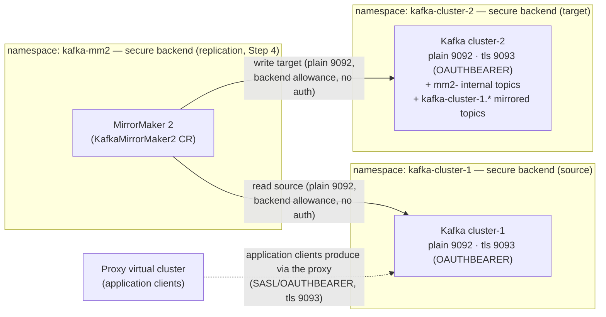

# Step 4: MirrorMaker 2 Between the Two Clusters (Optional)

> [↑ Setup overview](../openshift-setup.md) · prev: [Step 3: Kafka cluster](03-kafka-cluster.md) · next: [Step 5: Apicurio Registry](05-apicurio-registry.md)

With two Kafka clusters deployed (Steps [0.2](03-kafka-cluster.md#32--create-the-kafka-cluster)), **MirrorMaker 2** replicates data between them: topics and consumer groups from `kafka-cluster-1` to `kafka-cluster-2`. This is the migration pattern from use case [7 in the guide](../README.md#7-cluster-migration--upstream-switching) — run MM2 to keep the target in sync, then switch the proxy's virtual-cluster upstream to the new cluster and clients are cut over without knowing.

> **Deployment order:** in this guide MM2 is deployed **fourth** — immediately after the Kafka clusters (Step 3) and before the proxy; see the Guide map in the [setup overview](../openshift-setup.md). Its only dependencies are both clusters being Ready and the Cluster Operator watching `kafka-mm2` (the OperatorGroup extension below) — the DMZ NetworkPolicy allowance for `kafka-mm2` on the `plain` listener is created by the operator when the CR is applied, so replicating from the start means the target is in sync from the first record.

MM2 sits in the **secure backend** (`kafka-mm2`) — it is replication traffic between the backend clusters, never client-facing. Deployed via the Streams for Apache Kafka operator as a `KafkaMirrorMaker2` resource in its own **`kafka-mm2` namespace**, it connects **directly to both clusters' `plain` listeners** (9092) — unauthenticated and unencrypted, so no OAuth credentials or TLS trust are needed for the replication plane. It does *not* route through the proxy virtual clusters.



> **Security note:** the `plain` listener is unauthenticated and unencrypted — the trade-off is deliberate dev simplicity (no Keycloak client, no CA copies). If you want the replication plane authenticated instead, point MM2 at the `tls` listeners (9093), which requires SASL/OAUTHBEARER via the `custom` authentication type with the `mm2` Keycloak service-account client, plus each cluster's Strimzi CA copied into `kafka-mm2` (see [Step 3.2](03-kafka-cluster.md#32--create-the-kafka-cluster) and [Step 2.5](02-keycloak.md#25--client-authentication-at-the-proxy) — the v1 API change reference [31.7.4](https://docs.redhat.com/en/documentation/red_hat_streams_for_apache_kafka/3.2/html-single/deploying_and_managing_streams_for_apache_kafka_on_openshift/index#kafkamirrormaker2) documents `oauth` → `type: custom`). The DMZ NetworkPolicy allowance must then move to port 9093.

## 4.1 — Create the namespace and the MM2 resource

No credentials are needed — the `plain` listener (9092) on both clusters is unauthenticated:

```bash
oc new-project kafka-mm2
```

> **⚠️ Cluster Operator watch scope:** the Cluster Operator only reconciles `KafkaMirrorMaker2` resources in a namespace it watches. Add `kafka-mm2` to the OLM OperatorGroup `targetNamespaces` before deploying — otherwise the Ready wait times out (the same pitfall as the bridge in [Step 7.1](07-http-bridge.md#71--create-the-namespace-and-extend-the-cluster-operator-watch)):
>
> ```bash
> oc patch operatorgroup kafka-operator-group -n kafka --type merge \
>   -p '{"spec":{"targetNamespaces":["kafka","kafka-http-bridge","kafka-mm2"]}}'
> ```
>
> The Red Hat 3.2 guide instead places MM2 in the **target cluster's namespace**, which is already watched — either way works.

Deploy the MM2 resource — the ready-to-apply manifest is [`deploy/mirrormaker2/01-mirrormaker2.yaml`](../deploy/mirrormaker2/01-mirrormaker2.yaml):

```bash
oc apply -f deploy/mirrormaker2/01-mirrormaker2.yaml

oc wait --for=condition=Ready kafkamirrormaker2/kafka-cluster-1-to-2 -n kafka-mm2 --timeout=600s
oc get pods -n kafka-mm2
```

Field notes (full manifest in the deploy file):

- `spec.target` — the target cluster (`kafka-cluster-2`) with its `alias`, `bootstrapServers`, and the **required** Kafka Connect internals: `groupId`, `configStorageTopic`, `offsetStorageTopic`, `statusStorageTopic` (created on the target automatically).
- `spec.mirrors[].source` — the source cluster (`kafka-cluster-1`) with the same connection fields, plus `sourceConnector: {}` (empty object = default configuration, Red Hat 3.2 guide §10.9.1).
- `topicsPattern` / `groupsPattern` — regex selecting what to replicate (`.*` mirrors everything); mirrored resources are prefixed with the source alias (`kafka-cluster-1.<topic>`).
- Optional `checkpointConnector` / `heartbeatConnector` blocks for offset translation and source liveness (commented in the deploy manifest).

## 4.2 — Verify replication

Produce to `test-topic` on the source (e.g. via the proxy, [Step 6.10](06-proxy.md#610--apply-and-verify)) and consume from the mirrored topic on the target. Mirrored resources are prefixed with the source alias:

```bash
# Check the mirrored topic exists on the target (no auth needed — plain listener)
oc run kafka-cli --rm -i --restart=Never --image=quay.io/strimzi/kafka:latest-kafka-4.2.2 -n kafka-mm2 -- \
  bin/kafka-topics.sh --bootstrap-server kafka-cluster-2-kafka-bootstrap.kafka-cluster-2.svc.cluster.local:9092 --list
# kafka-cluster-1.test-topic
```

The MM2 `connect` pods in `kafka-mm2` log connector progress; MM2's internal topics (`mm2-configs`, `mm2-offsets`, `mm2-status`) are created on the target cluster automatically.

## 4.3 — Operational notes

- **Topology:** MM2 connects directly to both clusters' `plain` listeners — the DMZ NetworkPolicies were extended in [Step 3.4](03-kafka-cluster.md#34--restrict-kafka-ingress-to-the-proxy-namespace-dmz) to allow the `kafka-mm2` namespace on port 9092 only. The `tls` listener (9093) stays closed to `kafka-mm2`.
- **Security trade-off:** replication over the `plain` listener is unauthenticated and unencrypted — acceptable for the dev setup where traffic stays in-cluster, but point MM2 at the `tls` listeners (OAUTHBEARER via `custom` auth, see the security note at the top of this step) for anything else.
- **No credentials:** no Keycloak client and no CA copies are needed — `mm2` is not in the `kafka` realm's client list.
- **Failover/failback:** with `checkpointConnector` enabled, MM2 checkpoints consumer-group offsets from the source to the target (translated through the `kafka-cluster-1.` prefix), enabling a cut-back after failover — set `checkpointConnector.config.sync.group.offsets.enabled: "true"` to apply the offsets to the target (Red Hat 3.2 guide, [10.9.4](https://docs.redhat.com/en/documentation/red_hat_streams_for_apache_kafka/3.2/html-single/deploying_and_managing_streams_for_apache_kafka_on_openshift/index#synchronizing-consumer-group-offsets)). `heartbeatConnector` mirrors source-cluster liveness. Both are commented options in [deploy/mirrormaker2/01-mirrormaker2.yaml](../deploy/mirrormaker2/01-mirrormaker2.yaml).
- **No authorization:** neither cluster configures authorization, so the replicated data is fully accessible to authenticated principals on the target. The mirrored topics carry the `kafka-cluster-1.` prefix — ACLs (if you add authorization later) must be planned for the prefixed names. The Red Hat guide's [Securing MirrorMaker 2 connections procedure](https://docs.redhat.com/en/documentation/red_hat_streams_for_apache_kafka/3.2/html-single/deploying_and_managing_streams_for_apache_kafka_on_openshift/index#securing-mirrormaker-2-connections) includes the full ACL sets for `KafkaUser`-based setups (mTLS/SCRAM); our clusters use OAUTHBEARER `custom` auth instead, and no `KafkaUser` resources.
- **Through the proxy instead?** MM2 could route through the proxy's virtual clusters (OAUTHBEARER passes through the proxy), but the replication plane is infrastructure — connecting directly to the listeners keeps the client-facing proxy path clean and the blast radius of MM2 issues away from application traffic.
- **Cutover:** to switch clients from `kafka-cluster-1` to `kafka-cluster-2` after replication catches up, update the `KafkaService` (`spec.strimziKafkaRef.name/namespace`, [Step 6.5](06-proxy.md#65--define-the-backend-cluster-kafkaservice)) — clients keep using the same virtual-cluster endpoint.
