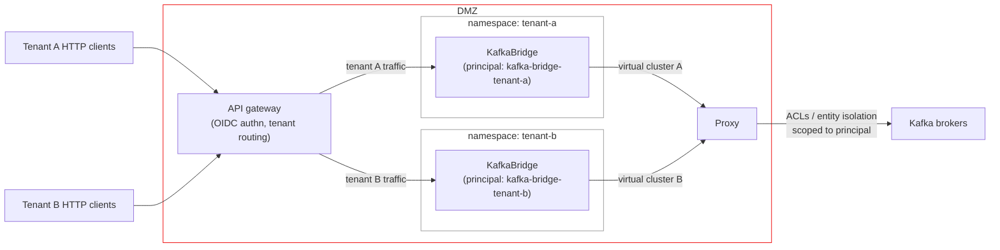
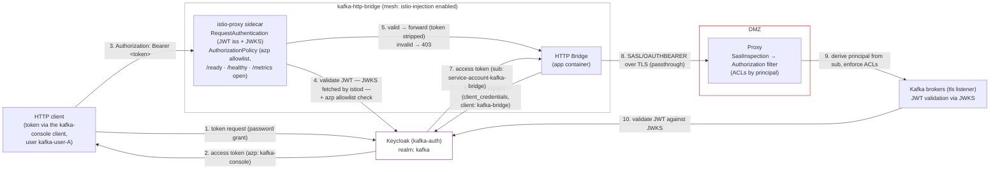

# Step 7: Deploy the Kafka HTTP Bridge (DMZ Client)

> [↑ Setup overview](../openshift-setup.md) · prev: [Step 6: Proxy](06-proxy.md) · next: [Step 8: Console](08-console.md)

The **HTTP Bridge** exposes the Kafka cluster over a REST API (`/topics`, `/consumers`), so HTTP clients — scripts, lightweight services, systems where a Kafka client library is impractical — can produce and consume without a native Kafka protocol connection. Deployed via the Cluster Operator as a `KafkaBridge` resource, it integrates with the proxy by being a **plain Kafka client of the virtual cluster**: point its `bootstrapServers` at the proxy's clusterIP bootstrap Service so HTTP traffic flows **through the proxy**, keeping the DMZ intact.

Placing the bridge in its own **`kafka-http-bridge` namespace** keeps the HTTP API isolated from both the proxy and the brokers — external HTTP clients reach only this namespace, and the bridge (DMZ) reaches the brokers (secure backend) only through the proxy (also in the DMZ). Based on the [Using the Streams for Apache Kafka HTTP Bridge](https://docs.redhat.com/en/documentation/red_hat_streams_for_apache_kafka/3.2/html/using_the_streams_for_apache_kafka_http_bridge) guide.

> **Deployment order:** the bridge is deployed **seventh** in this guide — immediately after the proxy (Step 6), which it connects through (its `bootstrapServers` is the proxy's clusterIP bootstrap, so it can't reach Kafka before the proxy is up); see the Guide map in the [setup overview](../openshift-setup.md).

## 7.1 — Create the namespace and extend the Cluster Operator watch

Create the namespace — the bridge sits in the **DMZ** alongside the proxy, as the
second client-facing door (the brokers stay in the secure backend):

```bash
oc new-project kafka-http-bridge
```

The Cluster Operator ([Step 3](03-kafka-cluster.md#step-3-deploy-the-kafka-cluster-streams-for-apache-kafka)) watches only the `kafka` namespace, so it would not reconcile a `KafkaBridge` in `kafka-http-bridge`. Extend its watch scope:

```bash
# 1. Add kafka-http-bridge to STRIMZI_NAMESPACE in the operator Deployment
oc set env deployment/strimzi-cluster-operator -n kafka STRIMZI_NAMESPACE=kafka,kafka-http-bridge

# 2. Install the RoleBindings for the watched namespace
sed -i 's/namespace: .*/namespace: kafka/' install/cluster-operator/*RoleBinding*.yaml
oc apply -f install/cluster-operator/020-RoleBinding-strimzi-cluster-operator.yaml -n kafka-http-bridge
oc apply -f install/cluster-operator/023-RoleBinding-strimzi-cluster-operator.yaml -n kafka-http-bridge
oc apply -f install/cluster-operator/031-RoleBinding-strimzi-cluster-operator-entity-operator-delegation.yaml -n kafka-http-bridge

# 3. Restart the operator to pick up the new watch scope
oc rollout restart deployment/strimzi-cluster-operator -n kafka
```

 > Alternatively, set `STRIMZI_NAMESPACE="*"` to watch all namespaces (see [Deploying the Cluster Operator to watch all namespaces](https://strimzi.io/docs/operators/latest/deploying.html#deploying-cluster-operator-to-watch-whole-cluster-str)).

> **OLM-installed operator?** Skip the steps above — do not edit the OLM-managed Deployment (OLM reverts it). Instead add the namespace to the operator's `OperatorGroup` and let OLM regenerate the RBAC and roll the operator — either by patching, or (declarative) by applying the updated OperatorGroup manifest:
>
> ```bash
> oc patch operatorgroup <operator-group-name> -n kafka --type merge \
>   -p '{"spec":{"targetNamespaces":["kafka","kafka-http-bridge"]}}'
> # or: oc apply -f deploy/kafka/00-cluster-operator-olm.yaml
> ```

Verify the watch scope before deploying the bridge — if the operator does not
watch `kafka-http-bridge`, the `KafkaBridge` in Step 7.2 is never reconciled
and its Ready wait times out:

```bash
oc get operatorgroup <operator-group-name> -n kafka -o jsonpath='{.spec.targetNamespaces}'
# ["kafka","kafka-http-bridge"]
```

## 7.2 — Deploy the bridge with a `KafkaBridge` resource

The bridge runs in the `kafka-http-bridge` namespace and connects to the **proxy's clusterIP bootstrap** (from [Step 6.10](06-proxy.md#610--apply-and-verify) — verify the exact port with `oc get services -n kafka-proxy`). The ready-to-apply manifest is [`deploy/bridge/01-kafka-bridge.yaml`](../deploy/bridge/01-kafka-bridge.yaml):

```bash
oc apply -f deploy/bridge/01-kafka-bridge.yaml

oc wait --for=condition=Ready kafkabridge/my-bridge -n kafka-http-bridge --timeout=300s
oc get pods -n kafka-http-bridge
```

Field notes (full manifest in the deploy file):

- `spec.bootstrapServers` — the **PROXY's clusterIP bootstrap**, not the Kafka cluster's.
- `spec.tls.trustedCertificates` — the `proxy-ca` Secret (the CA extracted in [Step 6.10, TLS variant](06-proxy.md#610--apply-and-verify), created in THIS namespace, not `kafka-proxy`), so the bridge trusts the proxy's ingress certificate.
- `spec.authentication` — SASL/OAUTHBEARER against the proxied `tls` listener (Step 3.2): `type: custom` with the Strimzi OAuth client handler, `OAUTH_CLIENT_ID`/`OAUTH_CLIENT_SECRET` via the container template from the `kafka-bridge` Keycloak client. Create the Secret first (the realm import does not create Kubernetes Secrets):
  `oc create secret generic kafka-bridge-oauth --from-literal=client-secret=kafka-bridge-secret -n kafka-http-bridge`
- `spec.http.port` — the REST API port (8080).

Expected output:

```text
NAME                          READY  STATUS   RESTARTS
my-bridge-bridge-<pod_id>     1/1    Running  0
```

The operator creates a Service named `<name>-bridge-service` on the configured `http.port`:

```bash
oc get services my-bridge-bridge-service -n kafka-http-bridge
```

## 7.3 — Verify produce/consume over HTTP through the proxy

```bash
# Produce a JSON record through the bridge (and therefore the proxy)
oc run bridge-producer --rm -i --restart=Never --image=curlimages/curl -n kafka-http-bridge -- \
  -X POST http://my-bridge-bridge-service:8080/topics/topic-A \
  -H "Content-Type: application/vnd.kafka.json.v2+json" \
  -d '{"records":[{"value":"hello via bridge + proxy"}]}'
```

```bash
# Create a consumer, subscribe, and fetch records
oc run bridge-consumer --rm -i --restart=Never --image=curlimages/curl -n kafka-http-bridge -- \
  -X POST http://my-bridge-bridge-service:8080/consumers/bridge-consumer-group \
  -H "Content-Type: application/vnd.kafka.v2+json" \
  -d '{"name":"bridge-consumer","format":"json","auto.offset.reset":"earliest"}'

oc run bridge-consumer --rm -i --restart=Never --image=curlimages/curl -n kafka-http-bridge -- \
  -X POST http://my-bridge-bridge-service:8080/consumers/bridge-consumer-group/instances/bridge-consumer/subscription \
  -H "Content-Type: application/vnd.kafka.v2+json" \
  -d '{"topics":["topic-A"]}'

oc run bridge-consumer --rm -i --restart=Never --image=curlimages/curl -n kafka-http-bridge -- \
  -H "Accept: application/vnd.kafka.json.v2+json" \
  http://my-bridge-bridge-service:8080/consumers/bridge-consumer-group/instances/bridge-consumer/records
```

## 7.4 — Operational notes

- **Replicas and HA:** producers are stateless, so multiple bridge replicas work well for producing workloads behind a load balancer. **Consumers are NOT recommended with multiple replicas** — consumer state (subscriptions, offsets in progress) is held in-memory per instance with no failover; if the pod dies, HTTP clients must recreate the consumer. Plan consumer-facing traffic accordingly. The load-test procedure for both paths (producer vs per-instance consumer capacity) is [15 — Load testing the data path](15-load-testing.md).
- **HTTP interface security is not built in:** the bridge's REST API has no authentication/authorization of its own. Restrict access with NetworkPolicies (see [12.5](#75--restrict-http-access-to-the-bridge-dmz-networkpolicy)), or front the bridge with a reverse proxy (e.g., OAuth 2.0) or API gateway. This also has multi-tenancy implications — see [7.6](#76--multi-tenancy-with-the-bridge).
- **Bridge → Kafka auth:** the `KafkaBridge` CR supports `spec.authentication` (`tls`, `scram-sha-256`, `scram-sha-512`, `plain`, `custom`) and `spec.tls.trustedCertificates` — the bridge authenticates to the *Kafka listener* through the proxy like any other client. The proxied `tls` listener requires SASL/OAUTHBEARER (Step 3.2), so the bridge uses `custom` authentication with the Strimzi OAuth client handler, obtaining tokens from the `kafka-bridge` Keycloak client ([Step 2.5](02-keycloak.md#25--client-authentication-at-the-proxy)); the bridge's HTTP API itself remains guarded by the namespace DMZ.
- **Non-Red Hat clusters:** the bridge is a plain Kafka client (`spec.bootstrapServers`), so it connects to **any spec-compliant Apache Kafka cluster** — a Red Hat build is not required. That is compatibility, not supportability: Red Hat supports the bridge side of the connection; issues originating in the third-party cluster belong to that vendor. See the family-wide note in the [README](../README.md#components-and-tested-versions).
- **Exposing the bridge outside the cluster:** use an OpenShift Route for the `my-bridge-bridge-service` (HTTP clients are exempt from the Kafka-protocol constraints that make Route exposure problematic for the proxy itself).
- **DMZ consistency:** with the bridge in `kafka-http-bridge`, the same trust boundary applies — the bridge is just another client of the proxy, and the Kafka namespace still only accepts connections from `kafka-proxy`. Add the NetworkPolicy from the next section to enforce which clients can reach the bridge's HTTP port.

## 7.5 — Restrict HTTP access to the bridge (DMZ NetworkPolicy)

The bridge's REST API has no authentication of its own (see the note above), so enforce access at the network layer. The bridge pods carry the Strimzi labels `strimzi.io/kind: KafkaBridge` and `strimzi.io/cluster: my-bridge`. Combine two additive policies in the `kafka-http-bridge` namespace:

1. **Default deny** — block all ingress to the bridge pods.
2. **Allowed clients** — permit ingress on the HTTP port 8080 from within the namespace (the `oc` test pods in 12.3) and from the namespace running your API layer / gateway (example: `api-gateway` — change to yours).

The ready-to-apply manifest is [`deploy/bridge/02-bridge-netpol-dmz.yaml`](../deploy/bridge/02-bridge-netpol-dmz.yaml) — it also ships the stand-in `api-gateway` namespace for the verification below:

```bash
oc apply -f deploy/bridge/02-bridge-netpol-dmz.yaml
oc get networkpolicies -n kafka-http-bridge
```

Verify the lockdown behaves as intended:

```bash
# From the api-gateway namespace: connection succeeds (replace with your API layer's namespace;
# the stand-in api-gateway namespace ships with the DMZ NetworkPolicy manifest above)
oc run bridge-allowed --rm -i --restart=Never --image=curlimages/curl -n api-gateway -- \
  --max-time 5 -s -o /dev/null -w "%{http_code}\n" \
  http://my-bridge-bridge-service.kafka-http-bridge.svc.cluster.local:8080/health

# From an unrelated namespace (e.g., default): connection should TIME OUT
oc run bridge-blocked --rm -i --restart=Never --image=curlimages/curl -n default -- \
  --max-time 5 -s -o /dev/null -w "%{http_code}\n" \
  http://my-bridge-bridge-service.kafka-http-bridge.svc.cluster.local:8080/health
```

Notes:

- **Egress is untouched:** these policies restrict ingress only, so the bridge can still connect to the proxy's bootstrap (`kafka-proxy:9292`). If you later add a default-deny **egress** policy to `kafka-http-bridge`, remember to allow egress to `kafka-proxy` on the proxy's bootstrap port.
- **Cluster Operator:** the operator reconciles the bridge via the Kubernetes API and pod-local probes — it does not need network access to port 8080, so the default-deny does not affect reconciliation.
- **Expose the bridge through your API layer:** front the `my-bridge-bridge-service` with your gateway (in the allowed namespace) rather than exposing the bridge directly — the gateway can add the authentication/authorization the HTTP interface lacks.

## 7.6 — Multi-tenancy with the bridge

The bridge's identityless HTTP interface has one architectural consequence worth planning for: **an HTTP client never presents an identity past the bridge**. Every request through a given bridge instance is made with *that bridge's* single Kafka identity — in this stack, `service-account-kafka-bridge` ([Step 6.6](06-proxy.md#66--optional-add-a-filter), the ACL manifest). The proxy's authorization filter and the broker ACLs therefore cannot distinguish which HTTP client made a request, and tenant isolation collapses to naming conventions (`tenant-a-` topic prefixes, group prefixes) that the bridge will happily let any caller violate. A single bridge reachable by multiple tenants is a single trust boundary, **not** a multi-tenant service.

> ⚠️ This stack's ACL grants `kafka-bridge` `* to * on *` — correct for the demo, but precisely the shape that makes a shared bridge unusable for real tenancy: it would also bypass the proxy's per-tenant entity-isolation filter ([Demo 7](demos/07-entity-isolation.md)), which partitions by *identity* — and there is only one identity here.

Since no identity passes through the bridge, the tenant boundary must fall somewhere the identity *is* known. Two workable patterns, which compose:

### Pattern A (recommended): one bridge per tenant

Deploy a separate `KafkaBridge` per tenant, each in its **own namespace**, each with its **own credentials**:

- Tenant A's bridge authenticates as `kafka-bridge-tenant-a` (its own Keycloak client, per [Step 2.5](02-keycloak.md#25--client-authentication-at-the-proxy)), tenant B's as `kafka-bridge-tenant-b`.
- Downstream enforcement becomes real again: the proxy's authorization filter or broker ACLs grant each bridge identity access only to that tenant's topics/groups — the same ACL-per-principal model as [`deploy/proxy/06-kafka-acl.yaml`](../deploy/proxy/06-kafka-acl.yaml), just with more principals.
- Point each tenant's bridge at that tenant's **virtual cluster** bootstrap ([Demo 9](demos/09-multi-tenant-virtual-clusters.md)): the tenant boundary is then enforced twice — at the virtual cluster (per-tenant `filterRefs`, per-tenant listeners) and at the ACL layer (per-tenant principal). The bridge's fixed identity stops mattering because it only ever sees one tenant's slice.
- Kubernetes isolation comes free: per-tenant namespace + NetworkPolicies (the [7.5](#75--restrict-http-access-to-the-bridge-dmz-networkpolicy) model, replicated per namespace), per-tenant RBAC, per-tenant resource quotas. Kafka quotas can also be keyed per bridge identity for per-tenant throughput limits.

### Pattern B: gateway in front (authenticate at the edge)

Keep (or add) an API gateway/OAuth proxy as the **only** thing allowed to reach the bridge's HTTP port — the [7.5](#75--restrict-http-access-to-the-bridge-dmz-networkpolicy) NetworkPolicy already reserves the `api-gateway` namespace for exactly this:

- The gateway validates the HTTP client's OIDC token (the `kafka-auth` Keycloak realm, [Step 2](02-keycloak.md)), maps it to a tenant, and enforces tenant authorization on the REST paths (e.g., tenant A may only `POST /topics/tenant-a-*`).
- Optionally it **routes per tenant**: tenant A's requests → tenant A's bridge, tenant B's → tenant B's bridge. This effectively merges into Pattern A, with the gateway as the front door.
- The bridge itself stays unauthenticated but is network-invisible to everyone except the gateway.

### Recommended shape

**Per-tenant bridge + per-tenant virtual cluster + per-tenant principal**, with the gateway (Pattern B) as optional polish:



The rule of thumb: **authenticate "who" at the edge (gateway), enforce "what" downstream (per-bridge identity against virtual clusters/ACLs)**. The bridge's identityless HTTP interface is tolerable only as long as it is never the shared component across tenants.

## 7.7 — Concrete products for the edge (gateway/OAuth proxy)

Section [7.6](#76--multi-tenancy-with-the-bridge) stays deliberately product-agnostic: any authenticating front door works in the DMZ shape it describes. If you want a concrete product for the gateway slot, these are the defensible candidates — all of them drop in behind the [7.5](#75--restrict-http-access-to-the-bridge-dmz-networkpolicy) NetworkPolicy as the only allowed client of the bridge, and none of them changes the per-tenant bridge topology from [7.6](#76--multi-tenancy-with-the-bridge):

- **Envoy Gateway with the JWT authentication filter** — validates Keycloak-issued bearer tokens directly (JWKS discovery, issuer/audience checks) before proxying to the bridge. No vendor CRDs, but path-level authorization (e.g., tenant A may only `POST /topics/tenant-a-*`) and consumer-session pinning across bridge replicas are wired yourself. Community-supported.
- **Kong Gateway** (OSS or Konnect/enterprise) — mature OIDC plugin that works against the `kafka-auth` Keycloak realm, plus rate limiting and consumer key-auth plugins. Runs on OpenShift; a good choice if the organization already operates Kong.
- **NGINX + oauth2-proxy** — the minimal option: NGINX fronts the bridge, `oauth2-proxy` validates tokens against the `kafka-auth` realm and forwards. Cheap and effective, but no per-plan rate limiting and consumer-session pinning is manual. Keep bridge replicas at 1 for consumer workloads (see [7.4](#74--operational-notes)).
- **OpenShift Service Mesh (OSSM)** — if the platform already runs a mesh, Istio's `RequestAuthentication` + `AuthorizationPolicy` give the same JWT validation as the Envoy option — against the `kafka-auth` realm (issuer + `jwksUri`), with the AuthorizationPolicy making auth mandatory and carving out `/ready`, `/healthy`, `/metrics` so probes and user-workload-monitoring scraping keep working ([Step 1.2](01-user-workload-monitoring.md#12--allow-the-monitoring-stack-into-the-locked-down-namespaces)). Red Hat-supported, and mesh mTLS covers the hops behind the edge. Caveats: the bridge (or the Istio ingress gateway fronting it) must join the mesh — check the sidecar doesn't interfere with the bridge's egress to the proxy bootstrap (`kafka-proxy:9292`) — and a mesh is a heavy install if you're not running one already. **Full install + configuration walkthrough: [7.8](#78--securing-the-bridge-with-openshift-service-mesh-ossm).**
- **IBM API Connect** — the fully supported, full-lifecycle API management platform (Red Hat's named successor path alongside its own offering). The heavyweight choice — only warranted if it is already your organization's API platform standard.

What they all have in common:

- **Same DMZ topology** — the gateway becomes the sole NetworkPolicy-allowed client in `kafka-http-bridge`; the bridge itself remains unauthenticated.
- **OIDC against the existing realm** — each option can validate the same tokens your native Kafka clients use (via JWT validation CRDs/policies, plugin, or OAuth proxy), so HTTP clients and Kafka clients share one identity provider.
- **Edge auth ≠ downstream identity** — for a single trust boundary, any option is complete; for multi-tenancy, pair the gateway with the per-tenant bridge topology from [7.6](#76--multi-tenancy-with-the-bridge), with the gateway routing tenant → tenant's bridge.

## 7.8 — Securing the bridge with OpenShift Service Mesh (OSSM)

This step implements the OSSM option from [7.7](#77--concrete-products-for-the-edge-gatewayoauth-proxy): the bridge joins the mesh, and Istio's `RequestAuthentication` + `AuthorizationPolicy` enforce OIDC on the bridge's HTTP API — tokens from the existing `kafka-auth` Keycloak realm, validated by the sidecar before requests reach the bridge process.

What changes and what doesn't:

- **The 7.5 DMZ NetworkPolicies still apply unchanged** — mesh policy adds per-request token validation on top of the namespace-level isolation; it does not replace it.
- **No Istio ingress gateway is required** — the sidecar enforces on inbound traffic wherever it arrives from: in-cluster Service traffic and an OpenShift Route (the 7.4 off-cluster exposure) both pass through the sidecar. A gateway is an optional later addition.
- **Bridge → Kafka is untouched** — the sidecar's outbound default is `PERMISSIVE` mTLS, so the bridge's existing SASL/OAUTHBEARER + TLS connection through the proxy (7.2) flows through the sidecar as plain passthrough.
- **Requires cluster-admin** (operator + control plane install) and **OSSM 3** — do not co-install with OSSM 2. The ready-to-apply manifests live in a **separate `deploy/ossm/` directory** (NOT `deploy/bridge/` — the base guide's blanket `oc apply -f deploy/bridge/` must not pick up the optional mesh install): [`deploy/ossm/01-install.yaml`](../deploy/ossm/01-install.yaml) (operator + control plane) and [`deploy/ossm/02-bridge-auth.yaml`](../deploy/ossm/02-bridge-auth.yaml) (bridge auth).

### Install the operator and the Istio control plane

```bash
oc apply -f deploy/ossm/01-install.yaml

# Wait for the control plane and CNI plugin to report Healthy
oc get istio default -n istio-system      # State: Healthy, Reconciled: True
oc get istiocni default                   # State: Healthy
```

The `Istio` CR scopes mesh discovery with `discoverySelectors` (`istio-discovery=enabled`), so the mesh only manages namespaces you explicitly label — it does not try to discover the whole cluster.

### Join the bridge to the mesh

Label the bridge namespace for discovery and sidecar injection, then restart the bridge so the proxy is injected:

```bash
oc label namespace kafka-http-bridge istio-discovery=enabled istio-injection=enabled
oc -n kafka-http-bridge rollout restart deployment/my-bridge-bridge
oc -n kafka-http-bridge get pods   # expect 2/2 — app container + istio-proxy sidecar
```

> **Egress check:** the sidecar now sits in front of the bridge's connection to the proxy bootstrap (`kafka-proxy:9292`) and its Keycloak token endpoint. With default `PERMISSIVE` outbound mTLS this is passthrough — verify produce/consume ([7.3](#73--verify-produceconsume-over-http-through-the-proxy)) still works before applying auth.

### Enforce OIDC on the bridge API

Apply the auth manifest with `envsubst` — the token `issuer` is the Keycloak realm's route URL (`<KEYCLOAK_HOST>`, see [deploy/README.md](../deploy/README.md)):

```bash
KEYCLOAK_HOST="keycloak-ingress-kafka-auth.${OPENSHIFT_APPS_DOMAIN}"
envsubst < deploy/ossm/02-bridge-auth.yaml | oc apply -f -
```

The manifest ships three resources:

1. **NetworkPolicy `keycloak-allow-http-istiod`** (kafka-auth) — istiod fetches the realm JWKS itself for the `RequestAuthentication` rule, and the existing `keycloak-allow-http-oauth` policy only opens port 8080 for the Kafka-related namespaces. Additive, so the existing policy is untouched.
2. **`RequestAuthentication`** (kafka-http-bridge, `strimzi.io/cluster: my-bridge` selector) — the sidecar validates `Authorization: Bearer` JWTs against the realm. The `issuer` must **exactly** match the token's `iss` claim (the Keycloak operator sets `frontendUrl` to the route hostname, so tokens carry `https://<KEYCLOAK_HOST>/realms/kafka` — verify with `jq -r .iss` on a decoded token). The `jwksUri` uses the in-cluster `keycloak-http` Service, the same OAuth chain path the brokers and bridge already use (DEV only — see the note in [`deploy/keycloak/05-keycloak-http.yaml`](../deploy/keycloak/05-keycloak-http.yaml)).
3. **`AuthorizationPolicy`** — makes a valid token **mandatory** (RequestAuthentication alone only rejects *invalid* tokens, it passes requests with no token through), and restricts tokens to an **allowlisted client** (`azp` claim — `kafka-console`, the demo realm's direct-access-grants client; extend the list as HTTP clients onboard). `/ready`, `/healthy`, and `/metrics` stay open so the Cluster Operator probes and the user-workload monitoring scrape ([Step 1.2](01-user-workload-monitoring.md#12--allow-the-monitoring-stack-into-the-locked-down-namespaces)) keep working.

### Verify

```bash
# 1. Unauthenticated request → 403 (AuthorizationPolicy denies)
oc run bridge-noauth --rm -i --restart=Never --image=curlimages/curl -n kafka-http-bridge -- \
  --max-time 5 -s -o /dev/null -w "%{http_code}\n" \
  http://my-bridge-bridge-service:8080/topics
# 403

# 2. Token via password grant (the kafka-console client has direct access
#    grants enabled and is the azp allowlist entry; same demo users as the
#    proxy authorization demos) — confidential client, so the secret is
#    required — then → 200
TOKEN=$(curl -s -X POST "http://keycloak-http.kafka-auth.svc.cluster.local:8080/realms/kafka/protocol/openid-connect/token" \
  -H "Content-Type: application/x-www-form-urlencoded" \
  -d "grant_type=password&client_id=kafka-console&client_secret=kafka-console-secret&username=kafka-user-A&password=password-a" | jq -r .access_token)

oc run bridge-auth --rm -i --restart=Never --image=curlimages/curl -n kafka-http-bridge -- \
  --max-time 5 -s -o /dev/null -w "%{http_code}\n" \
  -H "Authorization: Bearer $TOKEN" \
  http://my-bridge-bridge-service:8080/topics
# 200

# 3. Management endpoints stay open (no token) — probes and scraping unaffected
oc run bridge-mgmt --rm -i --restart=Never --image=curlimages/curl -n kafka-http-bridge -- \
  --max-time 5 -s -o /dev/null -w "%{http_code}\n" \
  http://my-bridge-bridge-service:8080/metrics
# 200
```

### The two OIDC flows at a glance

With the bridge in the mesh, **two independent OIDC exchanges** happen — one at the mesh edge (HTTP client → bridge), one on the Kafka path (bridge → brokers, [7.2](#72--deploy-the-bridge-with-a-kafkabridge-resource)) — and they never mix:



What the diagram shows:

- **Two distinct tokens from one realm.** The HTTP client's token (step 2, `azp: kafka-console`) is consumed by the sidecar and **stripped before it reaches the bridge** (`forwardOriginalToken` defaults to `false` — the bridge app never sees the HTTP client's credential). The bridge mints its **own** token independently (step 7, client `kafka-bridge` via `client_credentials`) for the Kafka path. Neither token crosses into the other flow.
- **Two separate validators of the same JWKS.** istiod validates the edge token (steps 3–5, fetched through the `keycloak-allow-http-istiod` NetworkPolicy); the brokers validate the bridge's token on the Kafka path (step 10) — both against the same realm certs via the in-cluster `keycloak-http` Service. The proxy does **not** cryptographically re-validate: `SaslInspection` (step 9) derives the ACL principal from the JWT `sub` claim, and the `Authorization` filter enforces the ACLs on it ([6.6](06-proxy.md#66--optional-add-a-filter)).
- **The two identities are deliberately non-interchangeable.** The HTTP client's token cannot serve as the bridge's Kafka credential (the bridge always mints its own), and the bridge's Kafka client is not on the edge `azp` allowlist — so a leaked edge token grants access to the bridge API only, and the Kafka principal stays the bridge's own ([7.4](#74--operational-notes), the bridge → Kafka auth note).
- **Identity still ends at the bridge** — the Kafka principal on the data path is always `service-account-kafka-bridge` regardless of which HTTP client sent the request; the per-tenant topology from [7.6](#76--multi-tenancy-with-the-bridge) is what turns the edge identity into a per-tenant Kafka principal.

Notes:

- **A 401 instead of 403** on the unauthenticated request means the `AuthorizationPolicy` is not selecting the pods (check the `strimzi.io/cluster`/`strimzi.io/kind` labels) — without it, unauthenticated requests pass.
- **Issuer mismatch** (401s on valid tokens) almost always means `iss` ≠ the configured `issuer` — decode a token and compare.
- **Multi-tenancy is unchanged:** the mesh authenticates *who* at the edge, but everything past the bridge still carries the bridge's single Kafka principal — the per-tenant bridge topology from [7.6](#76--multi-tenancy-with-the-bridge) still applies. `AuthorizationPolicy` rules per claim (e.g., tenant A may only `POST /topics/tenant-a-*`) can add coarse per-tenant authorization at the edge.
- **The edge policy does NOT mirror the Kafka ACLs** ([`deploy/proxy/06-kafka-acl.yaml`](../deploy/proxy/06-kafka-acl.yaml)) — and should not try to. The `AuthorizationPolicy` enforces *authentication* (realm + allowlisted client), not per-topic/per-group permissions: those live in the proxy's `Authorization` filter, keyed by **Kafka principal** — and every HTTP client carries the bridge's single principal (`service-account-kafka-bridge`, granted `* to * on *`). So any allowlisted realm user can, through the bridge, do everything the bridge principal may: e.g., `kafka-user-a` (scoped to `topic-A` by the ACLs) can produce to `topic-C` via the bridge, and the proxy's deny-by-default never sees them. This is the identity gap from [7.6](#76--multi-tenancy-with-the-bridge), restated for the mesh: real per-principal enforcement needs the per-tenant bridge topology (one bridge per tenant, own principal, scoped ACL grants), with the edge policy gating which bridge a caller reaches. Keeping the edge rules coarse and low-churn (the `azp` allowlist) avoids duplicating the ACL model in Envoy and drifting from the ACLs as the source of truth.
- **Consumer-session pinning:** the mesh does not pin a consumer's HTTP session to the bridge replica that created it — keep replicas at 1 for consumer workloads ([7.4](#74--operational-notes)), or front the bridge with a routing gateway.
- **Off-cluster exposure:** an OpenShift Route for `my-bridge-bridge-service` ([7.4](#74--operational-notes)) now lands on the sidecar too — the token check applies to external clients as well. For production, terminate TLS with a passthrough/re-encrypt Route so tokens are not sent in the clear; the Route must be able to reach the mesh-injected pod (no extra gateway config needed).
- **Cleanup** is in [12.1](12-cleanup.md): the bridge namespace labels, the two Istio security resources, and the `keycloak-allow-http-istiod` policy; deleting the `Istio`/`IstioCNI` resources uninstalls the control plane (leave the operator if other workloads use it).
