# Setting Up Streams for Apache Kafka Proxy on OpenShift (oc CLI)

Step-by-step instructions for deploying the full stack from the command line using the `oc` client — the **user-workload monitoring stack** (deployed first, [Step 1.1](docs/01-user-workload-monitoring.md#11--enable-monitoring-for-user-defined-projects-deploy-this-first-cluster-admin-once)), a **Streams for Apache Kafka cluster**, the **Red Hat build of Keycloak** OIDC authorization server (`kafka-auth` namespace), the **proxy Operator**, a working proxy with a virtual cluster, the **Kafka HTTP Bridge** as a proxy client, the **Streams for Apache Kafka Console** UI, and **Camel Quarkus** producer/consumer clients — with every component integrated into **OpenShift's built-in observability stack** (user-workload monitoring) in [Step 1](docs/01-user-workload-monitoring.md#step-1-integrate-the-stack-with-openshift-user-workload-monitoring-observability) — based on the [Streams for Apache Kafka 3.2 proxy documentation](https://docs.redhat.com/en/documentation/red_hat_streams_for_apache_kafka/3.2/html/deploying_and_managing_streams_for_apache_kafka_proxy_on_openshift).

> **Divergences from the Red Hat documentation** (all verified against a live cluster; ready-to-apply manifests in [`deploy/`](deploy/README.md)):
>
> - **Upstream release artifact for the proxy** instead of the Red Hat subscription download — kroxylicious operator **0.25.1** ([Step 6.1](docs/06-proxy.md#61--install-the-proxy-operator)), installed from the upstream release install file (published 2026-10-20). This guide renames the upstream `kroxylicious-operator` namespace/Deployment to `kafka-proxy` ([Step 6.1](docs/06-proxy.md#61--install-the-proxy-operator)); the Red Hat subscription artifacts keep the `kroxylicious-operator` name. The console operator, by contrast, is the **Red Hat OLM artifact** (`amq-streams-console` package, [Step 8.1](docs/08-console.md#81--install-the-console-operator)) — with behavior differences from the upstream non-OLM install noted there and in [Step 1.7](docs/01-user-workload-monitoring.md#17--console-kafka-console-read-metrics-from-user-workload-monitoring).
> - **Proxy bootstrap port is operator-allocated** — 9292 with the operator versions used here; the Red Hat guide's examples do not pin a port, so read it from the generated Service ([Step 6.10](docs/06-proxy.md#610--apply-and-verify)).
> - **Strimzi 0.51 API changes** — the `authentication.type: oauth` listener type is deprecated in 3.2 (use `custom` auth — see [Step 2.5](docs/02-keycloak.md#25--client-authentication-at-the-proxy)).
> - **OAuth end-to-end on the data path** — the Kafka cluster's `tls` listener (9093, the proxy's upstream) requires SASL/OAUTHBEARER (the only mechanism), configured via Strimzi 0.51 `custom` auth with the Strimzi OAuth callback handlers ([Step 3.2](docs/03-kafka-cluster.md#32--create-the-kafka-cluster), [deploy/kafka/02-kafka.yaml](deploy/kafka/02-kafka.yaml)). Tokens come from the `kafka` realm service-account clients ([deploy/keycloak/04-kafka-realm-import.yaml](deploy/keycloak/04-kafka-realm-import.yaml)); the proxy relays the SASL/OAUTHBEARER exchange (passthrough) and cannot authenticate upstream itself ([Step 2.5](docs/02-keycloak.md#25--client-authentication-at-the-proxy)). Keycloak serves the console's OIDC login too (Steps [1](docs/02-keycloak.md#step-2-install-red-hat-build-of-keycloak-kafka-auth-namespace) and [13](docs/08-console.md#step-8-deploy-the-streams-for-apache-kafka-console-kafka-console-namespace)).
> - **Camel images built in-cluster** via OpenShift BuildConfigs instead of an external registry ([Step 9.4](docs/09-camel-clients.md#94--build-and-deploy-the-containers)).
> - **Custom filter development documented upstream** — Red Hat 3.2 publishes no filter-development guide; [Step 10](docs/10-custom-filter.md#step-10-develop-and-deploy-a-custom-filter-optional) follows the upstream Developer Quick Start and Developer Guide for 0.25.1 (the deployed version) and uses the operator's `KROXYLICIOUS_IMAGE` override (present in the operator source, absent from both documentation sets).
> - **Record Validation config drift** — the Red Hat 3.2 Record Validation guide documents a `wireFormatVersion` option that the deployed upstream 0.25.1 proxy does not have; omit it ([Demo scenarios, Demo 2](docs/11-demos.md#demo-2--record-validation-end-to-end)).
> - **Apicurio Registry operator NetworkPolicy behavior** — the Red Hat Apicurio docs say `spec.app.networkPolicy.enabled: false` leaves NetworkPolicies to you, but the operator (3.2.6) re-creates its allow-all policies when the setting is changed on an **existing** resource; deploy the CR with the setting from the start ([Step 5.3](docs/05-apicurio-registry.md#53--lock-down-the-registry-network)).

---


## Guide map

The guide is split into one document per component under [`docs/`](docs). The step
numbering (**1–11**) matches the **deployment order**, and each component's first
manifest creates its namespace:

| Step | Document | Component | Notes |
|---|---|---|---|
| [1](docs/01-user-workload-monitoring.md) | [User-workload monitoring](docs/01-user-workload-monitoring.md) | OpenShift user-workload monitoring — [1.1](docs/01-user-workload-monitoring.md#11--enable-monitoring-for-user-defined-projects-deploy-this-first-cluster-admin-once) enables the stack (deployed **first**; cluster-admin, once), [1.2–1.9](docs/01-user-workload-monitoring.md#12--allow-the-monitoring-stack-into-the-locked-down-namespaces) is the per-component integration (netpols, PodMonitors, console metrics source, alert rules — deployed after those components exist) | deployed first and last |
| [2](docs/02-keycloak.md) | [Keycloak](docs/02-keycloak.md) | Red Hat build of Keycloak — OIDC authorization server (`kafka-auth`) | |
| [3](docs/03-kafka-cluster.md) | [Deploy the Kafka cluster](docs/03-kafka-cluster.md) | Streams for Apache Kafka cluster (secure backend) + backend lockdown NetworkPolicies | |
| [4](docs/04-mirrormaker2.md) | [MirrorMaker 2](docs/04-mirrormaker2.md) | Replication between the two clusters (optional) | |
| [5](docs/05-apicurio-registry.md) | [Apicurio Registry](docs/05-apicurio-registry.md) | Registry operator, dev PostgreSQL, `ApicurioRegistry3`, schema registration (5.1–5.4) | |
| [6](docs/06-proxy.md) | [Proxy](docs/06-proxy.md) | Streams for Apache Kafka Proxy — operator, virtual cluster, ingress, TLS, DNS (subsections 6.1–6.10) | |
| [7](docs/07-http-bridge.md) | [HTTP Bridge](docs/07-http-bridge.md) | Kafka HTTP Bridge as DMZ client (connects through the proxy) | |
| [8](docs/08-console.md) | [Console](docs/08-console.md) | Streams for Apache Kafka Console UI (connects through the proxy, OIDC via Keycloak) | |
| [9](docs/09-camel-clients.md) | [Camel clients](docs/09-camel-clients.md) | Camel Quarkus producer/consumer | |
| [10](docs/10-custom-filter.md) | [Custom filter](docs/10-custom-filter.md) | Custom filter development and deployment (optional) | |
| [11](docs/11-demos.md) | [Demo scenarios](docs/11-demos.md) | 14 ready-made demos — including the Record Validation demo (Demo 2: topic + filter wiring, optional) | |

Troubleshooting tips covering the whole stack are at the [end of this document](#troubleshooting-tips).

---

## Prerequisites

- **OpenShift cluster 4.18 or later** (3.2 is tested on 4.16–4.21, excluding 4.17).
- `oc` CLI installed and configured to connect to the cluster:

  ```bash
  oc login --token=<token> --server=<cluster-url>
  oc whoami
  ```

- An account with permission to create `CustomResourceDefinition` and RBAC (`ClusterRole`) resources (for the operator install):

  ```bash
  oc auth can-i create customresourcedefinitions
  oc auth can-i create clusterroles
  ```

- A **Kafka cluster available to be proxied** — it may run in the same OpenShift cluster or elsewhere; only network connectivity is required. If you don't have one, deploy one with Streams for Apache Kafka in [Step 3](docs/03-kafka-cluster.md#step-3-deploy-the-kafka-cluster-streams-for-apache-kafka).
- TLS certificate generation capability (for ingress types that require TLS).
- DNS management access (only for `loadBalancer` ingress).

All commands below assume a namespace of `kafka-proxy` — adjust to yours, and create it first if needed:

```bash
oc new-project kafka-proxy
```

> **Declarative namespaces:** every component's first manifest carries its own `Namespace` — applying a component's directory creates its namespace (`kafka` and `kafka-proxy` ship with the operator installs in [Step 3.1](docs/03-kafka-cluster.md#31--install-the-cluster-operator) and [Step 6.1](docs/06-proxy.md#61--install-the-proxy-operator), `kafka-auth` with the Keycloak operator in [Step 2.1](docs/02-keycloak.md#21--install-the-keycloak-operator-into-kafka-auth), `kafka-http-bridge` with the bridge in [Step 7](docs/07-http-bridge.md#step-7-deploy-the-kafka-http-bridge-dmz-client), `kafka-console` with the console operator in [Step 8](docs/08-console.md#step-8-deploy-the-streams-for-apache-kafka-console-kafka-console-namespace), `kafka-producer`/`kafka-consumer` with the Camel BuildConfigs in [Step 9](docs/09-camel-clients.md#step-9-deploy-camel-producer-and-consumer-clients-kafka-producer-and-kafka-consumer-namespaces), and the stand-in `api-gateway` with the bridge's DMZ NetworkPolicies). The `oc new-project` commands below remain as a shortcut for step-by-step runs.

### The architecture you'll deploy

By the end of this guide, the stack looks like this — the **proxy and HTTP Bridge in the DMZ** as the clusters' doors, the **Kafka clusters and the optional MirrorMaker 2 replication plane in the secure backend** (Step 4):

```mermaid
flowchart TB
    clients["Kafka clients (native)"]
    http["HTTP clients"]
    browser["Browser (UI)"]

    subgraph openshift["OpenShift cluster — logical separation via namespaces"]
        subgraph proxyNs["namespace: kafka-proxy — DMZ"]
            proxy["Proxy operator<br/>Virtual clusters 'kafka-cluster-1'/'kafka-cluster-2'<br/>clusterIP bootstraps :9292"]
        end
        subgraph bridgeNs["namespace: kafka-http-bridge — DMZ (exposed HTTP API, locked down)"]
            bridge["KafkaBridge<br/>(bootstrapServers → the proxy)<br/>REST API /topics · /consumers<br/>(+ API gateway, optional)"]
        end
        subgraph consoleNs["namespace: kafka-console"]
            console["Console operator + Console UI<br/>connected to the virtual cluster (Virtual label)<br/>OIDC-secured"]
        end
        subgraph producerNs["namespace: kafka-producer"]
            direction TB
            producer["Camel producer route<br/>(timer → kafka:test-topic)"]
        end
        subgraph consumerNs["namespace: kafka-consumer"]
            direction TB
            consumer["Camel consumer route<br/>(groupId=camel-consumer)"]
        end
        subgraph kafkaNs1["namespace: kafka-cluster-1 — secure backend (locked down)"]
            netpol1["[Backend lockdown] NetworkPolicy (Step 3.4)<br/>Kafka ingress ONLY from the kafka-proxy DMZ<br/>+ kafka-mm2, on the listener ports"]
            kafka1["Kafka cluster 'kafka-cluster-1' (KRaft)<br/>brokers 0–2<br/>plain 9092 · tls 9093 (OAUTHBEARER)"]
        end
        subgraph kafkaNs2["namespace: kafka-cluster-2 — secure backend (locked down)"]
            netpol2["[Backend lockdown] NetworkPolicy (Step 3.4)<br/>same allowances as cluster-1"]
            kafka2["Kafka cluster 'kafka-cluster-2' (KRaft)<br/>replication target (Step 4)"]
        end
        subgraph mm2Ns["namespace: kafka-mm2 — secure backend (replication, optional, Step 4)"]
            mm2["MirrorMaker 2<br/>kafka-cluster-1 → kafka-cluster-2<br/>(replicates inside the backend)"]
        end
        subgraph authNs["namespace: kafka-auth"]
            keycloak["Red Hat build of Keycloak — realm 'kafka'<br/>service-account clients for the data path<br/>+ kafka-console client (OIDC login)"]
        end
        subgraph registryNs["namespace: kafka-registry — secure backend (locked down)"]
            registryNetpol["[Backend lockdown] NetworkPolicy (Step 5.3)<br/>Registry ingress ONLY from the kafka-proxy DMZ,<br/>ONLY on the REST port"]
            registry["Apicurio Registry 3<br/>schema store for Record Validation<br/>(PostgreSQL storage)"]
        end
    end

    clients -- "Kafka protocol (plaintext within the cluster)" --> proxy
    http -- "REST (JSON)" --> bridge
    browser -- "HTTPS + OIDC login" --> console
    bridge -- "Kafka protocol via the proxy" --> proxy
    console -- "Kafka protocol via the proxy" --> proxy
    producer -- "produce via the proxy" --> proxy
    proxy -- "fetch responses via the proxy" --> consumer
    proxy -- "Kafka protocol<br/>tls 9093 (OAUTHBEARER)" --> kafka1
    proxy -- "schema fetch (REST :8080)<br/>Record Validation filter" --> registry
    mm2 -- "replicate topics + groups<br/>(plain 9092, no auth)" --> kafka1
    mm2 -- "internal topics + mirrored data<br/>(plain 9092, no auth)" --> kafka2

    browser -. "OIDC browser login<br/>(kafka-console client)" .-> keycloak
    producer -. "token fetch (client_credentials)" .-> keycloak

    style kafkaNs1 fill:#fdecea,stroke:#b71c1c,stroke-width:2px
    style kafkaNs2 fill:#fdecea,stroke:#b71c1c,stroke-width:2px
    style bridgeNs fill:#fff8e1,stroke:#e65100,stroke-width:2px
    style authNs fill:#e8eaf6,stroke:#283593,stroke-width:2px
    style proxyNs fill:#e8f5e9,stroke:#1b5e20,stroke-width:2px
    style consoleNs fill:#e8f5e9,stroke:#1b5e20,stroke-width:2px
    style producerNs fill:#e1f5fe,stroke:#0277bd,stroke-width:2px
    style consumerNs fill:#f3e5f5,stroke:#6a1b9a,stroke-width:2px
    style registryNs fill:#e0f2f1,stroke:#00695c,stroke-width:2px
    style mm2Ns fill:#efebe9,stroke:#4e342e,stroke-width:2px
```



Each namespace is a **logical isolation boundary**: its own RBAC, service accounts, and NetworkPolicies. The **DMZ** is the `kafka-proxy` namespace (green) — it holds the proxy, the single client-facing door to the brokers — plus the `kafka-http-bridge` namespace (amber), the exposed HTTP API (also a client of the proxy), locked down by its own NetworkPolicy ([Step 7.5](docs/07-http-bridge.md#75--restrict-http-access-to-the-bridge-dmz-networkpolicy)). The **secure backend** holds the Kafka clusters — the `kafka-cluster-1` and `kafka-cluster-2` namespaces (red), sealed off with no ingress except the DMZ proxy (plus the optional `kafka-mm2` replication plane — also in the secure backend — on the plain listener) — and the `kafka-registry` namespace (teal), Apicurio Registry, reachable only by the proxy on the REST port ([Step 5.3](docs/05-apicurio-registry.md#53--lock-down-the-registry-network)). The green `kafka-console` namespace is a client-facing UI, the Camel client workloads are in their own namespaces (`kafka-producer` in light blue, `kafka-consumer` in purple), `kafka-auth` (blue) holds the identity provider, and the optional `kafka-mm2` namespace (brown), also part of the secure backend, holds MirrorMaker 2 — it replicates between the backend clusters ([Step 4](docs/04-mirrormaker2.md#step-4-mirrormaker-2-between-the-two-clusters-optional)). Everything runs on a single OpenShift cluster, managed by the `oc` commands in this guide.

How to read it:

- **Data path:** native Kafka clients, the HTTP Bridge (itself in the DMZ), the Console, and the Camel producer/consumer all connect to the **proxy's virtual cluster** — never directly to the brokers. The proxy forwards to the Kafka `tls` listener (OAUTHBEARER), which only accepts connections from the `kafka-proxy` namespace — the DMZ door into the secure backend. The optional MirrorMaker 2 replication plane (also in the secure backend) is the one exception on the plain listener: `kafka-mm2` may reach port 9092 ([Step 4](docs/04-mirrormaker2.md#step-4-mirrormaker-2-between-the-two-clusters-optional)).
- **Schema path:** the proxy's Record Validation filter fetches schemas from Apicurio Registry (`kafka-registry`) over the in-cluster REST API when validating produce requests against the demo topic ([Step 5](docs/05-apicurio-registry.md#step-5-deploy-apicurio-registry-and-validate-records-record-validation)) — nothing client-facing reaches the registry — only the DMZ proxy does — so the registry sits in the secure backend.
- **Identity path:** the console's browser users authenticate to the console UI via OIDC against Keycloak (`kafka-auth`). The Kafka data path authenticates end-to-end with OAUTHBEARER ([Step 2.5](docs/02-keycloak.md#25--client-authentication-at-the-proxy)) — workloads obtain short-lived tokens from Keycloak's token endpoint, the proxy relays the SASL/OAUTHBEARER exchange to the brokers, and the brokers validate the tokens against Keycloak's JWKS. Broker access is additionally guarded by the DMZ NetworkPolicies.
- **Each namespace is independently locked down:** Kafka pods ([Step 3.4](docs/03-kafka-cluster.md#34--restrict-kafka-ingress-to-the-proxy-namespace-dmz)), the bridge's HTTP API ([Step 7.5](docs/07-http-bridge.md#75--restrict-http-access-to-the-bridge-dmz-networkpolicy)), and Apicurio Registry ([Step 5.3](docs/05-apicurio-registry.md#53--lock-down-the-registry-network)) enforce ingress NetworkPolicies.
- **Observability path:** OpenShift's user-workload monitoring ([Step 1](docs/01-user-workload-monitoring.md#step-1-integrate-the-stack-with-openshift-user-workload-monitoring-observability)) scrapes the Prometheus metrics endpoints of the Kafka cluster, the proxy and its operator, the bridge, Keycloak, and the Camel clients. The Console reads its cluster metrics from the same monitoring stack. The DMZ NetworkPolicies must therefore let the `openshift-user-workload-monitoring` namespace reach the metrics ports ([Step 1.2](docs/01-user-workload-monitoring.md#12--allow-the-monitoring-stack-into-the-locked-down-namespaces)).

---

## Troubleshooting Tips

- **Operator not ready** — check the deployment and pod logs in the operator namespace:

  ```bash
  oc get deployments,pods -n kafka-proxy
  oc logs -n kafka-proxy deploy/kafka-proxy
  ```
- **Virtual cluster not becoming ready** — `KafkaProxyIngress`/`VirtualKafkaCluster` resources must reference resources **in the same namespace**; verify `proxyRef`, `targetKafkaServiceRef`, and `ingressRef` names.
- **Client connection refused / TLS handshake failures** — almost always certificate SAN coverage: every bootstrap *and* per-broker address clients use must be in the certificate.
- **SASL/OAUTHBEARER authentication failures** (`SaslAuthenticationException`, token endpoint errors) — clients must use `SASL_SSL` with `sasl.mechanism=OAUTHBEARER` and a token from a client in the `kafka` realm ([deploy/keycloak/04-kafka-realm-import.yaml](deploy/keycloak/04-kafka-realm-import.yaml)); the issuer in the token must match `oauth.valid.issuer.uri` on the broker listener. Kafka 4.x rejects **http** token endpoints unless allowlisted (`org.apache.kafka.sasl.oauthbearer.allowed.urls`). Kubernetes Secrets cannot be referenced across namespaces — create each client secret Secret in the workload's namespace.
- **Brokers fail to start with `Failed to fetch public keys needed to validate JWT signatures` (`SocketTimeoutException: Connect timed out`)** — the JWKS URL points at the wrong Keycloak Service or the fetch is blocked. The operator-created `keycloak-service` exposes only TLS (8443) and management (9000) — plain-http URLs must point at the `keycloak-http` Service (port 8080, created by [`deploy/keycloak/05-keycloak-http.yaml`](deploy/keycloak/05-keycloak-http.yaml)), and that manifest's NetworkPolicy must allow the broker namespaces to reach port 8080. Verify from a broker namespace: `oc run curl-test --rm -i --restart=Never --image=curlimages/curl -n kafka-cluster-1 -- -s http://keycloak-http.kafka-auth.svc.cluster.local:8080/realms/kafka/protocol/openid-connect/certs`.
- **Brokers fail with `OAuthBearerConfigException: No principal name in JWT claim: sub`** — the listener's `oauth.username.claim` names a claim the realm's tokens don't carry. Keycloak service-account tokens carry the principal in `preferred_username` — set `oauth.username.claim=preferred_username` on the listener ([deploy/kafka/02-kafka.yaml](deploy/kafka/02-kafka.yaml)).
- **Brokers crash-loop with `OAuthBearerLoginModule: No principal name in JWT claim: sub` (`OAuthBearerUnsecuredLoginCallbackHandler` in the stack trace) at startup** — different failure, client-side: on a server-only OAUTHBEARER listener, Kafka 4.x still runs a *client* login at startup and the default **unsecured** handler mints a dummy JWT from the JAAS options, then fails extracting `sub`. Fix: add `unsecuredLoginStringClaim_sub="thePrincipalName"` to the listener's `oauthbearer.sasl.jaas.config` (Strimzi's own generated OAuth config includes the same option) — see [deploy/kafka/02-kafka.yaml](deploy/kafka/02-kafka.yaml).
- **`Token validation failed: Issuer not allowed: http://…apps…:8080/realms/kafka`** — Keycloak stamps tokens with the issuer derived from the Keycloak CR's `hostname` (the ingress route host), **not** the internal Service host the broker validates against. Fix on the broker side (never change Keycloak): set `oauth.valid.issuer.uri` to the URL Keycloak actually stamps — here `http://keycloak-ingress-kafka-auth.apps.<cluster-domain>:8080/realms/kafka` — while `oauth.jwks.endpoint.uri` can stay on the internal `keycloak-http` Service.
- **Clients loop on "Bootstrap broker … disconnected" while broker logs `InvalidRequestException: Unexpected Kafka request of type METADATA / INIT_PRODUCER_ID during SASL handshake`** — the client is reaching the proxy **without SASL** (e.g. `security.protocol=SSL` or `PLAINTEXT`) against a SASL-requiring upstream: the proxy's topology-learning filter forwards the client's non-SASL requests upstream, where the SASL handshake never ran, so the broker rejects them. Fix the client, not the proxy: it must use `SASL_SSL` + OAUTHBEARER. In this stack this hit the Camel clients whose images were built from stale sources (`securityProtocol = SSL` in the startup config dump proves a stale image) — rebuild the image (`oc start-build --from-dir=.`) and re-apply the Deployment (applying the manifest also re-resolves the pinned image digest after a build).
- **Camel client with `saslAuthType=OAUTH` fails with `No principal name in JWT claim: sub` (client side, `OAuthBearerUnsecuredLoginCallbackHandler`)** — camel's `saslAuthType=OAUTH` sets `security.protocol`, `sasl.mechanism` and the JAAS config, but not `sasl.login.callback.handler.class`, so Kafka's default *unsecured* handler runs and mints a dummy JWT instead of fetching a real token. It also doesn't set `sasl.oauthbearer.token.endpoint.url` as a client config property. Fix: set both keys programmatically on the component config (they contain dots, so Camel's property binder splits them and `additionalProperties` cannot be bound from `application.properties`), and add the `org.bitbucket.b_c:jose4j` dependency — the secured handler validates the JWT client-side and camel-quarkus-kafka doesn't pull jose4j in. See [KafkaProducerRoute.java](deploy/camel/producer/src/main/java/org/example/KafkaProducerRoute.java).
- **`Token validation failed: Unknown signing key (kid:…)` after a realm re-import / key rotation** — the brokers cache the JWKS; on an unknown kid the validator does a forced refresh (`JWKS keys change detected. Keys updated.` in the broker log). Give it ~1 minute before concluding failure — the first authentications fail while the cache is stale.
- **Kroxylicious `KafkaService`/`VirtualKafkaCluster` stuck with `ResolvedRefs=False` (`TransitivelyReferencedResourcesNotFound`)** — `strimziKafkaRef` resolves the bootstrap from the Strimzi `Kafka` CR's `status.listeners`; if the upstream cluster is NotReady (crashing brokers), there is no status to read and the whole virtual cluster fails to resolve. Fix the upstream Kafka cluster first, then the Kroxylicious resources reconcile on their own. Watch out: `KafkaProxy` can report `Ready=True` with `replicas: 0` while its proxy pod is missing — check `oc get kafkaproxy simple -n kafka-proxy -o jsonpath='{.status.replicas}'` and the operator events (`oc get events -n kafka-proxy --sort-by=.lastTimestamp`), not just the Ready condition.
- **Clients connect but can't reach brokers** — `nodeIdRanges` must cover every broker ID in the target cluster; also check DNS for `loadBalancer` broker addresses (each broker needs a unique, resolvable name).
- **`openShiftRoute` rejected** — the operator checks for the OpenShift Route API; this ingress type is only valid on OpenShift, not plain Kubernetes.
- **Missing KMS key with Record Encryption** — records silently pass through unencrypted; watch the proxy metrics to catch this.
- **HTTP Bridge not reconciled** — the Cluster Operator must watch the bridge's namespace; check `STRIMZI_NAMESPACE` ([Step 7.1](docs/07-http-bridge.md#71--create-the-namespace-and-extend-the-cluster-operator-watch)) and the RoleBindings in `kafka-http-bridge`.
- **Console shows no data / can't connect** — verify the console's `kafkaClusters` entry points at the proxy's virtual cluster (`kind: virtualkafkaclusters.kroxylicious.io`, `namespace: kafka-proxy`) with the correct `bootstrap.servers` value; direct connections to the Kafka pods from `kafka-console` are denied by the [Step 3.4](docs/03-kafka-cluster.md#34--restrict-kafka-ingress-to-the-proxy-namespace-dmz) NetworkPolicies.
- **Camel clients can't connect** — verify `camel.component.kafka.brokers` points at the proxy's clusterIP bootstrap (not the Kafka cluster's), and that the Camel Kafka component property is used (not the Quarkus `kafka.bootstrap.servers` key — see [Step 9.3](docs/09-camel-clients.md#93--connect-both-clients-to-the-proxy)).
- **HTTP Bridge connects but produce fails** — verify `bootstrapServers` points at the proxy's clusterIP bootstrap (not the Kafka cluster's), and that the bridge trusts the proxy's CA when the ingress uses TLS.
- **Bridge/consumer group joins stall through the proxy** — if a consumer creates and subscribes but `GET …/records` returns `[]` for a while, allow ~20–30 s for the group rebalance to complete through the proxy before concluding failure.
- **Metrics are not being scraped ([Step 1](docs/01-user-workload-monitoring.md#step-1-integrate-the-stack-with-openshift-user-workload-monitoring-observability))** — check in order: (1) user-workload monitoring is enabled and `prometheus-user-workload` pods run in `openshift-user-workload-monitoring` ([Step 1.1](docs/01-user-workload-monitoring.md#11--enable-monitoring-for-user-defined-projects-deploy-this-first-cluster-admin-once) — deployed first); (2) the `PodMonitor`/`ServiceMonitor` is in the *component's* namespace and its selector labels match the pods/services (`oc -n <namespace> get pod --show-labels`); (3) the `tcp-prometheus` (9404) / `management` / `http` / `rest-api` (8080) port names are spelled exactly as in the PodMonitor; (4) a default-deny NetworkPolicy in the component's namespace (Steps [0.4](docs/03-kafka-cluster.md#34--restrict-kafka-ingress-to-the-proxy-namespace-dmz) and [12.5](docs/07-http-bridge.md#75--restrict-http-access-to-the-bridge-dmz-networkpolicy)) doesn't block the `openshift-user-workload-monitoring` namespace ([Step 1.2](docs/01-user-workload-monitoring.md#12--allow-the-monitoring-stack-into-the-locked-down-namespaces)); (5) Prometheus Operator logs in `openshift-user-workload-monitoring` show scrape-config errors.
- **Console shows no metrics** — the `metricsSource` on the cluster entry must name a source from `metricsSources`, and `type: openshift-monitoring` requires user-workload monitoring to be enabled ([Step 1.1](docs/01-user-workload-monitoring.md#11--enable-monitoring-for-user-defined-projects-deploy-this-first-cluster-admin-once) — deployed first) with broker metrics scraped ([Step 1.3](docs/01-user-workload-monitoring.md#13--kafka-cluster-expose-broker-metrics-and-scrape-them)).
- **Custom filter not loaded / proxy crash-loops after wiring ([Step 10](docs/10-custom-filter.md#step-10-develop-and-deploy-a-custom-filter-optional))** — check in order: (1) the plugin JAR actually landed in the image (`oc -n kafka-proxy exec deploy/simple -- ls -R /opt/kroxylicious/classpath-plugins/`); (2) `spec.type` matches the factory name the ServiceLoader exposes — proxy logs show filter resolution errors (`oc -n kafka-proxy logs deploy/simple`); (3) third-party dependency JARs are in the same plugin subdirectory or shaded into the plugin JAR ([Step 10.3](docs/10-custom-filter.md#103--package-the-plugin-jars)); (4) the proxy image was rebuilt from the base version matching the operator ([Step 10.5](docs/10-custom-filter.md#105--point-the-operator-at-the-custom-image)).
- **Proxy crash-loops after adding the Record Validation filter ([Step 5](docs/05-apicurio-registry.md#step-5-deploy-apicurio-registry-and-validate-records-record-validation))** — the proxy rejects unknown/misplaced filter config fields at startup; check `oc -n kafka-proxy logs deploy/simple` for `Unrecognized field`. Verified pitfalls: `allowNulls`/`allowEmpty` must sit inside the rule definition (not next to `topicNames`), and `wireFormatVersion` from the Red Hat 3.2 guide doesn't exist in the deployed 0.25.1 proxy. Records rejected with `Broker: Broker failed to validate record` when the value doesn't match the schema — check the `apicurioId` is the schema's **contentId** (not the `globalId`) and that the registry URL is reachable from the proxy namespace ([Step 5.3](docs/05-apicurio-registry.md#53--lock-down-the-registry-network) netpols).
- **Cluster Operator crash-loops with `403 Forbidden` on a fresh cluster** — the operator (deployed via OLM in `kafka` with `STRIMZI_NAMESPACE` derived from the OperatorGroup `targetNamespaces`) watches every namespace in the list and fails when one doesn't exist yet. Create the namespaces first — [deploy/kafka/01-kafka-nodepool.yaml](deploy/kafka/01-kafka-nodepool.yaml) includes `Namespace` docs for `kafka-cluster-1`, `kafka-cluster-2`, and `kafka-http-bridge`; when MM2 is added ([Step 4](docs/04-mirrormaker2.md)), create `kafka-mm2` and extend the OperatorGroup list before applying the CR.
- **Fresh-cluster missing secrets/ConfigMaps** — Kubernetes Secrets cannot be referenced across namespaces, and several cross-namespace CA copies are imperative steps the operators don't do: copy `kafka-cluster-{1,2}-cluster-ca-cert` Secrets into `kafka-proxy` (proxy TLS to the brokers), extract the proxy cert `proxy-tls` into a `proxy-ca` Secret in `kafka-http-bridge` and a `proxy-ca` ConfigMap in `kafka-producer`/`kafka-consumer`, and copy the Keycloak cert into a `keycloak-ingress-ca` ConfigMap in `kafka-console`. The console's `console-kafka-tls` ConfigMap carries the trust material inline (`security.protocol=SASL_SSL`, `ssl.truststore.type=PEM`, `ssl.truststore.certificates`). A component stuck waiting on a missing Secret surfaces as `CreateContainerConfigError` or an operator `Ready=False` with "Some active Deployments are not available".
- **Envsubst produced a malformed host (`keycloak-ingress-kafka-auth.:8080`)** — `${OPENSHIFT_APPS_DOMAIN}` was empty because [deploy/env.sh](deploy/env.sh) wasn't sourced in the same shell before `envsubst`. Always run `source deploy/env.sh && envsubst < <file> | oc apply -f -` in one shell; a wrong issuer host forces a broker roll when corrected.
- **Broker PodMonitor discovers no targets on a multi-namespace cluster** — two pitfalls: (1) OpenShift's user-workload monitoring sets `ignoreNamespaceSelectors: true` on its Prometheus instance (a security default), so a `PodMonitor`'s cross-namespace `namespaceSelector` is **ignored** — targets are only discovered in the PodMonitor's own namespace. Deploy one PodMonitor per broker namespace ([deploy/observability/02-kafka-podmonitor.yaml](deploy/observability/02-kafka-podmonitor.yaml)); verify by inspecting the generated scrape config: `oc -n openshift-user-workload-monitoring exec prometheus-user-workload-0 -c prometheus -- grep -A6 "job_name: podMonitor/kafka" /etc/prometheus/config_out/prometheus.env.yaml`. (2) the broker namespaces' DMZ NetworkPolicies also block scraping — each needs an `allow-monitoring` policy for port 9404 ([deploy/observability/01-metrics-netpols.yaml](deploy/observability/01-metrics-netpols.yaml)). Confirm with `oc ... exec prometheus-user-workload-0 -c prometheus -- curl -s 'http://localhost:9090/api/v1/query?query=kafka_server_replicamanager_underreplicatedpartitions'` (query Prometheus itself via exec — external thanos-querier calls from a pod may fail).
- **MM2 resource Ready but no replication (Connect API `GET /connectors` returns `[]`)** — in the `KafkaMirrorMaker2` **v1** API, `sourceConnector` lives at **mirror level** (`spec.mirrors[].sourceConnector`), not under `spec.mirrors[].source`. Nested under `source` it is an unknown field the CRD silently prunes, so the operator reconciles the CR (Ready=True, no errors) but generates **zero** connector definitions. Move `sourceConnector: {}` to the mirror level and re-apply; verify connectors exist via `oc -n kafka-mm2 exec kafka-cluster-1-to-2-mirrormaker2-0 -- curl -s http://localhost:8083/connectors` and watch `kafka-cluster-1.<topic>` appear on the target cluster.
- **Apicurio registry pod fails with secret `registry-postgres-db` not found** — the PostgreSQL credentials Secret is an imperative [Step 5.2](docs/05-apicurio-registry.md#52--deploy-the-registry-postgresql-storage) prerequisite applied before the `ApicurioRegistry3` resource; after creating it, re-trigger the reconcile (`oc -n kafka-registry annotate apicurioregistry3 apicurio-registry strimzi.io/restart=rolling` — the annotation key `strimzi.io/reconciliation-` without a value is invalid).
