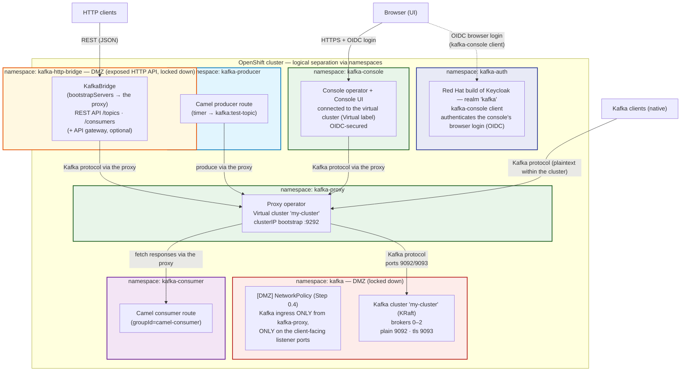

# Setting Up Streams for Apache Kafka Proxy on OpenShift (oc CLI)

Step-by-step instructions for deploying the full stack from the command line using the `oc` client — a **Streams for Apache Kafka cluster**, the **Red Hat build of Keycloak** OIDC authorization server (`kafka-auth` namespace), the **proxy Operator**, a working proxy with a virtual cluster, the **Kafka HTTP Bridge** as a proxy client, the **Streams for Apache Kafka Console** UI, and **Camel Quarkus** producer/consumer clients — with every component integrated into **OpenShift's built-in observability stack** (user-workload monitoring) in [Step 15](#step-15-integrate-the-stack-with-openshift-user-workload-monitoring-observability) — based on the [Streams for Apache Kafka 3.2 proxy documentation](https://docs.redhat.com/en/documentation/red_hat_streams_for_apache_kafka/3.2/html/deploying_and_managing_streams_for_apache_kafka_proxy_on_openshift).

> **Divergences from the Red Hat documentation** (all verified against a live cluster; ready-to-apply manifests in [`deploy/`](deploy/README.md)):
>
> - **Upstream release artifacts** instead of Red Hat subscription downloads — kroxylicious operator **0.25.1** (Step 2) and streamshub console **0.14.2** (Step 13).
> - **Proxy bootstrap port is operator-allocated** — 9292 with the operator versions used here; downstream Streams documentation shows 9082 (Step 11).
> - **Strimzi 0.51 API changes** — the `authentication.type: oauth` listener syntax is gone (configure SASL/OAUTHBEARER via `custom` auth — see Step 1.5).
> - **Unauthenticated data path by design** — the Kafka cluster keeps non-token listeners and the proxy runs without client authentication. This is a deployment choice, not a proxy limitation: the proxy supports SASL/OAUTHBEARER passthrough, inspection, validation, and termination (Step 1.5). Keycloak serves the console's OIDC login (Steps 1, 13).
> - **Camel images built in-cluster** via OpenShift BuildConfigs instead of an external registry (Step 14.4).
> - **Custom filter development documented upstream** — Red Hat 3.2 publishes no filter-development guide; Step 16 follows the upstream Developer Quick Start and Developer Guide for 0.25.1 (the deployed version) and uses the operator's `KROXYLICIOUS_IMAGE` override (present in the operator source, absent from both documentation sets).

---

## Table of Contents

- [Prerequisites](#prerequisites)
- [Step 0: Deploy the Kafka Cluster (Streams for Apache Kafka)](#step-0-deploy-the-kafka-cluster-streams-for-apache-kafka)
- [Step 1: Install Red Hat build of Keycloak (kafka-auth namespace)](#step-1-install-red-hat-build-of-keycloak-kafka-auth-namespace)
- [Step 2: Install the Proxy Operator](#step-2-install-the-proxy-operator)
- [Step 3: Understand the Custom Resources](#step-3-understand-the-custom-resources)
- [Step 4: Create the KafkaProxy Resource](#step-4-create-the-kafkaproxy-resource)
- [Step 5: Choose and Create an Ingress](#step-5-choose-and-create-an-ingress)
- [Step 6: Define the Backend Cluster (KafkaService)](#step-6-define-the-backend-cluster-kafkaservice)
- [Step 7: (Optional) Add a Filter](#step-7-optional-add-a-filter)
- [Step 8: Create the VirtualKafkaCluster](#step-8-create-the-virtualkafkacluster)
- [Step 9: TLS Certificates](#step-9-tls-certificates)
- [Step 10: DNS for Off-Cluster Ingress](#step-10-dns-for-off-cluster-ingress)
- [Step 11: Apply and Verify](#step-11-apply-and-verify)
- [Step 12: Deploy the Kafka HTTP Bridge (DMZ Client)](#step-12-deploy-the-kafka-http-bridge-dmz-client)
- [Step 13: Deploy the Streams for Apache Kafka Console (kafka-console namespace)](#step-13-deploy-the-streams-for-apache-kafka-console-kafka-console-namespace)
- [Step 14: Deploy Camel Producer and Consumer Clients (kafka-producer and kafka-consumer namespaces)](#step-14-deploy-camel-producer-and-consumer-clients-kafka-producer-and-kafka-consumer-namespaces)
- [Step 15: Integrate the Stack with OpenShift User-Workload Monitoring (Observability)](#step-15-integrate-the-stack-with-openshift-user-workload-monitoring-observability)
- [Step 16: Develop and Deploy a Custom Filter (Optional)](#step-16-develop-and-deploy-a-custom-filter-optional)
- [Troubleshooting Tips](#troubleshooting-tips)

---

## Prerequisites

- **OpenShift cluster 4.18 or later** (3.2 is tested on 4.16–4.21, excluding 4.17).
- `oc` CLI installed and configured to connect to the cluster:

  ```bash
  oc login --token=<token> --server=<cluster-url>
  oc whoami
  ```

- An account with permission to create `CustomResourceDefinition` and RBAC (`ClusterRole`) resources (for the operator install):

  ```bash
  oc auth can-i create customresourcedefinitions
  oc auth can-i create clusterroles
  ```

- A **Kafka cluster available to be proxied** — it may run in the same OpenShift cluster or elsewhere; only network connectivity is required. If you don't have one, deploy one with Streams for Apache Kafka in [Step 0](#step-0-deploy-the-kafka-cluster-streams-for-apache-kafka).
- TLS certificate generation capability (for ingress types that require TLS).
- DNS management access (only for `loadBalancer` ingress).

All commands below assume a namespace of `kafka-proxy` — adjust to yours, and create it first if needed:

```bash
oc new-project kafka-proxy
```

> **Declarative namespaces:** every component's first manifest carries its own `Namespace` — applying a component's directory creates its namespace (`kafka` and `kafka-proxy` ship with the operator installs in Steps 0.1/2, `kafka-auth` with the Keycloak operator in Step 1.1, `kafka-http-bridge` with the bridge in Step 12, `kafka-console` with the console operator in Step 13, `kafka-producer`/`kafka-consumer` with the Camel BuildConfigs in Step 14, and the stand-in `api-gateway` with the bridge's DMZ NetworkPolicies). The `oc new-project` commands below remain as a shortcut for step-by-step runs.

### The architecture you'll deploy

By the end of this guide, the stack looks like this — four namespaces, with the Kafka cluster locked into a DMZ that only the proxy can reach:



Each namespace is a **logical isolation boundary**: its own RBAC, service accounts, and NetworkPolicies. Two namespaces form the **DMZ**: the `kafka` namespace (red) holds the brokers, sealed off with no ingress except the proxy, and the `kafka-http-bridge` namespace (amber) holds the exposed HTTP API, locked down by its own NetworkPolicy (Step 12.5). The green namespaces are client-facing services (proxy, console UI), the Camel client workloads are in their own namespaces (`kafka-producer` in light blue, `kafka-consumer` in purple), and `kafka-auth` (blue) holds the identity provider. Everything runs on a single OpenShift cluster, managed by the `oc` commands in this guide.

How to read it:

- **Data path:** native Kafka clients, the HTTP Bridge, the Console, and the Camel producer/consumer all connect to the **proxy's virtual cluster** — never directly to the brokers. The proxy forwards to the Kafka listeners, which only accept connections from the `kafka-proxy` namespace (the DMZ).
- **Identity path:** the console's browser users authenticate to the console UI via OIDC against Keycloak (`kafka-auth`). The Kafka data path runs unauthenticated by design (Step 1.5) — the proxy does support SASL/OAUTHBEARER passthrough and inspection, but this deployment guards broker access with the DMZ NetworkPolicies instead.
- **Each namespace is independently locked down:** Kafka pods (Step 0.4) and the bridge's HTTP API (Step 12.5) enforce ingress NetworkPolicies.
- **Observability path:** OpenShift's user-workload monitoring (Step 15) scrapes the Prometheus metrics endpoints of the Kafka cluster, the proxy and its operator, the bridge, Keycloak, and the Camel clients. The Console reads its cluster metrics from the same monitoring stack. The DMZ NetworkPolicies must therefore let the `openshift-user-workload-monitoring` namespace reach the metrics ports (Step 15.2).

## Step 0: Deploy the Kafka Cluster (Streams for Apache Kafka)

If you don't already have a Kafka cluster, deploy one using **Streams for Apache Kafka** (Strimzi) from the same `streams-3.2-ocp-install-examples.zip` archive. The example below deploys a small **development** cluster; production notes follow.

### 0.1 — Install the Cluster Operator

1. The Cluster Operator manifests are in `install/cluster-operator/`. Choose a namespace for the Kafka cluster (example: `kafka`) and edit the manifests to match:

   ```bash
   oc new-project kafka

   # Linux
   sed -i 's/namespace: .*/namespace: kafka/' install/cluster-operator/*.yaml

   # macOS
   sed -i '' 's/namespace: .*/namespace: kafka/' install/cluster-operator/*.yaml
   ```

   > The Cluster Operator watches the namespace set in the `STRIMZI_NAMESPACE` environment variable of its `Deployment` (defaults to the installation namespace in the manifests). To watch other namespaces, set `STRIMZI_NAMESPACE` to a comma-separated list or use `STRIMZI_NAMESPACE="*"` for all namespaces.

2. Install the Cluster Operator and wait for it to be available:

   ```bash
   oc create -f install/cluster-operator -n kafka

   oc wait --for=condition=Available deployment/strimzi-cluster-operator \
     -n kafka --timeout=180s
   ```

**Alternative: OperatorHub (OLM).** On clusters with the `redhat-operators` catalog, install the operator as the `amq-streams` package from the `amq-streams-3.2.x` channel (Streams for Apache Kafka 3.2) with `installPlanApproval: Manual`. The operator watches the namespaces of its `OperatorGroup` — to watch additional namespaces later (Step 12.1), add them to the OperatorGroup's `spec.targetNamespaces`; OLM regenerates the RBAC and rolls the operator automatically. A ready-to-apply Namespace + OperatorGroup + Subscription file is in [`deploy/kafka/00-cluster-operator-olm.yaml`](deploy/kafka/00-cluster-operator-olm.yaml).

### 0.2 — Create the Kafka cluster

Kafka runs exclusively in **KRaft mode** (no ZooKeeper): you define the cluster with a `Kafka` resource plus `KafkaNodePool` resources. Nodes take the role of **broker**, **controller**, or both (dual-role). This dev example uses a single dual-role node pool with ephemeral storage:

```yaml
# kafka-nodepool.yaml
kind: KafkaNodePool
apiVersion: kafka.strimzi.io/v1
metadata:
  name: dual-role
  namespace: kafka
  labels:
    strimzi.io/cluster: my-cluster
spec:
  replicas: 3
  roles:
    - controller
    - broker
  storage:
    type: ephemeral
```

```yaml
# kafka.yaml
kind: Kafka
apiVersion: kafka.strimzi.io/v1
metadata:
  name: my-cluster
  namespace: kafka
  annotations:
    strimzi.io/node-pools: enabled
spec:
  kafka:
    replicas: 3
    listeners:
      - name: plain
        port: 9092
        type: internal
        tls: false
      - name: tls
        port: 9093
        type: internal
        tls: true
    config:
      offsets.topic.replication.factor: 3
      transaction.state.log.replication.factor: 3
      transaction.state.log.min.isr: 2
      default.replication.factor: 3
      min.insync.replicas: 2
    storage:
      type: ephemeral
```

> In the `v1` API, `.spec.replicas` is required on the `Kafka` resource, and node resources (CPU/memory) are managed through `KafkaNodePool`. Streams for Apache Kafka 3.2 uses **static controller quorums** — controller node pools cannot be scaled after creation.

Apply and wait for readiness:

```bash
oc apply -f kafka-nodepool.yaml -f kafka.yaml -n kafka

oc wait --for=condition=Ready kafka/my-cluster -n kafka --timeout=600s

oc get pods -n kafka
oc get services -n kafka
```

You should see broker pods (`my-cluster-dual-role-0/1/2`) and the bootstrap Service `my-cluster-kafka-bootstrap`.

> **⚠️ Strimzi 0.51 note (listener NetworkPolicy):** the operator auto-generates a listener `NetworkPolicy` named `my-cluster-network-policy-kafka` for every `Kafka` cluster. When a listener has no `networkPolicyPeers`, that generated policy **admit-all namespaces on the listener port** — and because NetworkPolicy rules are additive, it silently defeats the Step 0.4 DMZ (we verified this on 4.22: kcat from an unrelated namespace got through even with a default-deny policy in place). Restrict the generated policy by setting `networkPolicyPeers` **on each listener** (it is a listener-level property, not a `spec.kafka.kafka` key):
>
> ```yaml
>       - name: plain
>         port: 9092
>         type: internal
>         tls: false
>         networkPolicyPeers:
>           - podSelector: {}          # any pod in the kafka namespace (operators, probes)
>           - namespaceSelector:
>               matchLabels:
>                 kubernetes.io/metadata.name: kafka-proxy   # Step 0.4 DMZ client
> ```
>
> Set the same peers on every client-facing listener. The ready-to-apply manifest [deploy/kafka/02-kafka.yaml](deploy/kafka/02-kafka.yaml) already includes this for both listeners.

### 0.3 — Note the connection details for the proxy

This cluster's bootstrap address and broker IDs feed directly into the proxy's `KafkaService` (Step 6):

- `bootstrapServers`: `my-cluster-kafka-bootstrap.kafka.svc.cluster.local:9092` (plain listener)
- Broker node IDs: `0`–`2` → `nodeIdRanges: { start: 0, end: 2 }`

Because the cluster uses the `tls` listener, the proxy can connect over TLS with the Strimzi-generated CA — `trustAnchorRef` on the `KafkaService` can auto-trust it (see Step 6).

> **Production notes:** use **dedicated controller and broker node pools** (at least 3 controllers), `persistent-claim` storage sized for your retention, the `tls` listener with authentication (`tls` client auth or OAuth), and consider Cruise Control for rebalancing. See [*Deploying and Managing Streams for Apache Kafka on OpenShift*](https://docs.redhat.com/en/documentation/red_hat_streams_for_apache_kafka/3.2/html/deploying_and_managing_streams_for_apache_kafka_on_openshift) for full configuration guidance.

## Step 1: Install Red Hat build of Keycloak (kafka-auth namespace)

Deploy the **Red Hat build of Keycloak** as the OIDC authorization server for the platform's browser-facing components — the **Streams for Apache Kafka Console** (Step 13) authenticates its users through it. The **Kafka cluster itself is not wired to Keycloak in this deployment**: the data path runs unauthenticated by design (Step 1.5), though the proxy does support SASL/OAUTHBEARER passthrough if you enable it. Based on the [RHBK 26.4 Operator Guide](https://docs.redhat.com/en/documentation/red_hat_build_of_keycloak/26.4/html/operator_guide) (check [access.redhat.com](https://access.redhat.com/support/policy/updates/red_hat_build_of_keycloak_notes) for the latest supported release).

### 1.1 — Install the Keycloak Operator into `kafka-auth`

The operator is installed via OLM. Namespace, OperatorGroup, and Subscription are consolidated into a single file applied with one `oc apply`:

```yaml
# kafka-auth-operator.yaml
---
apiVersion: v1
kind: Namespace
metadata:
  name: kafka-auth
---
apiVersion: operators.coreos.com/v1
kind: OperatorGroup
metadata:
  name: keycloak-operator-group
  namespace: kafka-auth
spec: {}
---
apiVersion: operators.coreos.com/v1alpha1
kind: Subscription
metadata:
  name: rhbk-operator
  namespace: kafka-auth
spec:
  channel: <desired-channel>          # channel matching the RHBK version you want
  name: rhbk-operator
  source: redhat-operators
  sourceNamespace: openshift-marketplace
  installPlanApproval: Manual         # strongly recommended — see note below
```

> ⚠️ **Use `Manual` approval.** By default OLM auto-upgrades the operator, which pulls in unintended RHBK server upgrades and can require DB migration — with no downgrade path. With `Manual`, approve upgrades deliberately after reviewing release notes and backing up the database.

Apply everything in one step and wait for the operator:

```bash
oc apply -f kafka-auth-operator.yaml

oc get subscriptions -n kafka-auth
oc wait --for=jsonpath='{.status.phase}'=Succeeded csv --all -n kafka-auth --timeout=300s
oc get pods -n kafka-auth
```

> `oc apply -f <dir-or-file>` creates the namespace, the OperatorGroup, and subscribes in a single transaction — note that `Namespace`/`OperatorGroup`/`Subscription` resources must be applied together (as in this file) so the OperatorGroup exists when the Subscription is validated.

### 1.2 — Provision a database (dev: ephemeral PostgreSQL)

The operator does **not** manage the database. For development, deploy an ephemeral PostgreSQL:

```yaml
# postgres.yaml
apiVersion: apps/v1
kind: StatefulSet
metadata:
  name: postgresql-db
spec:
  serviceName: postgresql-db-service
  selector:
    matchLabels:
      app: postgresql-db
  replicas: 1
  template:
    metadata:
      labels:
        app: postgresql-db
    spec:
      containers:
        - name: postgresql-db
          image: postgres:15
          volumeMounts:
            - mountPath: /data
              name: cache-volume
          env:
            - name: POSTGRES_USER
              value: testuser
            - name: POSTGRES_PASSWORD
              value: testpassword
            - name: PGDATA
              value: /data/pgdata
            - name: POSTGRES_DB
              value: keycloak
      volumes:
        - name: cache-volume
          emptyDir: {}
---
apiVersion: v1
kind: Service
metadata:
  name: postgres-db
spec:
  selector:
    app: postgresql-db
    ports:
      - port: 5432
        targetPort: 5432
```

```bash
oc apply -f postgres.yaml -n kafka-auth

# Store the DB credentials in a Secret
oc create secret generic keycloak-db-secret \
  --from-literal=username=testuser \
  --from-literal=password=testpassword \
  -n kafka-auth
```

> **Production:** provision a supported database with persistent storage (cloud offering or a database operator) — not the ephemeral dev setup above.

### 1.3 — TLS certificate and Keycloak deployment

For development, generate a self-signed certificate and deploy Keycloak with an OpenShift-assigned hostname (`ingress.className: openshift-default` lets the operator assign one):

```bash
# The certificate MUST carry a SAN for the resulting route hostname — the
# broker-side JWKS fetch validates the hostname against the cert, and a plain
# CN is not enough (the brokers will fail to start). Discover the hostname the
# operator will assign first (<cr-name>-ingress-<namespace>.<cluster-domain>),
# or generate the cert after the Route exists and replace the Secret.
openssl req -new -newkey rsa:2048 -nodes \
  -subj '/CN=kafka-auth/O=Kafka Auth./C=US' \
  -addext "subjectAltName=DNS:keycloak-ingress-kafka-auth.<cluster-domain>" \
  -keyout key.pem -x509 -days 365 -out certificate.pem

oc create secret tls keycloak-tls-secret --cert certificate.pem --key key.pem -n kafka-auth
```

```yaml
# keycloak.yaml
apiVersion: k8s.keycloak.org/v2alpha1
kind: Keycloak
metadata:
  name: keycloak
  namespace: kafka-auth
spec:
  instances: 1
  db:
    vendor: postgres
    host: postgres-db
    usernameSecret:
      name: keycloak-db-secret
      key: username
    passwordSecret:
      name: keycloak-db-secret
      key: password
  http:
    tlsSecret: keycloak-tls-secret
  hostname:
    hostname: kafka-auth.example.com   # or leave unpopulated with the openshift-default IngressClass
  ingress:
    className: openshift-default
  proxy:
    headers: xforwarded
```

Apply and wait for readiness:

```bash
oc apply -f keycloak.yaml -n kafka-auth

oc wait --for=condition=Ready keycloak/keycloak -n kafka-auth --timeout=600s
oc get keycloaks/keycloak -n kafka-auth \
  -o go-template='{{range .status.conditions}}CONDITION: {{.type}}  STATUS: {{.status}}{{"\n"}}{{end}}'
```

Fetch the initial admin credentials (the operator stores them in a Secret):

```bash
oc get secret keycloak-initial-admin -o jsonpath='{.data.username}' | base64 --decode
oc get secret keycloak-initial-admin -o jsonpath='{.data.password}' | base64 --decode
```

> **Production:** change the initial admin credentials, enable MFA, and use a real hostname with a CA-signed certificate. Restrict who can create/edit `Keycloak` and `KeycloakRealmImport` CRs — they effectively hold namespace-level privileges.

### 1.4 — Create the `kafka` realm and the console client

Automate realm creation with a `KeycloakRealmImport` CR. The import creates the `kafka` realm with the client the platform's OIDC consumer needs — the **Streams for Apache Kafka Console** (Step 13):

```yaml
# kafka-realm-import.yaml
apiVersion: k8s.keycloak.org/v2alpha1
kind: KeycloakRealmImport
metadata:
  name: kafka-realm-import
  namespace: kafka-auth
spec:
  keycloakCRName: keycloak
  realm:
    realm: kafka
    enabled: true
    # Short-lived access tokens (5 min) — access stops quickly on revocation
    accessTokenLifespan: 300
    clients:
      # Console client — browser login (standard flow) for the Streams for
      # Apache Kafka Console UI (Step 13); set the redirect URI to the
      # console's hostname after deployment
      - clientId: kafka-console
        enabled: true
        protocol: openid-connect
        publicClient: false
        secret: kafka-console-secret
        standardFlowEnabled: true
        serviceAccountsEnabled: false
```

Where the client is used:

| Client | Used by | Where |
|---|---|---|
| `kafka-console` | Console UI (OIDC browser login, standard flow) | Step 13.3 |

```bash
oc apply -f kafka-realm-import.yaml -n kafka-auth
oc wait --for=condition=Done keycloakrealmimport/kafka-realm-import -n kafka-auth --timeout=300s
```

Verify the OIDC endpoints are reachable (the same endpoints the console's OIDC login uses):

```bash
oc get routes -n kafka-auth
# Token endpoint: https://<keycloak-hostname>/realms/kafka/protocol/openid-connect/token

curl -s https://<keycloak-hostname>/realms/kafka/protocol/openid-connect/token \
  -d grant_type=password \
  -d client_id=kafka-console \
  -d username=demo -d password=demopassword | jq -r .access_token
```

> The client's `secret` above is defined inline for simplicity. In production, store client secrets in Keycloak (rotated there) or in a Secret-backed vault rather than committing them in YAML — and keep the `kafka-auth` namespace access tightly restricted.

### 1.5 — Client authentication at the proxy

The proxy supports client authentication, and identity-aware filters (`Authorization`, `EntityIsolation`) require it — without authentication the proxy's subject is anonymous. The options — mTLS is documented in the Red Hat [Deploying and Managing guide](https://docs.redhat.com/en/documentation/red_hat_streams_for_apache_kafka/3.2/html/deploying_and_managing_streams_for_apache_kafka_proxy_on_openshift) (Securing a proxy → mutual TLS), SASL Passthrough Inspection in the Red Hat [SASL Inspection filter guide](https://docs.redhat.com/en/documentation/red_hat_streams_for_apache_kafka/3.2/html/sasl_inspection_filter_guide); the upstream [Client Authentication guide](https://kroxylicious.io/documentation/0.25.1/html/authentication-guide) additionally documents SASL Passthrough, OAuthBearer Validation, and SASL Termination:

| Approach | Filter | Broker keeps auth authority? | Infrastructure |
|---|---|---|---|
| mTLS | — (virtual cluster `tls.trust`) | — | PKI for client certificates |
| SASL Passthrough *(default)* | none | Yes — ACLs, audit logging, quotas keep working | None |
| SASL Passthrough Inspection | `SaslInspection` | Yes — proxy extracts the end-client principal (OAUTHBEARER, SCRAM-SHA-256/512 enabled by default; PLAIN opt-in) | None |
| OAuthBearer Validation | `OauthBearerValidation` | Yes — proxy rejects invalid/expired JWTs (JWKS, audience, issuer) before they reach the broker | JWKS endpoint |
| SASL Termination | `SaslTermination` | No — proxy authenticates the client itself (OAUTHBEARER or SCRAM) | JWKS endpoint or SCRAM credential store |

**This deployment runs the data path unauthenticated by design.** The Kafka cluster keeps its non-token listeners (`plain` for inter-broker and in-cluster clients, `tls` where encryption is needed), no `KafkaProtocolFilter` is configured, and the SASL exchange never enters the picture. The trade-off is explicit:

- **Broker isolation comes from the DMZ** (Step 0.4): Kafka ingress is denied to everything except the `kafka-proxy` namespace, on the client-facing listener ports only. Anything that can reach the proxy's virtual cluster can reach the brokers — treat proxy access as broker access.
- **Keycloak stays in the stack for the console's OIDC login** (Step 13) — that path authenticates browser users to the console UI, not Kafka tokens to brokers, and works entirely without proxy involvement.
- Identity-aware proxy filters (`Authorization`, `EntityIsolation`) are **not usable** in this configuration — they need an authenticated subject (mTLS or one of the SASL modes).

**To enable OAuth 2.0 with Keycloak on the data path** (use case [5 in the guide](README.md#5-oidc--oauth-20-authentication-with-red-hat-build-of-keycloak)):

1. Add an OAuth listener to the Kafka cluster — in Streams 3.2 (Strimzi 0.51) the dedicated `authentication.type: oauth` listener type is gone, so configure SASL/OAUTHBEARER via the `custom` authentication type with the Strimzi OAuth callback handlers, and set `inter.broker.listener.name` to a non-OAuth listener.
2. Create the Keycloak clients the workloads need (broker validation, per-workload service accounts) in the `kafka` realm from Step 1.4.
3. Add `KafkaProtocolFilter` resources in `kafka-proxy` and wire them to the virtual cluster with `spec.filterRefs` — e.g. `SaslInspection` with `enabledMechanisms: [OAUTHBEARER]`, plus `OauthBearerValidation` with `jwksEndpointUrl` pointing at Keycloak's `…/realms/kafka/protocol/openid-connect/certs`:

   ```yaml
   kind: KafkaProtocolFilter
   metadata:
     name: sasl-inspection
     namespace: kafka-proxy
   spec:
     type: SaslInspection
     configTemplate:
       enabledMechanisms: [ "OAUTHBEARER" ]
   ---
   kind: KafkaProtocolFilter
   metadata:
     name: oauthbearer-validation
     namespace: kafka-proxy
   spec:
     type: OauthBearerValidation
     configTemplate:
       jwksEndpointUrl: https://<keycloak-hostname>/realms/kafka/protocol/openid-connect/certs
       expectedIssuer: https://<keycloak-hostname>/realms/kafka
   ```

   The proxy must trust Keycloak's TLS certificate to fetch the JWKS (mount the CA from Step 1.3 into the proxy pod via the `KafkaProxy` resource's pod template, or use a CA-signed certificate for Keycloak).

4. Configure the clients (bridge, Camel, CLI) with `SASL/OAUTHBEARER` and the Strimzi OAuth client login callback handler, obtaining tokens from Keycloak's token endpoint.

> An OAuth-secured Kafka cluster *outside* the proxy path (clients connect directly) remains a valid alternative — the same `custom` authentication configuration applies, without the filter step.


### 0.4 — Restrict Kafka ingress to the proxy namespace (DMZ)

Because the goal is to run the proxy in a **DMZ**, lock down the Kafka cluster's network surface: the only namespace allowed to reach the Kafka listeners is `kafka-proxy`. Kubernetes `NetworkPolicy` rules are additive, so combine three policies on the Kafka pods (selected by the Strimzi label `strimzi.io/cluster: my-cluster`):

1. **Default deny** — block all ingress to Kafka pods.
2. **Same-namespace** — allow all traffic from within the `kafka` namespace (controller↔broker on the control-plane port, broker↔broker replication, Cluster/Entity Operator, Cruise Control).
3. **Proxy-only clients** — allow ingress from the `kafka-proxy` namespace **only** on the client-facing listener ports (9092 plain, 9093 TLS).

```yaml
# kafka-netpol-dmz.yaml
---
# 1. Default deny: no ingress to Kafka pods at all
kind: NetworkPolicy
apiVersion: networking.k8s.io/v1
metadata:
  name: my-cluster-deny-ingress
  namespace: kafka
spec:
  podSelector:
    matchLabels:
      strimzi.io/cluster: my-cluster
  policyTypes:
    - Ingress
  ingress: []
---
# 2. Allow all traffic from within the kafka namespace
#    (control plane 9091, broker replication, Cluster/Entity Operator)
kind: NetworkPolicy
apiVersion: networking.k8s.io/v1
metadata:
  name: my-cluster-allow-same-namespace
  namespace: kafka
spec:
  podSelector:
    matchLabels:
      strimzi.io/cluster: my-cluster
  ingress:
    - from:
        - podSelector: {}   # any pod in the kafka namespace
---
# 3. DMZ ingress: only the kafka-proxy namespace, only on client-facing ports
kind: NetworkPolicy
apiVersion: networking.k8s.io/v1
metadata:
  name: my-cluster-allow-proxy
  namespace: kafka
spec:
  podSelector:
    matchLabels:
      strimzi.io/cluster: my-cluster
  ingress:
    - from:
        - namespaceSelector:
            matchLabels:
              kubernetes.io/metadata.name: kafka-proxy
      ports:
        - port: 9092
          protocol: TCP
        - port: 9093
          protocol: TCP
```

Apply and verify:

```bash
oc apply -f kafka-netpol-dmz.yaml -n kafka
oc get networkpolicies -n kafka
```

Verify the DMZ behaves as intended:

```bash
# From another namespace (e.g., default): connection should TIME OUT
oc run kcat-blocked --rm -i --restart=Never --image=confluentinc/cp-kcat:latest -n default -- \
  -b my-cluster-kafka-bootstrap.kafka.svc.cluster.local:9092 -L

# From the kafka-proxy namespace: connection succeeds (this is what the proxy uses)
oc run kcat-allowed --rm -i --restart=Never --image=confluentinc/cp-kcat:latest -n kafka-proxy -- \
  -b my-cluster-kafka-bootstrap.kafka.svc.cluster.local:9092 -L
```

Notes:

- **Cluster Operator in another namespace?** The same-namespace rule covers the operator because this guide installs it into `kafka`. If yours runs elsewhere, add a `namespaceSelector` entry for its namespace to policy 2.
- **Strimzi-generated listener policy:** since Streams 3.2 (Strimzi 0.51), the operator also creates `my-cluster-network-policy-kafka` — without per-listener `networkPolicyPeers` (see [Step 0.2](#02--create-the-kafka-cluster)) it permits **all namespaces** on the listener ports, which defeats this DMZ. After applying, list `oc get networkpolicies -n kafka` and confirm the generated policy's listener rules honour the peers you set.
- **Direct-broker checks**: with the DMZ in place, "consume directly from the broker" verification (e.g., checking ciphertext after enabling Record Encryption) must run from the `kafka` or `kafka-proxy` namespace — from any other namespace it will be denied. That denial is the point.
- **Do not** add a `kubernetes.io/metadata.name: kafka` label requirement to policy 2 — podSelector rules already match by namespace; keep the same-namespace rule as shown.
- For defense in depth, also restrict the `kafka-proxy` namespace's **egress** to the Kafka brokers (plus the operator/API servers) so the proxy pod cannot be used as a pivot into the cluster.

## Step 2: Install the Proxy Operator

### Recommended: installation files

1. Download the release archive `streams-3.2-ocp-install-examples.zip` from the [Streams for Apache Kafka software downloads page](https://access.redhat.com/jbossnetwork/restricted/listSoftware.html?downloadType=distributions&product=jboss.amq.streams) and extract it:

   ```bash
   unzip streams-3.2-ocp-install-examples.zip -d streams-kafka-proxy
   cd streams-kafka-proxy
   ```

   - `install/` contains the YAML manifests for the operator.
   - `examples/` contains example custom resources for deploying a proxy.

2. Choose the namespace the operator will run in (example: `kafka-proxy`) and edit the installation files to match:

   ```bash
   oc new-project kafka-proxy

   # Linux
   sed -i 's/namespace: .*/namespace: kafka-proxy/' install/*.yaml

   # macOS
   sed -i '' 's/namespace: .*/namespace: kafka-proxy/' install/*.yaml
   ```

3. Deploy the operator (creates the CRDs, RBAC, and operator deployment):

   ```bash
   oc create -f install
   ```

4. Verify the deployment:

   ```bash
   oc wait --for=condition=Available deployment/kafka-proxy \
     -n kafka-proxy --timeout=120s

   oc get deployments -n kafka-proxy
   ```

   Expected output:

   ```text
   NAME                      READY  UP-TO-DATE  AVAILABLE
   kafka-proxy               1/1    1           1
   ```

### Alternative: OperatorHub (consolidated YAML)

If you prefer an OLM-managed install, consolidate Namespace, OperatorGroup, and Subscription into one file and apply it with `oc apply`. First discover the exact package name:

```bash
oc get packagemanifests -n openshift-marketplace | grep -i "proxy"
```

```yaml
# kafka-proxy-operator-subscription.yaml
---
apiVersion: v1
kind: Namespace
metadata:
  name: kafka-proxy
---
apiVersion: operators.coreos.com/v1
kind: OperatorGroup
metadata:
  name: proxy-operator-group
  namespace: kafka-proxy
spec: {}   # global OperatorGroup — the operator watches and manages proxies cluster-wide
---
apiVersion: operators.coreos.com/v1alpha1
kind: Subscription
metadata:
  name: streams-kafka-proxy-operator
  namespace: kafka-proxy
spec:
  channel: alpha                # or amq-streams-X.Y.x for version-pinned updates
  name: <package-name>          # from the packagemanifests output above
  source: redhat-operators
  sourceNamespace: openshift-marketplace
  installPlanApproval: Manual   # auto-upgrades on the default alpha channel skip pre-upgrade steps
```

```bash
oc apply -f kafka-proxy-operator-subscription.yaml

oc get subscriptions -n kafka-proxy
oc wait --for=jsonpath='{.status.phase}'=Succeeded csv --all -n kafka-proxy --timeout=300s
```

The rest of this guide works identically regardless of install method.

## Step 3: Understand the Custom Resources

The operator consumes these custom resources (API version `kroxylicious.io/v1alpha1`) and generates the OpenShift `Deployment`, `Service`, and `ConfigMap` resources that run the proxy:

| Resource | Purpose |
|---|---|
| `KafkaProxy` | An instance of the proxy; the top-level resource linking everything together |
| `KafkaProxyIngress` | How a virtual cluster is exposed on the network |
| `KafkaService` | The backend (upstream) Kafka cluster |
| `VirtualKafkaCluster` | The logical cluster presented to clients |
| `KafkaProtocolFilter` | Filter applied to traffic on a virtual cluster |
| `Secret` / `ConfigMap` | Referenced by `KafkaService` / `KafkaProtocolFilter` for TLS certs, tokens, and CA material |

> The API is deliberately decomposed (similar to the Kubernetes Gateway API), so you can use RBAC to split responsibility — e.g., network teams own `KafkaProxy`/`KafkaProxyIngress`, application teams own `VirtualKafkaCluster`/`KafkaService`/`KafkaProtocolFilter`.

## Step 4: Create the KafkaProxy Resource

An empty `spec` creates a proxy with default configuration:

```yaml
kind: KafkaProxy
apiVersion: kroxylicious.io/v1alpha1
metadata:
  namespace: kafka-proxy
  name: simple
spec: {}
```

## Step 5: Choose and Create an Ingress

A `KafkaProxyIngress` defines how clients reach the virtual cluster. It belongs to one `KafkaProxy` (via `proxyRef`) but can be shared by multiple virtual clusters.

| Ingress Type | Use case | Transport | DNS changes needed? |
|---|---|---|---|
| `clusterIP` | On-cluster applications | TCP / TLS | No |
| `loadBalancer` | Off-cluster applications | TLS only | Yes |
| `openShiftRoute` | Off-cluster applications (OpenShift only) | TLS only | No — hostnames assigned by OpenShift |

**clusterIP (TCP or TLS)** — uses a `ClusterIP` Service; for on-cluster clients:

```yaml
kind: KafkaProxyIngress
apiVersion: kroxylicious.io/v1alpha1
metadata:
  namespace: kafka-proxy
  name: cluster-ip
spec:
  proxyRef:
    name: simple
  clusterIP:
    protocol: TCP        # or TLS
```

**loadBalancer (TLS only)** — uses a `LoadBalancer` Service; the proxy uses SNI to route, so every bootstrap and broker address must be unique in DNS. The `$(nodeId)` token is required in the broker pattern; `$(virtualClusterName)` may be used when sharing the ingress across virtual clusters:

```yaml
kind: KafkaProxyIngress
apiVersion: kroxylicious.io/v1alpha1
metadata:
  namespace: kafka-proxy
  name: load-balancer
spec:
  proxyRef:
    name: simple
  loadBalancer:
    bootstrapAddress: "$(virtualClusterName).kafkaproxy.example.com"
    advertisedBrokerAddressPattern: "broker-$(nodeId).$(virtualClusterName).kafkaproxy.example.com"
```

**openShiftRoute (TLS only)** — uses OpenShift `Route` resources; bootstrap and broker hostnames are generated automatically as `<virtualClusterName>-bootstrap.<ingressDomain>:443` and `<virtualClusterName>-<nodeId>.<ingressDomain>:443`:

```yaml
kind: KafkaProxyIngress
apiVersion: kroxylicious.io/v1alpha1
metadata:
  namespace: kafka-proxy
  name: openshift-route
spec:
  proxyRef:
    name: simple
  openShiftRoute: {}
```

> TLS is recommended for production connections. `loadBalancer` and `openShiftRoute` support TLS only.

## Step 6: Define the Backend Cluster (KafkaService)

The `KafkaService` describes the upstream Kafka cluster. Declare the full range of broker node IDs:

```yaml
kind: KafkaService
apiVersion: kroxylicious.io/v1alpha1
metadata:
  namespace: kafka-proxy
  name: my-cluster
spec:
  bootstrapServers: my-cluster-kafka-bootstrap.kafka.svc.cluster.local:9092  # the cluster from Step 0
  nodeIdRanges:
    - name: brokers
      start: 0
      end: 2
```

- `bootstrapServers` specifies a comma-separated list of addresses in `<host>:<port>` format. Including multiple broker addresses helps clients connect when one is unavailable. For an external cluster, use its reachable bootstrap address (e.g., `kafka.example.com:9092`).
- `nodeIdRanges` must cover **all** broker node IDs in the target cluster (`start` and `end` inclusive). For the cluster deployed in Step 0, the dual-role broker IDs are `0`–`2`; check your `Kafka`/`KafkaNodePool` resources otherwise.
- TLS to the upstream can be configured here — for a cluster using the `tls` listener, `trustAnchorRef` accepts a `Secret`, and the operator can auto-trust the Strimzi-generated CA anchor.

## Step 7: (Optional) Add a Filter

A `KafkaProtocolFilter` is reusable across virtual clusters in the same namespace. `spec.type` names the filter implementation and `spec.configTemplate` carries the configuration (subject to operator interpolation):

```yaml
kind: KafkaProtocolFilter
apiVersion: kroxylicious.io/v1alpha1
metadata:
  namespace: kafka-proxy
  name: my-filter
spec:
  type: RecordValidation
  configTemplate:
    rules:
      - topicNames:
          - my-topic
        valueRule:
          syntacticallyCorrectJson:
            allowNulls: false
            allowEmpty: false
```

Start with **no filters** to validate basic connectivity, then add one at a time. See the [use case catalog](README.md#use-case-catalog) for Record Encryption and Record Validation configuration.

## Step 8: Create the VirtualKafkaCluster

The `VirtualKafkaCluster` wires everything together. All referenced resources must be in the same namespace. Filter order matters: client requests pass through filters from index `0` to `n`; broker responses pass through in reverse order. An empty/omitted `filterRefs` passes traffic through unchanged.

Minimal example (single ingress, one filter, on-cluster clients):

```yaml
kind: VirtualKafkaCluster
apiVersion: kroxylicious.io/v1alpha1
metadata:
  name: my-cluster
  namespace: kafka-proxy
spec:
  proxyRef:
    name: simple
  targetKafkaServiceRef:
    name: my-cluster
  ingresses:
    - ingressRef:
        name: cluster-ip
  filterRefs:
    - name: my-filter
```

TLS-enabled example with two ingresses (on- and off-cluster clients), each with its own server certificate:

```yaml
kind: VirtualKafkaCluster
apiVersion: kroxylicious.io/v1alpha1
metadata:
  name: my-cluster
  namespace: kafka-proxy
spec:
  proxyRef:
    name: simple
  targetKafkaServiceRef:
    name: my-cluster
  ingresses:
    - ingressRef:
        name: cluster-ip
      tls:
        certificateRef:
          name: cluster-ip-server-cert
          kind: Secret
    - ingressRef:
        name: load-balancer
      tls:
        certificateRef:
          name: external-server-cert
          kind: Secret
  filterRefs:
    - name: my-filter
```

## Step 9: TLS Certificates

TLS ingress types need a server certificate provided as a `Secret` of type `kubernetes.io/tls`:

```bash
oc create secret tls <secret-name> --namespace <namespace> --cert=<path/to/cert/file> --key=<path/to/key/file>
```

Certificate requirements:

- **PKCS#8 encoded PEM** private key, not password protected.
- **SANs must cover every address** clients will use (or use a wildcard certificate).
- Signed by a CA trusted by the **connecting applications** (on-cluster CA for `clusterIP`, off-cluster/public CA for `loadBalancer` and `openShiftRoute`).

Which SANs are needed per ingress type (assuming virtual cluster `my-cluster`, brokers 0–2):

| Ingress | SANs |
|---|---|
| `clusterIP` | `my-cluster-cluster-ip-bootstrap.<namespace>.svc.cluster.local` plus `my-cluster-cluster-ip-<nodeId>.<namespace>.svc.cluster.local` for each broker |
| `loadBalancer` | `mycluster.kafkaproxy.example.com` plus `broker-<nodeId>.mycluster.kafkaproxy.example.com` (derived from your `bootstrapAddress` / `advertisedBrokerAddressPattern`) |
| `openShiftRoute` | `mycluster-bootstrap.<ingressDomain>` plus `mycluster-<nodeId>.<ingressDomain>` — look up the ingress domain first: |

```bash
oc get ingresscontrollers.operator.openshift.io -n openshift-ingress-operator default -o=jsonpath='{.status.domain}'
```

> Ingress Controller sharding can result in different ingress domains per address — include all of them as SANs.
>
> Concretely, for this guide's `kafka-proxy` namespace with brokers 0–2, the `clusterIP` SANs are:
>
> ```text
> my-cluster-cluster-ip-bootstrap.kafka-proxy.svc.cluster.local
> my-cluster-cluster-ip-0.kafka-proxy.svc.cluster.local
> my-cluster-cluster-ip-1.kafka-proxy.svc.cluster.local
> my-cluster-cluster-ip-2.kafka-proxy.svc.cluster.local
> ```

## Step 10: DNS for Off-Cluster Ingress

**`openShiftRoute`**: nothing to do — OpenShift assigns the hostnames.

**`loadBalancer`**: bootstrap and broker names must resolve to the load balancer's external address:

1. Discover the external address:

   ```bash
   oc get virtualkafkacluster -n <namespace> <virtual-cluster-name> \
     -o=jsonpath='{.status.ingresses[?(@.name == "<ingress-name>")].loadBalancerIngressPoints}'
   ```

2. Create DNS mappings (example for `my-cluster` with brokers 0–2):

   ```text
   my-cluster.kafkaproxy.example.com            => <external address>
   broker-0.my-cluster.kafkaproxy.example.com   => <external address>
   broker-1.my-cluster.kafkaproxy.example.com   => <external address>
   broker-2.my-cluster.kafkaproxy.example.com   => <external address>
   ```

3. Verify resolution from the application network:

   ```bash
   nslookup my-cluster.kafkaproxy.example.com
   nslookup broker-0.my-cluster.kafkaproxy.example.com
   ```

## Step 11: Apply and Verify

1. Apply the resources (order doesn't strictly matter — the operator reconciles references):

   ```bash
   oc apply -f kafkaproxy.yaml -f ingress.yaml -f kafkaservice.yaml -f virtualcluster.yaml
   ```

2. **Wait for the operator to reconcile the resources.** The operator reports status conditions on the custom resources:

   - `ResolvedRefs=True` — all referenced resources exist (`KafkaProxy`, `KafkaProxyIngress`, `Secret`, ...)
   - `Accepted=True` — the configuration was successfully applied to the proxy

   ```bash
   oc wait --for=condition=ResolvedRefs=True virtualkafkacluster/my-cluster \
     -n kafka-proxy --timeout=120s

   oc wait --for=condition=Accepted=True virtualkafkacluster/my-cluster \
     -n kafka-proxy --timeout=120s

   oc wait --for=condition=ResolvedRefs=True kafkaproxyingress/cluster-ip \
     -n kafka-proxy --timeout=120s
   ```

   If these time out, inspect the conditions for `reason` and `message` details:

   ```bash
   oc get virtualkafkacluster my-cluster -n kafka-proxy \
     -o jsonpath='{.status.conditions}' | jq
   ```

3. **Wait for the proxy pods to be ready.** The operator creates a `Deployment` named after the `KafkaProxy` resource (here: `simple`):

   ```bash
   oc wait --for=condition=Available deployment/simple -n kafka-proxy --timeout=120s
   oc get pods -n kafka-proxy
   ```

4. Connect a client using the bootstrap address for your ingress type:
   - `clusterIP`: `<virtual-cluster>-<ingress>-bootstrap.<namespace>.svc.cluster.local` — the port is **operator-allocated**; get it from the generated Service or from `oc get virtualkafkacluster <name> -o jsonpath='{.status.ingresses[].bootstrapServer}'` (9292 with the operator versions this guide installs):

     ```bash
     oc get services -n kafka-proxy
     ```

   - `loadBalancer` / `openShiftRoute`: the bootstrap address from your DNS/Route configuration.

5. **Smoke-test end-to-end (plain TCP)** from inside the cluster with `kcat` (adjust image/bootstrap as needed):

   ```bash
   oc run kcat-producer --rm -i --restart=Never --image=confluentinc/cp-kcat:latest -- \
     -b my-cluster-cluster-ip-bootstrap.kafka-proxy.svc.cluster.local:9292 \
     -t test-topic -P -l <<< "hello through the proxy"

   oc run kcat-consumer --rm -i --restart=Never --image=confluentinc/cp-kcat:latest -- \
     -b my-cluster-cluster-ip-bootstrap.kafka-proxy.svc.cluster.local:9292 \
     -t test-topic -C -o beginning
   ```

6. **Smoke-test end-to-end (TLS variant)** — for TLS ingresses (`clusterIP` with `protocol: TLS`, `loadBalancer`, or `openShiftRoute`), the client must trust the CA that signed the proxy's server certificate. Extract the CA, make it available to the test pod via a ConfigMap, and point kcat at it:

   ```bash
   # 1. Extract the CA certificate (from the Secret/ConfigMap holding the signing CA)
   oc get secret <ca-secret> -n kafka-proxy -o jsonpath='{.data.ca\.crt}' | base64 -d > ca.crt

   # 2. Provide it to the test pod as a ConfigMap
   oc create configmap proxy-ca --from-file=ca.crt -n kafka-proxy

   # 3. Run kcat with the CA mounted and TLS enabled
   oc run kcat-producer --rm -i --restart=Never \
     --image=confluentinc/cp-kcat:latest \
     --overrides='{
       "spec": {
         "volumes": [{"name": "proxy-ca", "configMap": {"name": "proxy-ca"}}],
         "containers": [{
           "name": "kcat-producer",
           "volumeMounts": [{"name": "proxy-ca", "mountPath": "/etc/proxy-ca", "readOnly": true}]
         }]
       }
     }' -- \
     -b my-cluster-cluster-ip-bootstrap.kafka-proxy.svc.cluster.local:9083 \
     -t test-topic -P -l \
     -X security.protocol=SSL \
     -X ssl.ca.location=/etc/proxy-ca/ca.crt \
     <<< "hello through the proxy (TLS)"
   ```

   Notes for the TLS variant:

   - Connect using the **SAN name from the server certificate** (the generated bootstrap hostname) so SNI and certificate validation succeed — never an IP address.
   - `openShiftRoute` bootstrap endpoints use port **443**.
   - If the ingress uses client-certificate (mutual TLS) authentication, add `-X ssl.key.location`, `-X ssl.certificate.location`, and `-X ssl.key.password` as required.
   - `-X enable.ssl.certificate.verification=false` can be used **for quick smoke tests only** — never in production.

7. Continue with [Getting Started](README.md#getting-started-on-openshift) to add filters.

## Step 12: Deploy the Kafka HTTP Bridge (DMZ Client)

The **HTTP Bridge** exposes the Kafka cluster over a REST API (`/topics`, `/consumers`), so HTTP clients — scripts, lightweight services, systems where a Kafka client library is impractical — can produce and consume without a native Kafka protocol connection. Deployed via the Cluster Operator as a `KafkaBridge` resource, it integrates with the proxy by being a **plain Kafka client of the virtual cluster**: point its `bootstrapServers` at the proxy's clusterIP bootstrap Service so HTTP traffic flows **through the proxy**, keeping the DMZ intact.

Placing the bridge in its own **`kafka-http-bridge` namespace** keeps the HTTP API isolated from both the proxy and the brokers — external HTTP clients reach only this namespace, and the bridge→proxy→broker path stays inside the DMZ. Based on the [Using the Streams for Apache Kafka HTTP Bridge](https://docs.redhat.com/en/documentation/red_hat_streams_for_apache_kafka/3.2/html/using_the_streams_for_apache_kafka_http_bridge) guide.

### 12.1 — Create the namespace and extend the Cluster Operator watch

Create the namespace:

```bash
oc new-project kafka-http-bridge
```

The Cluster Operator (Step 0) watches only the `kafka` namespace, so it would not reconcile a `KafkaBridge` in `kafka-http-bridge`. Extend its watch scope:

```bash
# 1. Add kafka-http-bridge to STRIMZI_NAMESPACE in the operator Deployment
oc set env deployment/strimzi-cluster-operator -n kafka STRIMZI_NAMESPACE=kafka,kafka-http-bridge

# 2. Install the RoleBindings for the watched namespace
sed -i 's/namespace: .*/namespace: kafka/' install/cluster-operator/*RoleBinding*.yaml
oc apply -f install/cluster-operator/020-RoleBinding-strimzi-cluster-operator.yaml -n kafka-http-bridge
oc apply -f install/cluster-operator/023-RoleBinding-strimzi-cluster-operator.yaml -n kafka-http-bridge
oc apply -f install/cluster-operator/031-RoleBinding-strimzi-cluster-operator-entity-operator-delegation.yaml -n kafka-http-bridge

# 3. Restart the operator to pick up the new watch scope
oc rollout restart deployment/strimzi-cluster-operator -n kafka
```

 > Alternatively, set `STRIMZI_NAMESPACE="*"` to watch all namespaces (see [Deploying the Cluster Operator to watch all namespaces](https://strimzi.io/docs/operators/latest/deploying.html#deploying-cluster-operator-to-watch-whole-cluster-str)).

> **OLM-installed operator?** Skip the steps above — do not edit the OLM-managed Deployment (OLM reverts it). Instead add the namespace to the operator's `OperatorGroup` and let OLM regenerate the RBAC and roll the operator — either by patching, or (declarative) by applying the updated OperatorGroup manifest:
>
> ```bash
> oc patch operatorgroup <operator-group-name> -n kafka --type merge \
>   -p '{"spec":{"targetNamespaces":["kafka","kafka-http-bridge"]}}'
> # or: oc apply -f deploy/kafka/00-cluster-operator-olm.yaml
> ```

### 12.2 — Deploy the bridge with a `KafkaBridge` resource

The bridge runs in the `kafka-http-bridge` namespace and connects to the **proxy's clusterIP bootstrap** (from Step 11 — verify the exact port with `oc get services -n kafka-proxy`):

```yaml
# kafka-bridge.yaml
apiVersion: kafka.strimzi.io/v1
kind: KafkaBridge
metadata:
  name: my-bridge
  namespace: kafka-http-bridge
spec:
  # Replicas (required)
  replicas: 1
  # Kafka bootstrap servers (required) — the PROXY's clusterIP bootstrap, not the Kafka cluster's
  bootstrapServers: my-cluster-cluster-ip-bootstrap.kafka-proxy.svc.cluster.local:9292
  # HTTP configuration (required)
  http:
    port: 8080
  # If the proxy's clusterIP ingress uses TLS, trust the CA that signed the proxy's
  # server certificate (same CA extracted in Step 11, TLS variant — create the Secret
  # in THIS namespace, not kafka-proxy):
  # tls:
  #   trustedCertificates:
  #     - secretName: proxy-ca
  #       certificate: ca.crt
```

Apply and wait for readiness:

```bash
oc apply -f kafka-bridge.yaml -n kafka-http-bridge

oc wait --for=condition=Ready kafkabridge/my-bridge -n kafka-http-bridge --timeout=300s
oc get pods -n kafka-http-bridge
```

Expected output:

```text
NAME                          READY  STATUS   RESTARTS
my-bridge-bridge-<pod_id>     1/1    Running  0
```

The operator creates a Service named `<name>-bridge-service` on the configured `http.port`:

```bash
oc get services my-bridge-bridge-service -n kafka-http-bridge
```

### 12.3 — Verify produce/consume over HTTP through the proxy

```bash
# Produce a JSON record through the bridge (and therefore the proxy)
oc run bridge-producer --rm -i --restart=Never --image=curlimages/curl -n kafka-http-bridge -- \
  -X POST http://my-bridge-bridge-service:8080/topics/test-topic \
  -H "Content-Type: application/vnd.kafka.json.v2+json" \
  -d '{"records":[{"value":"hello via bridge + proxy"}]}'
```

```bash
# Create a consumer, subscribe, and fetch records
oc run bridge-consumer --rm -i --restart=Never --image=curlimages/curl -n kafka-http-bridge -- \
  -X POST http://my-bridge-bridge-service:8080/consumers/bridge-consumer-group \
  -H "Content-Type: application/vnd.kafka.v2+json" \
  -d '{"name":"bridge-consumer","format":"json","auto.offset.reset":"earliest"}'

oc run bridge-consumer --rm -i --restart=Never --image=curlimages/curl -n kafka-http-bridge -- \
  -X POST http://my-bridge-bridge-service:8080/consumers/bridge-consumer-group/instances/bridge-consumer/subscription \
  -H "Content-Type: application/vnd.kafka.v2+json" \
  -d '{"topics":["test-topic"]}'

oc run bridge-consumer --rm -i --restart=Never --image=curlimages/curl -n kafka-http-bridge -- \
  -H "Accept: application/vnd.kafka.json.v2+json" \
  http://my-bridge-bridge-service:8080/consumers/bridge-consumer-group/instances/bridge-consumer/records
```

### 12.4 — Operational notes

- **Replicas and HA:** producers are stateless, so multiple bridge replicas work well for producing workloads behind a load balancer. **Consumers are NOT recommended with multiple replicas** — consumer state (subscriptions, offsets in progress) is held in-memory per instance with no failover; if the pod dies, HTTP clients must recreate the consumer. Plan consumer-facing traffic accordingly.
- **HTTP interface security is not built in:** the bridge's REST API has no authentication/authorization of its own. Restrict access with NetworkPolicies (see [12.5](#125--restrict-http-access-to-the-bridge-dmz-networkpolicy)), or front the bridge with a reverse proxy (e.g., OAuth 2.0) or API gateway.
- **Bridge → Kafka auth:** the `KafkaBridge` CR supports `spec.authentication` (`tls`, `scram-sha-256`, `scram-sha-512`, `plain`, `custom`) and `spec.tls.trustedCertificates` — the bridge authenticates to the *Kafka listener* through the proxy like any other client. In this stack the data path is unauthenticated (Step 1.5); the bridge's Kafka connection is guarded by the namespace DMZ.
- **Exposing the bridge outside the cluster:** use an OpenShift Route for the `my-bridge-bridge-service` (HTTP clients are exempt from the Kafka-protocol constraints that make Route exposure problematic for the proxy itself).
- **DMZ consistency:** with the bridge in `kafka-http-bridge`, the same trust boundary applies — the bridge is just another client of the proxy, and the Kafka namespace still only accepts connections from `kafka-proxy`. Add the NetworkPolicy from the next section to enforce which clients can reach the bridge's HTTP port.

### 12.5 — Restrict HTTP access to the bridge (DMZ NetworkPolicy)

The bridge's REST API has no authentication of its own (see the note above), so enforce access at the network layer. The bridge pods carry the Strimzi labels `strimzi.io/kind: KafkaBridge` and `strimzi.io/cluster: my-bridge`. Combine two additive policies in the `kafka-http-bridge` namespace:

1. **Default deny** — block all ingress to the bridge pods.
2. **Allowed clients** — permit ingress on the HTTP port 8080 from within the namespace (the `oc` test pods in 12.3) and from the namespace running your API layer / gateway (example: `api-gateway` — change to yours).

```yaml
# bridge-netpol-dmz.yaml
---
# 1. Default deny: no ingress to the bridge pods
kind: NetworkPolicy
apiVersion: networking.k8s.io/v1
metadata:
  name: my-bridge-deny-ingress
  namespace: kafka-http-bridge
spec:
  podSelector:
    matchLabels:
      strimzi.io/kind: KafkaBridge
      strimzi.io/cluster: my-bridge
  policyTypes:
    - Ingress
  ingress: []
---
# 2. Allowed clients: same namespace + your API layer, only on the HTTP port
kind: NetworkPolicy
apiVersion: networking.k8s.io/v1
metadata:
  name: my-bridge-allow-clients
  namespace: kafka-http-bridge
spec:
  podSelector:
    matchLabels:
      strimzi.io/kind: KafkaBridge
      strimzi.io/cluster: my-bridge
  ingress:
    - from:
        - podSelector: {}   # any pod in kafka-http-bridge (e.g., the test pods in 12.3)
        - namespaceSelector:
            matchLabels:
              kubernetes.io/metadata.name: api-gateway   # your API layer / gateway namespace
      ports:
        - port: 8080
          protocol: TCP
```

Apply and verify:

```bash
oc apply -f bridge-netpol-dmz.yaml -n kafka-http-bridge
oc get networkpolicies -n kafka-http-bridge
```

Verify the lockdown behaves as intended:

```bash
# From the api-gateway namespace: connection succeeds (replace with your API layer's namespace;
# the stand-in api-gateway namespace ships with the DMZ NetworkPolicy manifest above)
oc run bridge-allowed --rm -i --restart=Never --image=curlimages/curl -n api-gateway -- \
  --max-time 5 -s -o /dev/null -w "%{http_code}\n" \
  http://my-bridge-bridge-service.kafka-http-bridge.svc.cluster.local:8080/health

# From an unrelated namespace (e.g., default): connection should TIME OUT
oc run bridge-blocked --rm -i --restart=Never --image=curlimages/curl -n default -- \
  --max-time 5 -s -o /dev/null -w "%{http_code}\n" \
  http://my-bridge-bridge-service.kafka-http-bridge.svc.cluster.local:8080/health
```

Notes:

- **Egress is untouched:** these policies restrict ingress only, so the bridge can still connect to the proxy's bootstrap (`kafka-proxy:9292`). If you later add a default-deny **egress** policy to `kafka-http-bridge`, remember to allow egress to `kafka-proxy` on the proxy's bootstrap port.
- **Cluster Operator:** the operator reconciles the bridge via the Kubernetes API and pod-local probes — it does not need network access to port 8080, so the default-deny does not affect reconciliation.
- **Expose the bridge through your API layer:** front the `my-bridge-bridge-service` with your gateway (in the allowed namespace) rather than exposing the bridge directly — the gateway can add the authentication/authorization the HTTP interface lacks.

## Step 13: Deploy the Streams for Apache Kafka Console (kafka-console namespace)

The **Streams for Apache Kafka Console** is a web UI for inspecting Kafka clusters — topics, nodes, consumer groups, and metrics. Since 3.2, the console can connect to **Streams for Apache Kafka Proxy virtual clusters**: point it at the proxy's clusterIP bootstrap via `kafkaClusters.kind: virtualkafkaclusters.kroxylicious.io` and it appears in the cluster selector with a **Virtual** label. In this DMZ layout the console connects **through the proxy** — direct access from `kafka-console` to the Kafka pods is denied by the Step 0.4 NetworkPolicies. Based on the [Using the Streams for Apache Kafka Console](https://docs.redhat.com/en/documentation/red_hat_streams_for_apache_kafka/3.2/html/using_the_streams_for_apache_kafka_console) guide.

### 13.1 — Install the console operator

The operator installs with **cluster-wide scope** (a single instance manages consoles in all namespaces). The 3.2-recommended path is the OLM install files from the console installation artifacts (available from the [Streams for Apache Kafka release page](https://access.redhat.com/jbossnetwork/restricted/listSoftware.html?downloadType=distributions&product=jboss.amq.streams)):

```bash
oc new-project kafka-console

# After downloading and extracting the console installation artifacts:
export NAMESPACE=kafka-console
cat install/console-operator/olm/*.yaml | envsubst | oc apply -n ${NAMESPACE} -f -

oc wait --for=condition=Available deployment/console-operator -n kafka-console --timeout=300s
oc get pods -n kafka-console
```

Expected output:

```text
NAME               READY  STATUS   RESTARTS
console-operator   1/1    Running  0
```

Alternatives:

- **Without OLM:** `cat install/console-operator/non-olm/console-operator.yaml | envsubst | oc apply -n kafka-console -f -`
- **OperatorHub:** for 3.2, the OLM/OperatorHub listings become available after the operator is submitted and approved (tracked in [streamshub/console issue 1526](https://github.com/streamshub/console/issues/1526))

### 13.2 — Deploy the Console connected to the virtual cluster

```yaml
# kafka-console.yaml
apiVersion: console.streamshub.github.com/v1alpha1
kind: Console
metadata:
  name: kafka-console
  namespace: kafka-console
spec:
  hostname: kafka-console.<cluster-domain>
  kafkaClusters:
    - name: my-cluster
      kind: virtualkafkaclusters.kroxylicious.io   # proxy virtual cluster (3.2)
      namespace: kafka-proxy
      properties:
        values:
          - name: bootstrap.servers
            value: my-cluster-cluster-ip-bootstrap.kafka-proxy.svc.cluster.local:9292
    # To connect to the physical cluster instead, use the Strimzi resource shape —
    # but note the Step 0.4 DMZ NetworkPolicies only allow kafka-proxy to reach
    # the Kafka pods, so the console in kafka-console can only go through the proxy:
    # - name: my-cluster
    #   namespace: kafka
    #   listener: plain
```

Apply and check the deployment:

```bash
oc apply -f kafka-console.yaml -n kafka-console
oc get pods -n kafka-console
```

When the console is running, access the UI at the hostname from `spec.hostname` (the operator exposes it over HTTP).

Notes:

- **Metrics:** with no metrics source configured, the operator creates an **embedded Prometheus** (development/evaluation only). For production, use OpenShift's user workload monitoring or a standalone Prometheus via `metricsSources` — see [Step 15.7](#157--console-kafka-console-read-metrics-from-user-workload-monitoring) for the exact configuration — and note the Kafka cluster must expose the metrics properties matching the example `console-kafka-metrics` ConfigMap from the console artifacts for the console to display all data.
- **Authenticated clusters:** if the target listener requires authentication, reference a `KafkaUser` via `kafkaClusters.credentials.kafkaUser.name` — not needed here, since the proxy's target listener is unauthenticated in this guide.

### 13.3 — (Recommended) Secure the console UI with Keycloak (OIDC)

The console supports OIDC for its own UI access — the browser login goes through the Red Hat build of Keycloak realm from Step 1, using the `kafka-console` client (standard flow) created there. Add the security block to the `Console` resource:

```yaml
# added to spec of kafka-console.yaml
  security:
    oidc:
      authServerUrl: https://kafka-auth.example.com/realms/kafka
      clientId: kafka-console
      clientSecret:
        valueFrom:
          secretKeyRef:
            name: kafka-console-oidc-secret
            key: client-secret
    subjects:
      - include:
          - <user-or-group-1>
        roleNames:
          - administrators
    roles:
      - name: administrators
        rules:
          - resources:
              - kafkas
            privileges:
              - 'ALL'
```

Store the client secret from Step 1.4 in a Secret:

```bash
oc create secret generic kafka-console-oidc-secret \
  --from-literal=client-secret=kafka-console-secret \
  -n kafka-console
```

> Group-based authorization (mapping a JWT claim such as `groups` to roles via `subjects[].claim`) requires group membership claims in the Keycloak tokens — configure the realm accordingly, or map individual users as shown. See the console guide's [OIDC security section](https://docs.redhat.com/en/documentation/red_hat_streams_for_apache_kafka/3.2/html/using_the_streams_for_apache_kafka_console/assembly-deploying-str#ref-authentication-options-str) for the full `roles`/`subjects` syntax, including per-cluster role rules.

### 13.4 — Operational notes

- **DMZ coherence:** the console connects only to the proxy's virtual cluster — no direct broker access from `kafka-console`, consistent with the Step 0.4 lockdown. The console sees the *virtual* cluster (with a **Virtual** label in the selector), so topics and records you browse are exactly what proxy clients see.
- **OIDC-secured console:** the console UI is protected by `security.oidc` (Step 13.3) — browser users log in through Keycloak. The Kafka data path has no token authentication (Step 1.5); the console's Kafka connection to the virtual cluster is unauthenticated by design, guarded instead by the namespace DMZ.
- **Namespace layout:** the console joins the DMZ family of namespaces — `kafka` (brokers, locked down) → `kafka-proxy` (proxy) → `kafka-http-bridge` (HTTP API) → `kafka-console` (UI), with `kafka-auth` (Keycloak) providing the console's identity layer.

## Step 14: Deploy Camel Producer and Consumer Clients (kafka-producer and kafka-consumer namespaces)

To complete the picture, deploy two **Camel Quarkus** integrations — a Kafka **producer** route (timer-driven) in a `kafka-producer` namespace and a Kafka **consumer** route in a `kafka-consumer` namespace — each in its own namespace for logical separation, connecting to the **proxy's virtual cluster** like any other client and never directly to the brokers.

> Red Hat build of Apache **Camel K is no longer supported** (last release 1.10.10, Camel 3.18). The latest supported release is **Red Hat build of Apache Camel for Quarkus 3.33.3** (Camel **4.18.3.redhat-00001**, Camel Quarkus 3.33.0.redhat-00010) — see the [Camel release schedule](https://access.redhat.com/articles/7021827) for the current version, and the [Camel for Quarkus reference](https://docs.redhat.com/en/documentation/red_hat_build_of_apache_camel/) for details.

### 14.1 — Create the namespaces and the Camel Quarkus projects

Create one namespace per client:

```bash
oc new-project kafka-producer
oc new-project kafka-consumer
```

Create two integration projects (one per client), each pinned to the latest Red Hat Camel for Quarkus release:

```xml
<!-- pom.xml (essentials) -->
<properties>
  <maven.compiler.release>21</maven.compiler.release>
  <quarkus.platform.version>3.33.3.SP2-redhat-00001</quarkus.platform.version>
</properties>

<repositories>
  <repository>
    <id>redhat-ga</id>
    <url>https://maven.repository.redhat.com/ga/</url>
  </repository>
</repositories>

<dependencyManagement>
  <dependencies>
    <dependency>
      <groupId>com.redhat.quarkus.platform</groupId>
      <artifactId>quarkus-camel-bom</artifactId>
      <version>${quarkus.platform.version}</version>
      <type>pom</type>
      <scope>import</scope>
    </dependency>
  </dependencies>
</dependencyManagement>

<dependencies>
  <dependency>
    <groupId>org.apache.camel.quarkus</groupId>
    <artifactId>camel-quarkus-kafka</artifactId>
  </dependency>
  <dependency>
    <groupId>org.apache.camel.quarkus</groupId>
    <artifactId>camel-quarkus-timer</artifactId>
  </dependency>
</dependencies>
```

> **⚠️ `quarkus-maven-plugin` version:** the plugin is versioned by **Quarkus core**, not by the Red Hat platform BOM — using `${quarkus.platform.version}` (`3.33.3.SP2-redhat-00001`) fails plugin resolution. Take the core version pinned inside the BOM (`io.quarkus:quarkus-core`, here `3.33.3.redhat-00007`):
>
> ```xml
> <properties>
>   <quarkus.plugin.version>3.33.3.redhat-00007</quarkus.plugin.version>
> </properties>
> <!-- ... -->
> <plugin>
>   <groupId>io.quarkus</groupId>
>   <artifactId>quarkus-maven-plugin</artifactId>
>   <version>${quarkus.plugin.version}</version>
> </plugin>
> ```

### 14.2 — Producer and consumer routes (separate projects)

**Producer project** (deployed to `kafka-producer`):

```java
// producer: src/main/java/org/example/KafkaProducerRoute.java
package org.example;

import jakarta.enterprise.context.ApplicationScoped;
import org.apache.camel.builder.RouteBuilder;

@ApplicationScoped
public class KafkaProducerRoute extends RouteBuilder {
    @Override
    public void configure() {
        from("timer:tick?period=5s")
            .setBody(simple("hello from Camel ${date:now:yyyy-MM-dd HH:mm:ss}"))
            .to("kafka:test-topic");   // produced THROUGH the proxy
    }
}
```

**Consumer project** (deployed to `kafka-consumer`):

```java
// consumer: src/main/java/org/example/KafkaConsumerRoute.java
package org.example;

import jakarta.enterprise.context.ApplicationScoped;
import org.apache.camel.builder.RouteBuilder;

@ApplicationScoped
public class KafkaConsumerRoute extends RouteBuilder {
    @Override
    public void configure() {
        from("kafka:test-topic?groupId=camel-consumer&autoOffsetReset=earliest")
            .log("received: ${body}");   // consumed THROUGH the proxy
    }
}
```

### 14.3 — Connect both clients to the proxy

The Camel Kafka component is configured through its own component property — **not** the plain Quarkus `kafka.bootstrap.servers` key (that one configures `quarkus-kafka`, which Camel Quarkus ignores). In **both** projects, point it at the **proxy's clusterIP bootstrap** (from Step 11 — not the Kafka cluster's bootstrap). The environment override is `CAMEL_COMPONENT_KAFKA_BROKERS` (Quarkus maps property dots to underscores) — used by the Deployments in Step 14.4:

```properties
# src/main/resources/application.properties (in both projects)
camel.component.kafka.brokers=my-cluster-cluster-ip-bootstrap.kafka-proxy.svc.cluster.local:9292
```

> The Kafka data path carries no credentials in this deployment (Step 1.5). If you enable OAuth on the path through the proxy (`SaslInspection`/`OauthBearerValidation` — see Step 1.5) or connect to an OAuth-secured cluster outside the proxy path, add the Strimzi OAuth client dependency (`io.strimzi:kafka-oauth-client`) and set `camel.component.kafka.security-protocol`/`sasl-*` properties accordingly.
>
> Use `SASL_SSL` plus TLS trust configuration if the proxy's ingress uses TLS. For production, inject the secret via a Kubernetes Secret and a configuration provider rather than a plaintext property.

### 14.4 — Build and deploy the containers

Build one image per client:

```bash
# In the producer project:
mvn -B package -DskipTests
podman build -t <registry>/camel-kafka-producer:1.0.0 -f - . <<'EOF'
FROM registry.access.redhat.com/ubi9/openjdk-21-runtime:latest
COPY target/quarkus-app /deployments/
EOF
podman push <registry>/camel-kafka-producer:1.0.0

# In the consumer project:
mvn -B package -DskipTests
podman build -t <registry>/camel-kafka-consumer:1.0.0 -f - . <<'EOF'
FROM registry.access.redhat.com/ubi9/openjdk-21-runtime:latest
COPY target/quarkus-app /deployments/
EOF
podman push <registry>/camel-kafka-consumer:1.0.0
```

> **No external registry?** Build in-cluster with an OpenShift `BuildConfig` (binary build + Docker strategy) instead of `podman push` — the internal registry serves the images via `image-registry.openshift-image-registry.svc:5000`. Ready-to-apply BuildConfig + ImageStream manifests are in [`deploy/camel/`](deploy/camel/):
>
> ```bash
> # Per client (producer shown; repeat in kafka-consumer with consumer names):
> mvn -B package -DskipTests
> oc apply -f deploy/camel/producer/00-buildconfig.yaml -n kafka-producer
> oc start-build camel-kafka-producer --from-dir=deploy/camel/producer -n kafka-producer --follow
> ```
>
> The `--from-dir` payload carries the `Dockerfile` **and** `target/quarkus-app/`; the image lands at `image-registry.openshift-image-registry.svc:5000/kafka-producer/camel-kafka-producer:1.0.0` (`lookupPolicy.local: true` lets the Deployment reference it without the registry prefix).

```yaml
# camel-kafka-producer.yaml
apiVersion: apps/v1
kind: Deployment
metadata:
  name: camel-kafka-producer
  namespace: kafka-producer
spec:
  replicas: 1
  selector:
    matchLabels:
      app: camel-kafka-producer
  template:
    metadata:
      labels:
        app: camel-kafka-producer
    spec:
      containers:
        - name: app
          image: <registry>/camel-kafka-producer:1.0.0
          env:
            - name: CAMEL_COMPONENT_KAFKA_BROKERS   # overrides camel.component.kafka.brokers (Step 14.3)
              value: my-cluster-cluster-ip-bootstrap.kafka-proxy.svc.cluster.local:9292
---
# camel-kafka-consumer.yaml
apiVersion: apps/v1
kind: Deployment
metadata:
  name: camel-kafka-consumer
  namespace: kafka-consumer
spec:
  replicas: 1
  selector:
    matchLabels:
      app: camel-kafka-consumer
  template:
    metadata:
      labels:
        app: camel-kafka-consumer
    spec:
      containers:
        - name: app
          image: <registry>/camel-kafka-consumer:1.0.0
          env:
            - name: CAMEL_COMPONENT_KAFKA_BROKERS   # overrides camel.component.kafka.brokers (Step 14.3)
              value: my-cluster-cluster-ip-bootstrap.kafka-proxy.svc.cluster.local:9292
```

Apply and watch the routes run (each in its own namespace):

```bash
oc apply -f camel-kafka-producer.yaml -n kafka-producer
oc apply -f camel-kafka-consumer.yaml -n kafka-consumer

oc wait --for=condition=Available deployment/camel-kafka-producer -n kafka-producer --timeout=300s
oc wait --for=condition=Available deployment/camel-kafka-consumer -n kafka-consumer --timeout=300s

oc logs -f deployment/camel-kafka-producer -n kafka-producer
oc logs -f deployment/camel-kafka-consumer -n kafka-consumer
```

Expected output (consumer logs):

```text
received: hello from Camel 2026-10-28 10:15:00
received: hello from Camel 2026-10-28 10:15:05
```

### 14.5 — Operational notes

- **Namespace separation:** each client lives in its own namespace (`kafka-producer`, `kafka-consumer`) — own RBAC, own service accounts, and independently lockable via NetworkPolicies.
- **DMZ coherence:** the Camel clients connect only to the proxy's virtual cluster — direct access from `kafka-producer` or `kafka-consumer` to the Kafka pods is denied by the Step 0.4 NetworkPolicies. The producer's messages and the consumer's records both flow through the proxy, so any enabled filters (encryption, validation, authorization) apply to this traffic too.
- **Verify in the console (Step 13):** the produced messages appear on `test-topic` in the Streams for Apache Kafka Console — a nice end-to-end check that everything shares one data path.
- **Scaling:** the consumer uses a fixed consumer group (`camel-consumer`); scale the Deployment for multiple partitions and rebalance like any Kafka consumer.
- **Version pinning:** the BOM above pins the Red Hat build; check the [release schedule](https://access.redhat.com/articles/7021827) before upgrading — Camel Quarkus and Quarkus platform versions move together.

## Step 15: Integrate the Stack with OpenShift User-Workload Monitoring (Observability)

The stack above has one component per capability — brokers, proxy, bridge, identity provider, UI, clients — but no common place to look at how they all behave together. OpenShift ships a **built-in monitoring stack** that is the natural home for that: enable **monitoring for user-defined projects** (user-workload monitoring), and every component's Prometheus metrics are collected centrally by the user-workload Prometheus instance (`prometheus-user-workload`), visualized on the Observe → Dashboard page, and available for Alertmanager rules.

This step wires **every component of the stack** into that stack:

| # | Component | Metrics source | Integration mechanism | Scrape target |
|---|---|---|---|---|
| 15.3 | Kafka cluster (brokers/KRaft nodes) | Strimzi Metrics Reporter | `Kafka` CR `metricsConfig` + `PodMonitor` | port `tcp-prometheus` (9404), `/metrics` |
| 15.4 | Kafka Proxy + proxy Operator | built-in `/metrics` endpoints | `PodMonitor` | proxy: port `management`; operator: port `http` |
| 15.5 | HTTP Bridge | Prometheus JMX Exporter | `KafkaBridge` CR `metricsConfig` + `PodMonitor` | port `rest-api` (8080), `/metrics` |
| 15.6 | Red Hat build of Keycloak | Micrometer | Keycloak CR `metrics-enabled` option | auto-generated `ServiceMonitor` |
| 15.7 | Streams for Apache Kafka Console | consumes cluster metrics | Console CR `metricsSources` | reads from the user-workload Prometheus |
| 15.8 | Camel producer/consumer | Quarkus Micrometer | Micrometer deps + `Service`/`ServiceMonitor` | port 8080, `/q/metrics` |

Prerequisites and caveats:

- **15.1 needs `cluster-admin`** (it configures the cluster monitoring stack) and only ever happens once. Everything after that is namespace-level work.
- The `ServiceMonitor`/`PodMonitor` CRDs must exist — they are installed by default on OpenShift and become active once user-workload monitoring is enabled.
- **The DMZ NetworkPolicies must allow scraping.** A `PodMonitor` scrape goes from the monitoring pods directly to each pod's metrics port, so the default-deny policies of the `kafka` and `kafka-http-bridge` namespaces (Steps 0.4 and 12.5) would block Prometheus entirely. Rule `15.2` opens them for the monitoring namespace only.
- Metrics endpoints are **HTTP and unauthenticated** — that is exactly why the DMZ restrictions above matter.

### 15.1 — Enable monitoring for user-defined projects (cluster admin, once)

Monitoring of user-defined projects is enabled through the `cluster-monitoring-config` ConfigMap in `openshift-monitoring`:

```yaml
# cluster-monitoring-config.yaml
apiVersion: v1
kind: ConfigMap
metadata:
  name: cluster-monitoring-config
  namespace: openshift-monitoring
data:
  config.yaml: |
    enableUserWorkload: true
```

```bash
oc apply -f cluster-monitoring-config.yaml
```

Wait for the user-workload monitoring components to appear (this can take a couple of minutes):

```bash
oc -n openshift-user-workload-monitoring get pod
```

Expect `prometheus-operator`, `prometheus-user-workload-0`, and `thanos-ruler-user-workload-*` pods to be `Running`.

> Configuring the user-workload stack itself (retention, resource limits, Alertmanager) is done via the `user-workload-monitoring-config` ConfigMap in `openshift-user-workload-monitoring` — see the [Configuring user workload monitoring](https://docs.redhat.com/en/documentation/monitoring_stack_for_red_hat_openshift/4.22/html/configuring_user_workload_monitoring) guide.

### 15.2 — Allow the monitoring stack into the DMZ namespaces

Two of the locked-down namespaces (Step 0.4 and Step 12.5) would block metric scraping. Add one additive policy per namespace, allowing ingress **only** from the monitoring namespace and **only** on the metrics ports. Kubernetes `NetworkPolicy` rules are additive, so these extend the existing DMZ rules without loosening anything else:

```yaml
# kafka-metrics-netpol.yaml
---
# Kafka namespace: allow openshift-user-workload-monitoring to scrape the metrics port
kind: NetworkPolicy
apiVersion: networking.k8s.io/v1
metadata:
  name: my-cluster-allow-monitoring
  namespace: kafka
spec:
  podSelector:
    matchLabels:
      strimzi.io/cluster: my-cluster
  ingress:
    - from:
        - namespaceSelector:
            matchLabels:
              kubernetes.io/metadata.name: openshift-user-workload-monitoring
      ports:
        - port: 9404
          protocol: TCP
---
# Bridge namespace: openshift-user-workload-monitoring may scrape the Bridge port
kind: NetworkPolicy
apiVersion: networking.k8s.io/v1
metadata:
  name: my-bridge-allow-monitoring
  namespace: kafka-http-bridge
spec:
  podSelector:
    matchLabels:
      strimzi.io/kind: KafkaBridge
      strimzi.io/cluster: my-bridge
  ingress:
    - from:
        - namespaceSelector:
            matchLabels:
              kubernetes.io/metadata.name: openshift-user-workload-monitoring
      ports:
        - port: 8080
          protocol: TCP
```

```bash
oc apply -f kafka-metrics-netpol.yaml
oc get networkpolicies -n kafka
oc get networkpolicies -n kafka-http-bridge
```

Notes:

- The `kafka-proxy`, `kafka-console`, `kafka-producer`, `kafka-consumer`, and `kafka-auth` namespaces from this guide have no ingress policies, so no extra rules are needed there. If you later apply default-deny ingress to any of them (defense in depth), add the same allowance for `openshift-user-workload-monitoring` on that component's metrics port.
- The scrape arrives as **ingress** traffic to the monitored pods, so these policies are all you need — the monitoring pods' own egress configuration is managed by the cluster monitoring operator. If you later default-deny **egress** in a user namespace, that does not affect outbound scrape behaviour from `openshift-user-workload-monitoring` either.

### 15.3 — Kafka cluster: expose broker metrics and scrape them

For a Streams for Apache Kafka cluster, enable the **Strimzi Metrics Reporter** — it exposes Kafka broker/KRaft metrics directly in Prometheus format on port 9404 with no extra agent. Add `metricsConfig` to the `Kafka` resource from Step 0.2:

```yaml
# added to spec.kafka of kafka.yaml
kind: Kafka
# ...
spec:
  kafka:
    metricsConfig:
      type: strimziMetricsReporter
      values:
        allowList:
          - ".*"           # or narrow, e.g. "kafka.log.*", "kafka.network.*", "kafka.server.*"
```

```bash
oc apply -f kafka.yaml -n kafka

# Metrics config changes are rolled onto the broker pods
oc wait --for=condition=Ready kafka/my-cluster -n kafka --timeout=600s
```

Define the scrape: a `PodMonitor` in the `kafka` namespace selecting the cluster's pod pods (`strimzi.io/kind: Kafka`), mapping the Strimzi labels onto Prometheus labels (this mirrors the `kafka-resources-metrics.yaml` example shipped with Streams for Apache Kafka):

```yaml
# kafka-podmonitor.yaml
apiVersion: monitoring.coreos.com/v1
kind: PodMonitor
metadata:
  name: kafka-resources-metrics
  namespace: kafka
  labels:
    app: strimzi
spec:
  selector:
    matchExpressions:
      - key: "strimzi.io/kind"
        operator: In
        values: ["Kafka"]
  podMetricsEndpoints:
    - path: /metrics
      port: tcp-prometheus
      relabelings:
        - separator: ;
          regex: __meta_kubernetes_pod_label_(strimzi_io_.+)
          replacement: $1
          action: labelmap
        - sourceLabels: [__meta_kubernetes_namespace]
          targetLabel: namespace
          action: replace
        - sourceLabels: [__meta_kubernetes_pod_name]
          targetLabel: kubernetes_pod_name
          action: replace
```

```bash
oc apply -f kafka-podmonitor.yaml -n kafka
```

Notes:

- Alternatively, apply the example `kafka-metrics.yaml` from the `streams-3.2-ocp-install-examples.zip` archive — it uses the Prometheus **JMX Exporter** flavor of `metricsConfig` with curated relabeling rules for the Strimzi Grafana dashboards (port 9404 in both cases).
- The example archive also ships PodMonitor definitions (`examples/metrics/prometheus-install/pod-monitors/`) for the **Cluster Operator** — label `strimzi.io/kind: cluster-operator`, port `http` — and **Entity Operator** (port `healthcheck`) if you want operator-level metrics too; both run in the `kafka` namespace in this setup.
- Strimzi provides **Grafana dashboards** calibrated to these metrics (`examples/metrics/grafana-dashboards/`) — import them into your Grafana instance, or visualize directly in Observe → Dashboards.

Verify with a PromQL query (Observe → Metrics, or against `prometheus-user-workload`):

```text
kafka_server_replicamanager_underreplicatedpartitions
```

### 15.4 — Kafka Proxy and proxy Operator: scrape via PodMonitor

The proxy emits Prometheus metrics for connections, messages, and per-filter activity (Record Encryption operations, validation rejections, idle-disconnect causes); the operator exposes its own reconciliation metrics. Both expose unauthenticated `<port>/metrics` endpoints — integrate both with user-workload monitoring as documented in the proxy guide:

```yaml
# proxy-podmonitors.yaml (in kafka-proxy, alongside the proxies and operator)
---
apiVersion: monitoring.coreos.com/v1
kind: PodMonitor
metadata:
  name: proxy
  namespace: kafka-proxy
spec:
  selector:
    matchLabels:
      app.kubernetes.io/name: kroxylicious
      app.kubernetes.io/component: proxy
  podMetricsEndpoints:
    - path: /metrics
      port: management
---
apiVersion: monitoring.coreos.com/v1
kind: PodMonitor
metadata:
  name: operator
  namespace: kafka-proxy
spec:
  selector:
    matchLabels:
      app.kubernetes.io/name: kroxylicious
      app.kubernetes.io/component: operator
  podMetricsEndpoints:
    - path: /metrics
      port: http
```

```bash
oc apply -f proxy-podmonitors.yaml -n kafka-proxy
```

Verify with:

```text
kroxylicious_build_info
```

Useful proxy signals to watch (labelled `virtual_cluster` and `node_id`):

- `kroxylicious_client_to_proxy_active_connections` vs `_disconnects_total`/`_errors_total` — client churn, including `idle_timeout` disconnections from the idle connection handling (use case [8 in the guide](README.md#8-observability--metrics)).
- `kroxylicious_client_to_proxy_request_total` vs `kroxylicious_proxy_to_server_request_total` — a **short-circuiting filter** (Record Validation rejecting records) shows as downstream counts exceeding upstream counts; request-size deltas reveal the Record Encryption overhead.

> Full metric reference: [Monitoring](https://docs.redhat.com/en/documentation/red_hat_streams_for_apache_kafka/3.2/html/deploying_and_managing_streams_for_apache_kafka_proxy_on_openshift/assembly-operator-monitoring-operator) in the proxy guide.

### 15.5 — HTTP Bridge: enable and scrape bridge metrics

The bridge's Kafka producer/consumer internals are JMX-based, so use the Prometheus **JMX Exporter** flavor of `metricsConfig` — apply the example file from the `streams-3.2-ocp-install-examples.zip` archive, or add `metricsConfig` to the `KafkaBridge` resource from Step 12.2 (note: `.spec.enableMetrics` in `KafkaBridge` is deprecated and replaced by `metricsConfig`):

```yaml
# added to kafka-bridge.yaml
apiVersion: kafka.strimzi.io/v1
kind: KafkaBridge
metadata:
  name: my-bridge
  namespace: kafka-http-bridge
spec:
  # ...
  metricsConfig:
    type: jmxPrometheusExporter
    valueFrom:
      configMapKeyRef:
        name: bridge-metrics
        key: metrics-config.yml
---
kind: ConfigMap
apiVersion: v1
metadata:
  name: bridge-metrics
  namespace: kafka-http-bridge
  labels:
    app: strimzi
data:
  metrics-config.yml: |
    lowercaseOutputName: true
    rules:
      # Kafka client metrics with topic context (more patterns in the shipped
      # kafka-bridge-metrics.yaml example)
      - pattern: kafka.producer<type=(.+), client-id=(.+), topic=(.+)><>([a-z-]+)-total
        name: strimzi_bridge_kafka_producer_$4_total
        type: COUNTER
        labels: { type: "$1", clientId: "$2", topic: "$3" }
      - pattern: kafka.consumer<type=(.+), client-id=(.+), topic=(.+)><>([a-z-]+)-total
        name: strimzi_bridge_kafka_consumer_$4_total
        type: COUNTER
        labels: { type: "$1", clientId: "$2", topic: "$3" }
```

```bash
oc apply -f kafka-bridge.yaml -n kafka-http-bridge
```

The bridge metrics are exposed on the same HTTP port (8080, port name `rest-api`) as the REST API — the Step 15.2 policy already allows the monitoring stack to scrape it:

```yaml
# bridge-podmonitor.yaml
apiVersion: monitoring.coreos.com/v1
kind: PodMonitor
metadata:
  name: bridge-metrics
  namespace: kafka-http-bridge
  labels:
    app: strimzi
spec:
  selector:
    matchLabels:
      strimzi.io/kind: KafkaBridge
      strimzi.io/cluster: my-bridge
  podMetricsEndpoints:
    - path: /metrics
      port: rest-api
```

```bash
oc apply -f bridge-podmonitor.yaml -n kafka-http-bridge
```

Verify with the bridge's own metrics, e.g. `strimzi_bridge_kafka_producer_request_total`.

> The shipped example (`kafka-bridge-metrics.yaml`) contains the full rule set, including OAuth 2.0 client metrics — useful if you later enable token-based authentication on the data path (Step 1.5).

### 15.6 — Keycloak: enable metrics (auto-generated ServiceMonitor)

The Red Hat build of Keycloak exposes Micrometer metrics on its management endpoint once enabled. With the Keycloak CR config from Step 1.3, add the `metrics-enabled` option:

```yaml
# keycloak.yaml — added to spec
apiVersion: k8s.keycloak.org/v2alpha1
kind: Keycloak
metadata:
  name: keycloak
  namespace: kafka-auth
spec:
  # ...
  additionalOptions:
    - name: metrics-enabled
      value: "true"
```

```bash
oc apply -f keycloak.yaml -n kafka-auth
oc wait --for=condition=Ready keycloak/keycloak -n kafka-auth --timeout=600s
```

The Keycloak operator **automatically creates a `ServiceMonitor`** for the deployment when `metrics-enabled` is set (requires the `ServiceMonitor` CRD — present once Step 15.1 is done), targeting the Keycloak metrics endpoint on the management port. Verify and query:

```bash
oc get servicemonitors -n kafka-auth
```

Keys of interest: HTTP request timers on the metrics endpoint, and Keycloak runtime metrics (login/session counts, JWKS/introspection call stats) — the exact metric names follow Keycloak's Micrometer naming and depend on which build/profiling options are enabled.

> **NetworkPolicy note:** the Keycloak metrics endpoint is on the Keycloak **management** port (9000), distinct from the TLS ingress port. The `kafka-auth` namespace has no ingress policy in this guide. If you later default-deny ingress there, allow `openshift-user-workload-monitoring` on port 9000.

### 15.7 — Console (kafka-console): read metrics from user-workload monitoring

The Console displays cluster metrics, and without a metrics source it creates its own **embedded Prometheus** (fine for evaluation, bad for production) — swap it for the user-workload Prometheus from Steps 15.1–15.3. Extend the `Console` resource from Step 13.2:

```yaml
# kafka-console.yaml — added to spec
apiVersion: console.streamshub.github.com/v1alpha1
kind: Console
metadata:
  name: kafka-console
  namespace: kafka-console
spec:
  # ...
  metricsSources:
    - name: uwm-prometheus
      type: openshift-monitoring     # OpenShift built-in user-workload monitoring
  kafkaClusters:
    - name: my-cluster
      kind: virtualkafkaclusters.kroxylicious.io
      namespace: kafka-proxy
      metricsSource: uwm-prometheus
      properties:
        values:
          - name: bootstrap.servers
            value: my-cluster-cluster-ip-bootstrap.kafka-proxy.svc.cluster.local:9292
```

```bash
oc apply -f kafka-console.yaml -n kafka-console
```

The Console then shows the broker metrics collected by Steps 15.2–15.3 in its dashboard panels — from the same Prometheus that serves Observe → Dashboards, with no extra scraper running. (The `type` alternatives are `standalone` for a user-supplied Prometheus and `embedded` — the default for development.)

> **Scraping the console's own metrics:** the console app exposes its Prometheus endpoint at `/metrics` on the web port (not `/q/metrics`). The streamshub console operator creates a `streamshub-console-operator` ServiceMonitor with an **empty selector** and its own `/q/metrics` path — it matches every service in the namespace, so the console's scrape fails with HTTP 500. Scope the operator's ServiceMonitor to its own service and add one for the console (see [`deploy/console/03-console-metrics.yaml`](deploy/console/03-console-metrics.yaml)):
>
> ```bash
> oc -n kafka-console patch servicemonitor streamshub-console-operator --type merge \
>   -p '{"spec":{"selector":{"matchLabels":{"app.kubernetes.io/name":"streamshub-console-operator"}}}}'
> oc apply -f deploy/console/03-console-metrics.yaml
> ```

### 15.8 — Camel producer/consumer: Micrometer + ServiceMonitor

The Camel Quarkus clients from Step 14 do not expose metrics by default — add the Quarkus **Micrometer** registry. Extend the dependency set of **both** projects:

```xml
<!-- pom.xml, after camel-quarkus-timer (both producer and consumer projects) -->
<dependency>
  <groupId>io.quarkus</groupId>
  <artifactId>quarkus-micrometer</artifactId>
</dependency>
<dependency>
  <groupId>io.quarkus</groupId>
  <artifactId>quarkus-micrometer-registry-prometheus</artifactId>
</dependency>
<dependency>
  <groupId>org.apache.camel.quarkus</groupId>
  <artifactId>camel-quarkus-micrometer</artifactId>
</dependency>
```

Rebuild and repush the images (Step 14.4), then roll the Deployments. Register the metrics endpoints (`/q/metrics` on the app port) for scraping — the Step 14 Deployments have no Services yet, so create one per client plus a `ServiceMonitor`:

```yaml
# camel-producer-metrics.yaml — repeat with consumer names/labels/values for kafka-consumer
apiVersion: v1
kind: Service
metadata:
  name: camel-kafka-producer
  namespace: kafka-producer
  labels:
    app: camel-kafka-producer   # REQUIRED: the ServiceMonitor selects Services by this label
spec:
  selector:
    app: camel-kafka-producer
  ports:
    - name: http
      port: 8080
      targetPort: 8080
---
apiVersion: monitoring.coreos.com/v1
kind: ServiceMonitor
metadata:
  name: camel-kafka-producer
  namespace: kafka-producer
spec:
  selector:
    matchLabels:
      app: camel-kafka-producer
  endpoints:
    - port: http
      path: /q/metrics
```

```bash
oc apply -f camel-producer-metrics.yaml -n kafka-producer
oc apply -f camel-consumer-metrics.yaml -n kafka-consumer
```

Verify with JVM + Quarkus + Kafka-client + Camel route metrics, e.g. `camel_route_timer_...`, `jvm_memory_used_bytes`, and Quarkus HTTP metrics for the Camel routes. This also gives you a client-side end-to-end delta against the proxy's `kroxylicious_*` counts from Step 15.4.

> The `/q/metrics` endpoint shares the app port with the routes (8080). The producer/consumer namespaces have no ingress policies in this guide; if you default-deny later, allow `openshift-user-workload-monitoring` on port 8080.

### 15.9 — Verify the whole path and add alert rules

**Verify scraping.** In the OpenShift web console: **Observe → Metrics** and pick one query per component — every one should return data rather than "no results":

```text
kafka_server_replicamanager_underreplicatedpartitions   # Step 15.3 — brokers
kroxylicious_build_info                                 # Step 15.4 — proxy
strimzi_bridge_kafka_producer_request_total             # Step 15.5 — bridge
up{namespace="kafka-auth"}                              # Step 15.6 — Keycloak reachable; its metric names vary by build (jvm_*, netty_*, ...)
up{namespace=~"kafka|kafka-proxy|kafka-http-bridge|kafka-producer|kafka-consumer|kafka-auth"}
```

**Alert rules.** Alert rules are defined as `PrometheusRule` resources in the component's namespace and are picked up by the user-workload Prometheus notification pipeline. Keep the rules component-specific and start minimal:

```yaml
# kafka-stack-alerts.yaml
apiVersion: monitoring.coreos.com/v1
kind: PrometheusRule
metadata:
  name: kafka-stack-alerts
  namespace: kafka-proxy     # component namespace; broker rules go in kafka, etc.
  labels:
    # required by the user-workload Prometheus ruleSelector (OCP default):
    openshift.io/prometheus-rule-evaluation-scope: leaf-prometheus
spec:
  groups:
    - name: kafka.stack.rules
      rules:
        # Proxy availability — the Deployment is named after the KafkaProxy
        # resource (here: simple); adapt to your proxy deployment name
        - alert: ProxyDown
          expr: |
            up{namespace="kafka-proxy", pod=~"simple-.*"} == 0
          for: 5m
          labels:
            severity: critical
          annotations:
            summary: "Kafka proxy has no responding scrape targets"
        # Broker health — evaluated against the kafka-namespace metrics
        - alert: KafkaUnderReplicatedPartitions
          expr: |
            kafka_server_replicamanager_underreplicatedpartitions > 0
          for: 10m
          labels:
            severity: warning
          annotations:
            summary: "Under-replicated partitions on the Kafka cluster"
```

```bash
oc apply -f kafka-stack-alerts.yaml -n kafka-proxy
```

Rules worth adding as you enable filters (all derived from the counters gathered above):

- **Broker health:** `kafka_server_replicamanager_underreplicatedpartitions > 0`; Kafka Exporter, if deployed, adds consumer-lag alerts.
- **Proxy filter anomalies:** validation-rejection spikes (downstream request counts permanently exceeding upstream) and Record Encryption/DEK refresh errors — signal plans like "records passed through unencrypted".
- **Keycloak:** sustained cache-miss or request-failure rates on the metrics endpoint from Step 15.6.

> Configure notification receivers (email, webhook, etc.) in the `user-workload-monitoring-config` ConfigMap — the recipient routing is out of scope for this guide; see [Configuring metrics for user workload monitoring](https://docs.redhat.com/en/documentation/monitoring_stack_for_red_hat_openshift/4.22/html/configuring_user_workload_monitoring/configuring-metrics-uwm).

---

## Step 16: Develop and Deploy a Custom Filter (Optional)

Beyond the built-in filters ([use case catalog](README.md#use-case-catalog)), the proxy's behavior can be extended with your own Java filter — for example custom redaction, routing, or enrichment logic that no shipped filter provides.

**Where this is documented.** The Red Hat 3.2 documentation covers the *deployment* side of filters — the `KafkaProtocolFilter` resource and the `filterRefs` wiring (Step 7; [Deploying and Managing → Deploying a proxy](https://docs.redhat.com/en/documentation/red_hat_streams_for_apache_kafka/3.2/html/deploying_and_managing_streams_for_apache_kafka_proxy_on_openshift)) — but **does not publish a filter-development guide**: the [product Overview](https://docs.redhat.com/en/documentation/red_hat_streams_for_apache_kafka/3.2/html/streams_for_apache_kafka_on_openshift_overview) only notes that "an API provides a convenient means for implementing custom logic". Filter development is documented by the upstream Kroxylicious project, whose 0.25.1 release matches the operator and proxy versions deployed by this guide: the [Developer Quick Start](https://kroxylicious.io/documentation/0.25.1/html/developer-quick-start), the [Developer Guide](https://kroxylicious.io/documentation/0.25.1/html/developer-guide), and the [Javadocs](https://kroxylicious.io/documentation/0.25.1/javadoc/index.html).

The end-to-end path: generate a filter project → implement and test → package the plugin JARs → build a custom proxy image → point the operator at it → wire the filter to the virtual cluster.

### 16.1 — Generate and test a filter project

Requires **JDK 21** and Maven. The `kroxylicious-filter-archetype` Maven archetype bootstraps a project with two working find-and-replace filters to experiment with:

```bash
mvn archetype:generate -DarchetypeGroupId=io.kroxylicious \
  -DarchetypeArtifactId=kroxylicious-filter-archetype \
  -DarchetypeVersion=0.25.1 \
  -DgroupId=org.example -DartifactId=sample-filter \
  -Dversion=1.0-SNAPSHOT -DinteractiveMode=false
cd sample-filter
mvn verify
```

`mvn verify` runs the generated unit and integration tests — the integration tests run against an **in-VM Kafka cluster**, so no broker infrastructure is needed while iterating on filter logic. The two sample filters:

- `SampleProduceRequestFilterFactory` — rewrites produce requests in flight (default `foo` → `bar`)
- `SampleFetchResponseFilterFactory` — rewrites fetch responses (default `bar` → `baz`)

### 16.2 — Implement your own filter

- Protocol filters implement interfaces from `io.kroxylicious:kroxylicious-api` (on Maven Central); knowledge of the Kafka protocol is generally required. The [Javadocs](https://kroxylicious.io/documentation/0.25.1/javadoc/index.html) are the API reference.
- Each filter ships with a **`FilterFactory`** that constructs the filter from configuration — the values later carried in `spec.configTemplate` — and is registered through the standard Java **ServiceLoader** mechanism (`META-INF/services/io.kroxylicious.proxy.filter.FilterFactory`).
- The `spec.type` of a `KafkaProtocolFilter` (Step 7) must name the factory the ServiceLoader exposes: the sample project's `SampleProduceRequestFilterFactory` / `SampleFetchResponseFilterFactory`, or built-in short names such as `RecordValidation` and `SaslInspection`.

### 16.3 — Package the plugin JARs

Filters are packaged as standard JARs: the filter classes, one `FilterFactory` per filter, and the ServiceLoader metadata. Third-party plugin JARs are deployed through the **`classpath-plugins/`** directory under the proxy installation directory — the startup script scans its subdirectories and adds their contents to the classpath, where plugins are discovered via ServiceLoader alongside the built-in filters. Each plugin lives in its own subdirectory, together with any third-party dependency JARs it needs:

```text
kroxylicious/
├── libs/                      # built-in proxy JARs (do not modify)
└── classpath-plugins/         # third-party plugin JARs, one subdir per plugin
    └── sample-filter/
        └── sample-filter-1.0.jar
```

> ⚠️ **Loading plugins from `classpath-plugins/` is an Alpha feature** — it may change or be removed without warning in any release. There is also **no classloader isolation between plugins**: all plugins share a single classpath with the proxy itself, so shade (relocate) transitive dependencies with the Maven Shade Plugin to avoid version collisions with the proxy or other plugins.

The 0.25.1 proxy image already ships the (empty) `/opt/kroxylicious/classpath-plugins/` directory — a custom image only needs to add files to it. (If the directory is missing, plugin scanning is skipped and the proxy starts normally.)

### 16.4 — Build the custom proxy image in-cluster

Layer the plugin JARs onto the stock proxy image, using the same in-cluster Build pattern as the Camel clients (Step 14.4). [`deploy/custom-filter/Dockerfile`](deploy/custom-filter/Dockerfile):

```dockerfile
FROM quay.io/kroxylicious/proxy:0.25.1

COPY target/*.jar /opt/kroxylicious/classpath-plugins/sample-filter/
```

[`deploy/custom-filter/01-buildconfig.yaml`](deploy/custom-filter/01-buildconfig.yaml) declares the `kafka-filter-dev` namespace, an `ImageStream`, and a binary (from-dir) Docker-strategy `BuildConfig` producing `kroxylicious-custom-filter:0.25.1`:

```bash
cp deploy/custom-filter/Dockerfile sample-filter/
oc apply -f deploy/custom-filter/01-buildconfig.yaml
oc start-build kroxylicious-custom-filter --from-dir=sample-filter \
  -n kafka-filter-dev --follow
```

The payload is the Maven project directory — the build needs the `Dockerfile` plus `target/*.jar`. The image is then referenceable cluster-internally as:

```text
image-registry.openshift-image-registry.svc:5000/kafka-filter-dev/kroxylicious-custom-filter:0.25.1
```

### 16.5 — Point the operator at the custom image

The `KafkaProxy` CR has no image-override field; the operator picks the operand image from its own configuration. The 0.25.1 operator honors the **`KROXYLICIOUS_IMAGE`** environment variable on the operator Deployment to override it (verified in the operator source for this release; neither the Red Hat 3.2 guide nor the upstream operator guide documents it):

```bash
oc -n kafka-proxy set env deploy/kafka-proxy \
  KROXYLICIOUS_IMAGE=image-registry.openshift-image-registry.svc:5000/kafka-filter-dev/kroxylicious-custom-filter:0.25.1
oc -n kafka-proxy rollout status deploy/kafka-proxy --timeout=120s
```

The operator then recreates the proxy deployment (`simple`) with the custom image. Verify the plugin JAR is in place:

```bash
oc -n kafka-proxy rollout status deploy/simple --timeout=120s
oc -n kafka-proxy exec deploy/simple -- ls /opt/kroxylicious/classpath-plugins/sample-filter/
```

> The operator does not validate the operand image — keep the custom image's base in lockstep with the operator version: rebuild from the matching `quay.io/kroxylicious/proxy` tag whenever you upgrade the operator (Step 2). `KROXYLICIOUS_IMAGE` is deliberately not baked into [`deploy/proxy/01-proxy-operator-install.yaml`](deploy/proxy/01-proxy-operator-install.yaml) — the base stack runs the stock image.

### 16.6 — Configure and wire the filter

Declare the filter as a `KafkaProtocolFilter` (Step 7) and reference it from the virtual cluster's `filterRefs`. [`deploy/custom-filter/02-kafkaprotocolfilter.yaml`](deploy/custom-filter/02-kafkaprotocolfilter.yaml):

```yaml
kind: KafkaProtocolFilter
apiVersion: kroxylicious.io/v1alpha1
metadata:
  namespace: kafka-proxy
  name: sample-produce-request-filter
spec:
  type: SampleProduceRequestFilterFactory
  configTemplate:
    findValue: foo
    replacementValue: bar
```

```bash
oc apply -f deploy/custom-filter/02-kafkaprotocolfilter.yaml
oc -n kafka-proxy patch virtualkafkacluster my-cluster --type=merge \
  -p '{"spec":{"filterRefs":[{"name":"sample-produce-request-filter"}]}}'
oc -n kafka-proxy rollout status deploy/simple --timeout=120s   # proxy reconfigures
```

Verify end to end: produce a message containing `foo` through the proxy (the Step 14 producer, or a console client against the Step 11 bootstrap) and consume it — the stored value reads `bar`. If the proxy pod crash-loops after wiring, the `spec.type` name does not match what the ServiceLoader exposes — check `oc -n kafka-proxy logs deploy/simple` for filter resolution errors.

> Reverting: remove the `filterRefs` entry and delete the `KafkaProtocolFilter`, then `oc -n kafka-proxy set env deploy/kafka-proxy KROXYLICIOUS_IMAGE-` to drop the override and return to the stock image.

---

## Troubleshooting Tips

- **Operator not ready** — check the deployment and pod logs in the operator namespace:

  ```bash
  oc get deployments,pods -n kafka-proxy
  oc logs -n kafka-proxy deploy/kafka-proxy
  ```
- **Virtual cluster not becoming ready** — `KafkaProxyIngress`/`VirtualKafkaCluster` resources must reference resources **in the same namespace**; verify `proxyRef`, `targetKafkaServiceRef`, and `ingressRef` names.
- **Client connection refused / TLS handshake failures** — almost always certificate SAN coverage: every bootstrap *and* per-broker address clients use must be in the certificate.
- **Clients connect but can't reach brokers** — `nodeIdRanges` must cover every broker ID in the target cluster; also check DNS for `loadBalancer` broker addresses (each broker needs a unique, resolvable name).
- **`openShiftRoute` rejected** — the operator checks for the OpenShift Route API; this ingress type is only valid on OpenShift, not plain Kubernetes.
- **Missing KMS key with Record Encryption** — records silently pass through unencrypted; watch the proxy metrics to catch this.
- **HTTP Bridge not reconciled** — the Cluster Operator must watch the bridge's namespace; check `STRIMZI_NAMESPACE` (Step 12.1) and the RoleBindings in `kafka-http-bridge`.
- **Console shows no data / can't connect** — verify the console's `kafkaClusters` entry points at the proxy's virtual cluster (`kind: virtualkafkaclusters.kroxylicious.io`, `namespace: kafka-proxy`) with the correct `bootstrap.servers` value; direct connections to the Kafka pods from `kafka-console` are denied by the Step 0.4 NetworkPolicies.
- **Camel clients can't connect** — verify `camel.component.kafka.brokers` points at the proxy's clusterIP bootstrap (not the Kafka cluster's), and that the Camel Kafka component property is used (not the Quarkus `kafka.bootstrap.servers` key — see Step 14.3).
- **HTTP Bridge connects but produce fails** — verify `bootstrapServers` points at the proxy's clusterIP bootstrap (not the Kafka cluster's), and that the bridge trusts the proxy's CA when the ingress uses TLS.
- **Bridge/consumer group joins stall through the proxy** — if a consumer creates and subscribes but `GET …/records` returns `[]` for a while, allow ~20–30 s for the group rebalance to complete through the proxy before concluding failure.
- **Metrics are not being scraped (Step 15)** — check in order: (1) user-workload monitoring is enabled and `prometheus-user-workload` pods run in `openshift-user-workload-monitoring` (Step 15.1); (2) the `PodMonitor`/`ServiceMonitor` is in the *component's* namespace and its selector labels match the pods/services (`oc -n <namespace> get pod --show-labels`); (3) the `tcp-prometheus` (9404) / `management` / `http` / `rest-api` (8080) port names are spelled exactly as in the PodMonitor; (4) a default-deny NetworkPolicy in the component's namespace (Steps 0.4, 12.5) doesn't block the `openshift-user-workload-monitoring` namespace (Step 15.2); (5) Prometheus Operator logs in `openshift-user-workload-monitoring` show scrape-config errors.
- **Console shows no metrics** — the `metricsSource` on the cluster entry must name a source from `metricsSources`, and `type: openshift-monitoring` requires user-workload monitoring to be enabled (Step 15.1) with broker metrics scraped (Step 15.3).
- **Custom filter not loaded / proxy crash-loops after wiring (Step 16)** — check in order: (1) the plugin JAR actually landed in the image (`oc -n kafka-proxy exec deploy/simple -- ls -R /opt/kroxylicious/classpath-plugins/`); (2) `spec.type` matches the factory name the ServiceLoader exposes — proxy logs show filter resolution errors (`oc -n kafka-proxy logs deploy/simple`); (3) third-party dependency JARs are in the same plugin subdirectory or shaded into the plugin JAR (Step 16.3); (4) the proxy image was rebuilt from the base version matching the operator (Step 16.5).
